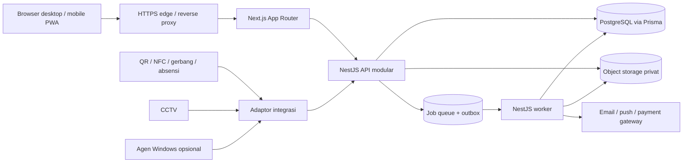

# Topologi Teknis yang Disarankan

## Topologi logis

`Adaptor integrasi` adalah modul dan endpoint khusus di NestJS pada awal, bukan server tambahan. Streaming video CCTV tetap di sistem CCTV; aplikasi hanya menyimpan metadata/referensi bila disetujui.

## Deployment awal

| Lapisan | Deployment minimum | Catatan |
| --- | --- | --- |
| Edge | Reverse proxy + TLS | Satu domain utama; rate limit dan batas unggah |
| Web | 1 deployment Next.js | Dapat digandakan saat trafik perlu |
| API | 1 deployment NestJS | Modular monolith; stateless untuk scaling |
| Worker | 1 deployment terpisah | Pekerjaan lambat dan retry; tidak memblokir request |
| Data | PostgreSQL terkelola atau VM yang dipelihara | Backup, restore, koneksi dibatasi |
| File | Object storage privat | Lampiran, rapor, dokumen, kuitansi |
| Observabilitas | Log, metrik, alert | `requestId` lintas web/API/worker |

Server fisik/cloud provider belum dipilih. Pemilihan mempertimbangkan lokasi data, koneksi internet dua gedung, kapasitas pengguna serentak, biaya operasional, target RPO/RTO, dan kemampuan tim IT. Jangan menetapkan jumlah VM atau spesifikasi CPU sebelum estimasi trafik dan pilot.

## Alur data penting

1. **Interaksi pengguna:** browser membuka URL Next.js; sesi dan konteks peran diverifikasi; halaman mengambil data melalui NestJS.
2. **Mutasi:** NestJS memvalidasi DTO, izin, scope, dan versi; Prisma menulis transaksi; audit dan outbox tercatat atomik.
3. **Pekerjaan latar:** worker mengambil job, melakukan impor/pengiriman/ekspor, mencatat hasil, dan retry idempoten.
4. **Perangkat:** adaptor mengautentikasi perangkat, menyimpan event mentah dengan waktu kejadian dan waktu diterima, lalu merekonsiliasi. Kegagalan perangkat tidak otomatis menjadi status absensi final.
5. **Pembayaran:** browser membuat intent; status lunas hanya setelah callback sah/rekonsiliasi, bukan dari halaman sukses.
6. **File:** upload privat → validasi jenis/ukuran → metadata database → URL unduh sementara setelah pemeriksaan izin.

## Batas keamanan

- PostgreSQL, worker, dan object storage tidak terbuka langsung ke internet umum.
- Backend memeriksa RBAC **dan** scope: anak, kelas, unit, gedung, penugasan, atau kasus. Menu frontend hanya petunjuk navigasi.
- Modul keselamatan, UKS/konseling, lokasi, dan keuangan memakai field filtering serta audit pembacaan/ekspor yang lebih ketat.
- Kredensial perangkat, payment gateway, dan secret notifikasi disimpan pada secret store.
- Lingkungan development, staging, production terpisah; staging memakai data sintetis/disamarkan.
- Backup dan restore diuji; target RPO/RTO diputuskan sekolah sebelum go-live.

## Konsistensi dan performa

Mulai dari satu PostgreSQL agar transaksi identitas, penempatan, dan tagihan konsisten. Pekerjaan berat pindah ke worker. Gunakan pagination/filter server untuk TanStack Table. Dashboard dapat memakai read model/snapshot dengan label waktu pembaruan. Pool koneksi dan strategi migrasi mengikuti pilihan PostgreSQL; jalur aplikasi dan jalur migrasi perlu dibedakan bila penyedia memakai pooler. Arsitektur ini memberi ruang untuk memisahkan layanan tertentu nanti tanpa membayar kompleksitas microservices sejak awal.

## Ketahanan dua gedung

Jika dua gedung memakai jaringan yang sama, uji titik putus koneksi pada gerbang, absensi, dan transportasi. Perangkat lapangan memerlukan prosedur manual dan rekonsiliasi yang diaudit. Mode offline aplikasi tidak diaktifkan secara umum sebelum konflik data, enkripsi lokal, dan kebijakan perangkat bersama dirancang. Tampilan selalu menyebut waktu sinkron terakhir saat data mungkin usang.
