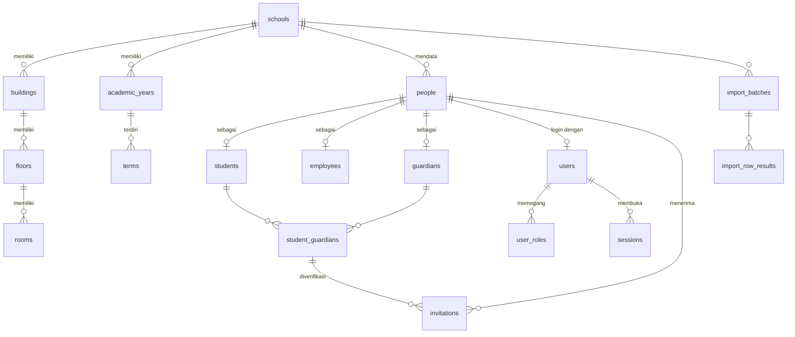

# Model data R0 Fondasi

Tabel awal Smart School untuk rilis **R0 Fondasi** ([PRD](prd.md) bagian 7: E1–E3, E9). Sumber kebenarannya [`apps/api/prisma/schema.prisma`](../apps/api/prisma/schema.prisma) dan migrasi di `apps/api/prisma/migrations/`. Dokumen ini adalah ringkasan untuk dibaca.

**Konvensi semua tabel**
- Primary key UUID (`id`). NIS, NIP, dan nomor pegawai adalah identifier bisnis, bukan primary key.
- `createdAt`/`updatedAt` disimpan dalam UTC dan ditampilkan dalam zona waktu sekolah (`schools.timezone`, default `Asia/Jakarta`).
- Kolom tanggal tanpa jam (lahir, mulai/selesai) memakai tipe `date`.
- Data tidak dihapus untuk mengubah status: pakai kolom status dan tanggal berlaku.

## Ringkasan: 21 tabel dalam 5 kelompok

| Kelompok | Tabel | Isi |
| --- | --- | --- |
| Identitas & akses | `users`, `user_roles`, `sessions`, `invitations`, `mfa_challenges` | Akun login (termasuk rahasia MFA terenkripsi), peran per sekolah, sesi aktif, undangan akun/wali, tahap kedua login MFA |
| Audit | `audit_events` | Jejak tindakan penting; hanya bisa ditambah |
| Sekolah | `schools`, `buildings`, `floors`, `rooms`, `academic_years`, `terms` | Profil sekolah, dua gedung beserta lantai dan ruang, tahun ajaran dan semester |
| Orang | `people`, `students`, `employees`, `guardians`, `student_guardians`, `person_documents`, `profile_correction_requests` | Profil orang, peran sebagai siswa/pegawai/wali, hubungan wali–siswa, dokumen pribadi, pengajuan koreksi data diri |
| Impor | `import_batches`, `import_row_results` | Riwayat impor CSV/Excel dan hasil per baris |

### Tambahan R0 (FR-1.6, FR-3.6, FR-3.7)

| Tabel / kolom | Isi dan aturan |
| --- | --- |
| `users.mfaSecret`, `mfaPendingSecret`, `mfaEnabledAt` | Rahasia TOTP terenkripsi AES-256-GCM dengan `APP_SECRET`; `mfaPendingSecret` menunggu kode pertama yang benar |
| `mfa_challenges` | Tantangan tahap kedua login: hash token, berlaku 5 menit, maks. 5 percobaan, sekali pakai |
| `person_documents` | Kategori, judul, nama file aman, tipe (dikenali dari byte awal: PDF/JPG/PNG), ukuran, SHA-256, `storageKey` (file di penyimpanan privat), pengunggah. Dihapus lunak; isi file ikut dihapus dari penyimpanan |
| `profile_correction_requests` | `changes` JSON `{field: {from, to}}`, alasan, status `PENDING`/`APPROVED`/`REJECTED`/`CANCELLED`, peninjau dan catatan. **Satu pengajuan menunggu per orang** (partial unique index). Persetujuan ditolak bila data resmi sudah berubah sejak diajukan |

## 1. Identitas & akses

### `users`: akun login
| Kolom | Tipe | Keterangan |
| --- | --- | --- |
| `email` | text, unik | Selalu huruf kecil (CHECK) |
| `passwordHash` | text, null | scrypt dengan salt; null untuk akun yang belum mengatur kata sandi |
| `status` | `ACTIVE` / `DISABLED` | Akun dinonaktifkan, bukan dihapus |
| `personId` | FK `people`, unik | Satu akun untuk satu orang |
| `lastLoginAt` | timestamp | |

### `user_roles`: peran per sekolah
`userId`, `role` (`ADMIN`, `MANAGEMENT`, `CURRICULUM`, `TEACHER`, `STAFF`, `STUDENT`, `GUARDIAN`), `schoolId`. Unik untuk kombinasi (user, peran, sekolah). Satu orang bisa memegang beberapa peran, misalnya guru yang juga wali murid. Daftar izin setiap peran ada di kode (`apps/api/src/auth/permissions.ts`).

### `sessions`: sesi aktif
`tokenHash` (SHA-256, unik; token asli hanya ada di cookie `HttpOnly`), `userId`, `activeRole`, `expiresAt` (12 jam), `lastSeenAt`, `ip`, `userAgent`. Logout atau penonaktifan akun menghapus baris sesi.

### `invitations`: undangan akun dan verifikasi wali
`personId`, `email`, `role` yang akan diberikan, `studentGuardianId` (terisi bila undangan memverifikasi hubungan wali), `tokenHash` (unik), `expiresAt` (7 hari), `acceptedAt`, `revokedAt`, `createdById`. Undangan hanya bisa dipakai sekali. Membuat undangan baru membatalkan undangan lama yang belum dipakai.

## 2. Audit

### `audit_events`
`action` (mis. `auth.login`, `student.create`, `guardian_link.revoke`, `academic_year.activate`), `entityType`, `entityId`, `actorUserId`, `schoolId`, `requestId`, `ip`, `metadata` (JSON: ringkasan perubahan, tanpa kata sandi atau token), `createdAt`.
**Trigger database menolak `UPDATE` dan `DELETE`**, sehingga catatan audit tidak bisa diubah dari mana pun, termasuk UI operasional (FR-9.2).

## 3. Sekolah

| Tabel | Kolom penting | Aturan |
| --- | --- | --- |
| `schools` | `name`, `npsn` (unik), `address`, `timezone` | |
| `buildings` | `schoolId`, `code`, `name` | Kode unik per sekolah (mis. `A`, `B`) |
| `floors` | `buildingId`, `level` (1 = lantai dasar), `name` | Satu baris per lantai per gedung |
| `rooms` | `buildingId`, `floorId`, `code`, `name`, `type`, `capacity`, `isActive` | Kode unik per gedung. FK gabungan memastikan lantai berada di gedung yang sama. Jenis: kelas, lab, perpustakaan, kantor, olahraga, aula, lainnya. |
| `academic_years` | `name` (`2026/2027`), `startDate`, `endDate`, `status` | Status `DRAFT`, `ACTIVE`, atau `CLOSED`. **Hanya satu `ACTIVE` per sekolah** (partial unique index). Tanggal selesai ≥ tanggal mulai. |
| `terms` | `academicYearId`, `name`, `sequence`, `startDate`, `endDate` | Urutan unik per tahun ajaran; aplikasi menolak semester yang tumpang tindih atau keluar dari rentang tahun ajaran |

## 4. Orang

Profil orang (`people`) terpisah dari akun login (`users`). Satu orang bisa sekaligus siswa, pegawai, atau wali, dan bisa belum punya akun.

| Tabel | Kolom penting | Aturan |
| --- | --- | --- |
| `people` | `fullName`, `gender`, `birthDate`, `birthPlace`, `phone`, `email`, `address`, `createdById`, `updatedById` | Indeks pada nama untuk pencarian |
| `students` | `personId`, `nis`, `nisn`, `status`, `enrolledAt`, `exitedAt` | **NIS unik per sekolah**, termasuk siswa yang sudah tidak aktif. NISN unik bila diisi. Status: aktif, lulus, pindah, keluar. |
| `employees` | `personId`, `employeeNumber`, `nip`, `position`, `employmentType`, `isTeacher`, `status`, `joinedAt` | Nomor pegawai wajib dan unik. NIP opsional (tidak semua pegawai punya), tetapi unik bila diisi. |
| `guardians` | `personId`, `occupation` | |
| `student_guardians` | `studentId`, `guardianId`, `relationship`, `status`, `isPrimaryContact`, `canViewAcademic`, `canViewAttendance`, `canViewFinance`, `validFrom`, `validUntil`, `verifiedAt`, `revokedAt` | Unik per pasangan siswa–wali. Status `PENDING`, `VERIFIED`, atau `REVOKED`. **Wali hanya bisa melihat data anak saat `VERIFIED` dan masih dalam rentang berlaku.** |

## 5. Impor

| Tabel | Kolom penting |
| --- | --- |
| `import_batches` | `kind` (`STUDENTS`), `fileName`, `checksum` (SHA-256 isi file, untuk menandai unggahan ulang), `totalRows`, `createdCount`, `skippedCount`, `errorCount`, `createdById` |
| `import_row_results` | `batchId`, `rowNumber`, `status` (`CREATED` / `SKIPPED` / `ERROR`), `message`, `entityId` |

Impor aman diulang: baris dengan NIS dan nama yang sama dengan data yang ada ditandai `SKIPPED`, tidak dibuat ganda.

## Perkiraan tabel R1 (belum dibuat)

Tabel ini ditambahkan saat R1 MVP Operasional, setelah keputusan D4 (aturan absensi) dan D8 (kanal notifikasi) di [PRD](prd.md) disepakati.

| Tabel | Isi |
| --- | --- |
| `class_groups` | Rombel per tahun ajaran, wali kelas, kapasitas, ruang utama |
| `enrollments` | Penempatan siswa ke rombel dengan tanggal berlaku (riwayat, bukan ditimpa) |
| `subjects` | Mata pelajaran |
| `teaching_assignments` | Guru × mapel × rombel × periode |
| `timetable_versions`, `timetable_slots` | Jadwal berversi dan slot hari/jam/ruang |
| `attendance_sessions` | Sesi absensi dari jadwal atau ad hoc |
| `attendance_records` | Satu status final per siswa per sesi |
| `attendance_corrections` | Nilai lama, nilai baru, alasan, penyetuju |
| `announcements` | Pengumuman, audiens, dan waktu terbit |
| `notifications`, `delivery_attempts` | Notifikasi per penerima dan setiap percobaan pengiriman |
