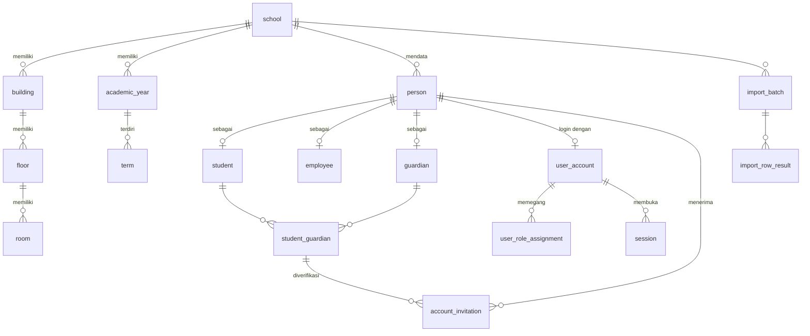
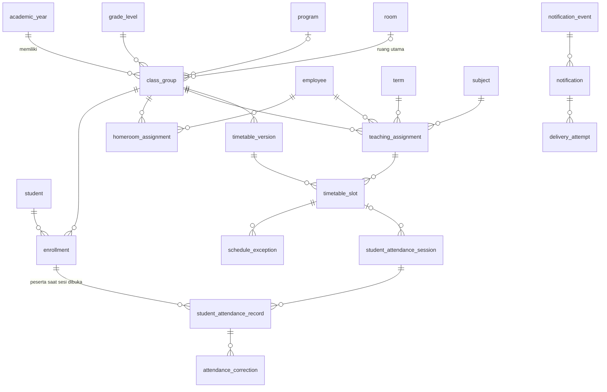
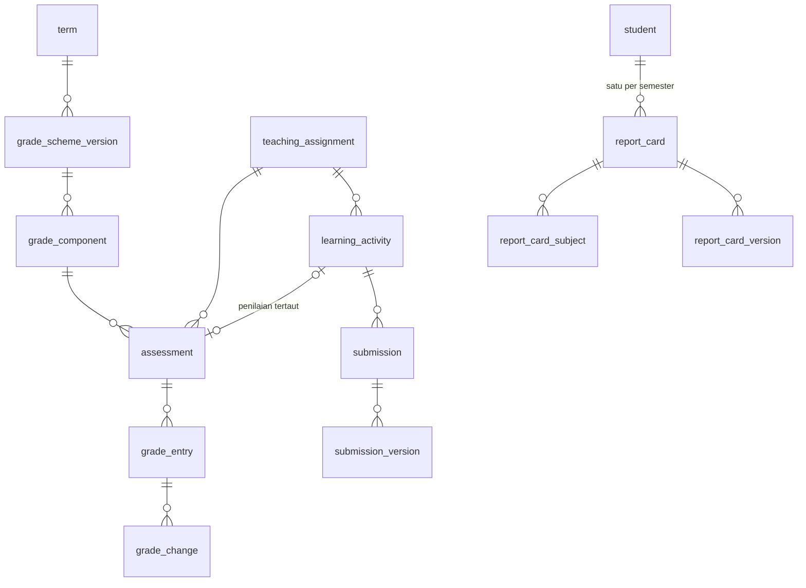

# Model data Elvara (R0 + R1 + R2)

Tabel Elvara School Ecosystem untuk rilis **R0 Fondasi**, **R1 MVP Operasional** ([PRD](prd.md) bagian 7), dan **R2 Akademik** ([PRD R2](prd-r2.md)). Nama tabel tunggal snake_case mengikuti `architecture_blueprint/05_database_core_tables.md`; kolom memakai nama camelCase dari Prisma. Sumber kebenarannya [`apps/api/prisma/schema.prisma`](../apps/api/prisma/schema.prisma) dan migrasi di `apps/api/prisma/migrations/`. Dokumen ini adalah ringkasan untuk dibaca.

**Konvensi semua tabel**
- Primary key UUID (`id`). NIS, NIP, dan nomor pegawai adalah identifier bisnis, bukan primary key.
- `createdAt`/`updatedAt` disimpan dalam UTC dan ditampilkan dalam zona waktu sekolah (`school.timezone`, default `Asia/Jakarta`).
- Kolom tanggal tanpa jam (lahir, mulai/selesai) memakai tipe `date`.
- Data tidak dihapus untuk mengubah status: pakai kolom status dan tanggal berlaku.

## R0 Fondasi: 21 tabel dalam 5 kelompok

| Kelompok | Tabel | Isi |
| --- | --- | --- |
| Identitas & akses | `user_account`, `user_role_assignment`, `session`, `account_invitation`, `mfa_challenge` | Akun login (termasuk rahasia MFA terenkripsi), peran per sekolah, sesi aktif, undangan akun/wali, tahap kedua login MFA |
| Audit | `audit_event` | Jejak tindakan penting; hanya bisa ditambah |
| Sekolah | `school`, `building`, `floor`, `room`, `academic_year`, `term` | Profil sekolah, dua gedung beserta lantai dan ruang, tahun ajaran dan semester |
| Orang | `person`, `student`, `employee`, `guardian`, `student_guardian`, `person_document`, `profile_correction_request` | Profil orang, peran sebagai siswa/pegawai/wali, hubungan wali–siswa, dokumen pribadi, pengajuan koreksi data diri |
| Impor | `import_batch`, `import_row_result` | Riwayat impor CSV/Excel dan hasil per baris |

### Tambahan R0 (FR-1.6, FR-3.6, FR-3.7)

| Tabel / kolom | Isi dan aturan |
| --- | --- |
| `user_account.mfaSecret`, `mfaPendingSecret`, `mfaEnabledAt` | Rahasia TOTP terenkripsi AES-256-GCM dengan `APP_SECRET`; `mfaPendingSecret` menunggu kode pertama yang benar |
| `mfa_challenge` | Tantangan tahap kedua login: hash token, berlaku 5 menit, maks. 5 percobaan, sekali pakai |
| `person_document` | Kategori, judul, nama file aman, tipe (dikenali dari byte awal: PDF/JPG/PNG), ukuran, SHA-256, `storageKey` (file di penyimpanan privat), pengunggah. Dihapus lunak; isi file ikut dihapus dari penyimpanan |
| `profile_correction_request` | `changes` JSON `{field: {from, to}}`, alasan, status `PENDING`/`APPROVED`/`REJECTED`/`CANCELLED`, peninjau dan catatan. **Satu pengajuan menunggu per orang** (partial unique index). Persetujuan ditolak bila data resmi sudah berubah sejak diajukan |

## 1. Identitas & akses

### `user_account`: akun login
| Kolom | Tipe | Keterangan |
| --- | --- | --- |
| `email` | text, unik | Selalu huruf kecil (CHECK) |
| `passwordHash` | text, null | scrypt dengan salt; null untuk akun yang belum mengatur kata sandi |
| `status` | `ACTIVE` / `DISABLED` | Akun dinonaktifkan, bukan dihapus |
| `personId` | FK `person`, unik | Satu akun untuk satu orang |
| `lastLoginAt` | timestamp | |

### `user_role_assignment`: peran per sekolah
`userId`, `role` (`ADMIN`, `MANAGEMENT`, `CURRICULUM`, `TEACHER`, `STAFF`, `STUDENT`, `GUARDIAN`), `schoolId`. Unik untuk kombinasi (user, peran, sekolah). Satu orang bisa memegang beberapa peran, misalnya guru yang juga wali murid. Daftar izin setiap peran ada di kode (`apps/api/src/auth/permissions.ts`).

### `session`: sesi aktif
`tokenHash` (SHA-256, unik; token asli hanya ada di cookie `HttpOnly`), `userId`, `activeRole`, `expiresAt` (12 jam), `lastSeenAt`, `ip`, `userAgent`. Logout atau penonaktifan akun menghapus baris sesi.

### `account_invitation`: undangan akun dan verifikasi wali
`personId`, `email`, `role` yang akan diberikan, `studentGuardianId` (terisi bila undangan memverifikasi hubungan wali), `tokenHash` (unik), `expiresAt` (7 hari), `acceptedAt`, `revokedAt`, `createdById`. Undangan hanya bisa dipakai sekali. Membuat undangan baru membatalkan undangan lama yang belum dipakai.

## 2. Audit

### `audit_event`
`action` (mis. `auth.login`, `student.create`, `guardian_link.revoke`, `academic_year.activate`), `entityType`, `entityId`, `actorUserId`, `schoolId`, `requestId`, `ip`, `metadata` (JSON: ringkasan perubahan, tanpa kata sandi atau token), `createdAt`.
**Trigger database menolak `UPDATE` dan `DELETE`**, sehingga catatan audit tidak bisa diubah dari mana pun, termasuk UI operasional (FR-9.2).

## 3. Sekolah

| Tabel | Kolom penting | Aturan |
| --- | --- | --- |
| `school` | `name`, `npsn` (unik), `address`, `timezone` | |
| `building` | `schoolId`, `code`, `name` | Kode unik per sekolah (mis. `A`, `B`) |
| `floor` | `buildingId`, `level` (1 = lantai dasar), `name` | Satu baris per lantai per gedung |
| `room` | `buildingId`, `floorId`, `code`, `name`, `type`, `capacity`, `isActive` | Kode unik per gedung. FK gabungan memastikan lantai berada di gedung yang sama. Jenis: kelas, lab, perpustakaan, kantor, olahraga, aula, lainnya. |
| `academic_year` | `name` (`2026/2027`), `startDate`, `endDate`, `status` | Status `DRAFT`, `ACTIVE`, atau `CLOSED`. **Hanya satu `ACTIVE` per sekolah** (partial unique index). Tanggal selesai ≥ tanggal mulai. |
| `term` | `academicYearId`, `name`, `sequence`, `startDate`, `endDate` | Urutan unik per tahun ajaran; aplikasi menolak semester yang tumpang tindih atau keluar dari rentang tahun ajaran |

## 4. Orang

Profil orang (`person`) terpisah dari akun login (`user_account`). Satu orang bisa sekaligus siswa, pegawai, atau wali, dan bisa belum punya akun.

| Tabel | Kolom penting | Aturan |
| --- | --- | --- |
| `person` | `fullName`, `gender`, `birthDate`, `birthPlace`, `phone`, `email`, `address`, `createdById`, `updatedById` | Indeks pada nama untuk pencarian |
| `student` | `personId`, `nis`, `nisn`, `status`, `enrolledAt`, `exitedAt` | **NIS unik per sekolah**, termasuk siswa yang sudah tidak aktif. NISN unik bila diisi. Status: aktif, lulus, pindah, keluar. |
| `employee` | `personId`, `employeeNumber`, `nip`, `position`, `employmentType`, `isTeacher`, `status`, `joinedAt` | Nomor pegawai wajib dan unik. NIP opsional (tidak semua pegawai punya), tetapi unik bila diisi. |
| `guardian` | `personId`, `occupation` | |
| `student_guardian` | `studentId`, `guardianId`, `relationship`, `status`, `isPrimaryContact`, `canViewAcademic`, `canViewAttendance`, `canViewFinance`, `validFrom`, `validUntil`, `verifiedAt`, `revokedAt` | Unik per pasangan siswa–wali. Status `PENDING`, `VERIFIED`, atau `REVOKED`. **Wali hanya bisa melihat data anak saat `VERIFIED` dan masih dalam rentang berlaku.** |

## 5. Impor

| Tabel | Kolom penting |
| --- | --- |
| `import_batch` | `kind` (`STUDENTS`), `fileName`, `checksum` (SHA-256 isi file, untuk menandai unggahan ulang), `totalRows`, `createdCount`, `skippedCount`, `errorCount`, `createdById` |
| `import_row_result` | `batchId`, `rowNumber`, `status` (`CREATED` / `SKIPPED` / `ERROR`), `message`, `entityId` |

Impor aman diulang: baris dengan NIS dan nama yang sama dengan data yang ada ditandai `SKIPPED`, tidak dibuat ganda.

## R1 MVP Operasional (20 tabel)

Ditambahkan setelah keputusan D1 (tingkat dan program diatur sekolah), D4 (guru bebas mengubah absensi sampai 23.59 hari sesi, sesudahnya lewat koreksi), dan D8 (notifikasi dalam aplikasi dulu). Nama dan pembagian mengikuti `architecture_blueprint/05_database_core_tables.md` bagian B–E.

### B. Struktur kelas

| Tabel | Kolom utama | Aturan |
| --- | --- | --- |
| `grade_level` | `code`, `ordinal`, `name` | Kode dan urutan unik per sekolah |
| `program` | `code`, `name`, `status` | Program/jurusan, opsional menurut jenjang |
| `class_group` | `academicYearId`, `gradeLevelId`, `programId`, `code`, `capacity`, `mainRoomId`, `status` | Kode unik per tahun ajaran; kapasitas > 0 dan tidak bisa diturunkan di bawah jumlah siswa yang sedang ditempatkan |
| `enrollment` | `studentId`, `classGroupId`, `validFrom`, `validTo`, `status` (`ACTIVE`/`MOVED`/`ENDED`), `reason` | **Satu penempatan terbuka per siswa** (partial unique index). Pindah kelas menutup penempatan lama sehari sebelumnya (`MOVED`) dan membuat yang baru; riwayat tidak ditimpa |
| `homeroom_assignment` | `classGroupId`, `employeeId`, `validFrom`, `validTo` | **Satu wali kelas terbuka per rombel.** Mengganti wali kelas menutup yang lama sehari sebelum tanggal mulai |

### C. Mata pelajaran, penugasan, jadwal

| Tabel | Kolom utama | Aturan |
| --- | --- | --- |
| `subject` | `code`, `name`, `groupCode`, `status` | Mapel nonaktif tidak bisa dipakai penugasan baru |
| `teaching_assignment` | `termId`, `classGroupId`, `subjectId`, `employeeId`, `teachingRole` (`MAIN`/`ASSISTANT`), `weeklyPeriods` | Unik per semester–rombel–mapel–guru; satu guru utama per mapel per rombel. Guru hanya mengisi absensi untuk penugasannya |
| `lesson_period` | `sequence`, `startTime`, `endTime` | Bel sekolah, pilihan cepat saat menyusun jadwal. Slot menyimpan jamnya sendiri, jadi mengubah bel tidak menggeser jadwal lama |
| `timetable_version` | `termId`, `classGroupId`, `versionNo`, `status` (`DRAFT`/`PUBLISHED`/`SUPERSEDED`), `effectiveFrom`, `publishedAt` | **Paling banyak satu draf dan satu versi terbit** per rombel per semester. Draf baru menyalin versi terbit. Penerbitan ditolak bila ada benturan guru, rombel, atau ruang; versi lama menjadi `SUPERSEDED` |
| `timetable_slot` | `versionId`, `teachingAssignmentId`, `roomId`, `weekday` (1 = Senin … 7 = Minggu), `startTime`, `endTime` | Jam `HH:MM` zona waktu sekolah; mulai < selesai (CHECK) |
| `schedule_exception` | `timetableSlotId`, `exceptionDate`, `kind` (`CANCELLED`/`SUBSTITUTED`), `substituteEmployeeId`, `roomId`, `reason` | Mengubah satu pertemuan pada satu tanggal tanpa mengubah jadwal mingguan. Satu perubahan per pertemuan per tanggal; pengganti tidak boleh bentrok; tidak bisa dibuat/dihapus setelah sesi absensinya dibuka |

### D. Absensi siswa

| Tabel | Kolom utama | Aturan |
| --- | --- | --- |
| `student_attendance_session` | `classGroupId`, `timetableSlotId`, `teachingAssignmentId`, `sessionDate`, `kind` (`SCHEDULED`/`AD_HOC`), `reason`, `status` (`OPEN`/`CLOSED`/`CANCELLED`), `takenById`, `closedAt` | Satu sesi per pertemuan per tanggal. Sesi tambahan dibuka wali kelas dengan alasan. Pertemuan yang dibatalkan tidak bisa dibuka; bila diganti, pengisinya guru pengganti. Sesi dibatalkan tidak dihitung rekap |
| `student_attendance_record` | `sessionId`, `studentId`, `enrollmentId`, `status` (`PRESENT`/`EXCUSED`/`SICK`/`ABSENT`/`LATE`, null = belum diisi), `note`, `versionNo`, `finalizedAt` | Gabungan `session_participant` dan `student_attendance_record` pada blueprint: peserta diambil dari penempatan yang berlaku saat sesi dibuka. `versionNo` naik setiap status berubah. Guru bebas mengubah sampai akhir hari sesi (zona waktu sekolah) |
| `attendance_correction` | `recordId`, `oldStatus`, `proposedStatus`, `reason`, `requestedById`, `decision` (`PENDING`/`APPROVED`/`REJECTED`), `decidedById`, `decisionNote` | Hanya setelah batas hari. **Satu koreksi menunggu per catatan.** Diputuskan wali kelas rombel atau admin; koreksi milik sendiri diputuskan admin |

**Finalisasi dan notifikasi alpa (FR-7.3).** Status dianggap final saat sesi ditutup, saat catatan pada sesi yang sudah ditutup diubah, saat koreksi disetujui, atau saat batas hari lewat. Untuk yang terakhir, job terjadwal (tiap 10 menit) memberi `finalizedAt` pada sesi yang belum ditutup. Notifikasi alpa dikirim pada saat final itu ke akun wali dengan hubungan `VERIFIED`, masih berlaku, dan `canViewAttendance`; `sourceEventId` = `attendance.absent:<recordId>` sehingga setiap catatan hanya memicu satu notifikasi.

### Pekerjaan pegawai (FR-8.5, [ADR 0004](adr/0004-jadwal-tugas-staf.md))

| Tabel | Kolom utama | Aturan |
| --- | --- | --- |
| `work_shift` | `employeeId`, `title`, `startsAt`, `endsAt`, `roomId` (lokasi), `status` (`SCHEDULED`/`CANCELLED`), `note`, `cancelReason` | Tugas staf per waktu dan lokasi, diisi admin. Disimpan sebagai instan UTC, ditampilkan dalam jam sekolah. Tugas terjadwal yang bentrok untuk pegawai yang sama ditolak; selesai > mulai dan alasan wajib saat dibatalkan (CHECK). R3 menambah `work_schedule` (pola mingguan) yang menghasilkan baris ini |

### E. Komunikasi

| Tabel | Kolom utama | Aturan |
| --- | --- | --- |
| `announcement` | `title`, `body`, `audienceKind` (`ALL`/`STAFF`/`STUDENTS`/`GUARDIANS`/`CLASS_GROUP`/`BUILDING`/`ROLE`), `classGroupId`, `buildingId`, `audienceRole`, `status` (`SCHEDULED`/`PUBLISHED`/`WITHDRAWN`), `publishAt`, `publishedAt`, `withdrawnAt` | Kolom sasaran wajib sesuai jenis audiens (CHECK). Audiens diperiksa saat dibaca, jadi siswa yang pindah kelas tidak lagi melihat pengumuman rombel lamanya. Pengumuman terjadwal terbit saat waktunya tiba |
| `notification_event` | `sourceEventId` (unik), `eventType`, `payload` | Kejadian sumber; proses yang diulang tidak menggandakan notifikasi |
| `notification` | `eventId`, `recipientId`, `channel` (`IN_APP`/`EMAIL`/`PUSH`), `status`, `title`, `body`, `link`, `readAt` | Unik per kejadian–penerima–kanal. Terkirim ≠ dibaca |
| `delivery_attempt` | `notificationId`, `result` (`SENT`/`FAILED`/`SKIPPED`), `providerRef`, `detail` | Satu baris per percobaan per kanal; adapter email/push nanti cukup menambah baris |
| `read_receipt` | `userId`, `itemKind`, `itemId`, `readAt` | Tanda baca pengumuman per pengguna (baca ≠ persetujuan) |

### Angka beranda (FR-8.8)

Angka di beranda dihitung langsung dari tabel di atas (tanpa cache) dan dikirim bersama definisi, sumber tabel, dan waktu perhitungan (`generatedAt`). Contoh: tingkat kehadiran = (Hadir + Terlambat) ÷ catatan terisi pada sesi yang tidak dibatalkan, 7 hari terakhir.

## R2 Akademik (13 tabel)

Ditambahkan setelah keputusan D11 ([ADR 0005](adr/0005-d11-penilaian-rapor.md)): Kurikulum Merdeka, bobot komponen per mapel × tingkat × semester, nilai terlihat per penilaian yang diterbitkan, rapor disusun wali kelas dan disetujui kepala sekolah. Rincian kebutuhan di [PRD R2](prd-r2.md).

| Tabel | Kolom utama | Aturan |
| --- | --- | --- |
| `academic_calendar_event` | `title`, `category` (`SEMESTER`/`EXAM`/`HOLIDAY`/`REPORT_DAY`/`DEADLINE`/`ACTIVITY`), `startsOn`, `endsOn`, `audience` (`ALL`/`STAFF`/`STUDENTS_GUARDIANS`/`GRADE_LEVEL`), `gradeLevelId`, `location`, `description`, `status` (`DRAFT`/`PUBLISHED`/`CANCELLED`), `publishedAt` | Selesai ≥ mulai dan tingkat wajib untuk audiens tingkat (CHECK). Audiens diperiksa saat dibaca. Ujian dan libur yang beririsan ditandai saat disimpan |
| `grade_scheme_version` | `termId`, `subjectId`, `gradeLevelId`, `versionNo`, `passingScore` (KKTP, opsional), `roundingRule` (`HALF_UP_INTEGER`), `status` (`DRAFT`/`PUBLISHED`/`SUPERSEDED`) | **Paling banyak satu draf dan satu terbit** per mapel × tingkat × semester (partial unique). Terbit hanya bila bobot berjumlah 100; versi terbit tidak diubah, revisi = versi baru |
| `grade_component` | `schemeVersionId`, `code`, `name`, `weight`, `sortOrder` | Bobot 0–100 (CHECK). Kode unik per versi |
| `learning_outcome` | `subjectId`, `gradeLevelId`, `code`, `description`, `status` | Capaian pembelajaran; dipakai guru saat menulis deskripsi rapor |
| `assessment` | `teachingAssignmentId`, `componentId`, `activityId`, `title`, `assessedOn`, `status` (`DRAFT`/`PUBLISHED`), `publishedAt` | Komponen harus dari skema terbit yang berlaku; penilaian tetap menunjuk versi skema saat dibuat. Hanya penilaian terbit yang terlihat siswa/wali dan dihitung nilai akhir. Boleh terbit walau ada nilai kosong: peserta tanpa isian dicatat "belum dinilai" dan nilai akhirnya "belum lengkap" |
| `grade_entry` | `assessmentId`, `studentId`, `state` (`PENDING`/`SCORED`/`MISSING`/`EXCUSED`), `score`, `feedback`, `versionNo` | Skor wajib bila `SCORED` dan kosong untuk keadaan lain; 0–100 (CHECK). Belum dinilai ≠ nol; tidak mengumpulkan dihitung 0; tidak berlaku tidak dihitung. `versionNo` mencegah timpa-menimpa |
| `grade_change` | `gradeEntryId`, `oldState`, `oldScore`, `newState`, `newScore`, `reason`, `actorId` | Riwayat perubahan nilai yang sudah terbit; alasan wajib |
| `learning_activity` | `teachingAssignmentId`, `kind`, `title`, `instructions`, `opensAt`, `dueAt`, `allowLate`, `allowResubmit`, `acceptsSubmissions`, `status` (`DRAFT`/`PUBLISHED`/`CLOSED`/`CANCELLED`) | Tenggat > dibuka (CHECK). Setiap kegiatan dibuat bersama penilaian tertaut pada satu komponen skema |
| `submission` | `activityId`, `studentId`, `status` (`ON_TIME`/`LATE`), `submittedAt`, `latestVersionNo` | Satu per siswa per tugas |
| `submission_version` | `submissionId`, `versionNo`, `text`, `storageKey`, `originalName`, `mimeType`, `sizeBytes`, `sha256`, `late`, `idempotencyKey`, `submittedAt` | Kiriman tidak ditimpa; kunci idempoten mencegah kiriman ganda saat koneksi putus. Berkas privat, unduhan tercatat |
| `report_card` | `studentId`, `termId`, `classGroupId`, `status` (`DRAFT`/`SUBMITTED`/`RETURNED`/`PUBLISHED`), `homeroomNote`, `submittedAt`, `decidedAt`, `returnNote`, `currentVersionNo` | **Satu rapor per siswa per semester**, dibuat saat deskripsi pertama ditulis. Diajukan wali kelas hanya bila tanpa kekurangan (nilai akhir tiap mapel lengkap, deskripsi terisi); disetujui atau dikembalikan pemegang `report-cards:approve`. Revisi setelah terbit: peninjau membuka kembali dengan alasan (status dikembalikan), wali kelas mengajukan ulang, dan persetujuan berikutnya wajib beralasan |
| `report_card_subject` | `reportCardId`, `subjectId`, `highestAchievement`, `needsImprovement`, `updatedById` | Deskripsi capaian per mapel, ditulis guru mapel; terkunci setelah diajukan |
| `report_card_version` | `reportCardId`, `versionNo`, `snapshot` (JSON), `storageKey` (PDF), `sha256`, `revisionReason`, `publishedAt`, `publishedById` | **Tidak pernah diubah.** Dibuat saat disetujui: isi rapor disalin utuh sehingga rapor terbit tetap sama walau nilai sumber berubah. Versi lama tetap dapat diunduh; setiap unduhan tercatat |

**Nilai akhir.** Rata-rata nilai per komponen dikali bobot, dihitung per versi skema dari penilaian terbit, dibulatkan sekali di akhir (setengah ke atas). Tidak mengumpulkan dihitung 0; tidak berlaku dikeluarkan dari rata-rata dan bobotnya. Nilai akhir belum lengkap bila masih ada nilai belum dinilai atau komponen tanpa penilaian. Di bawah KKTP ditandai "perlu tindak lanjut". Aturan yang sama dipakai buku nilai, portal, dan rapor.

**Angka beranda R2 (E16).** Mengikuti aturan FR-8.8. Guru: kiriman belum dinilai, penilaian draf, deskripsi rapor belum diisi; wali kelas: rapor siap atau terbit dibanding peserta rombel binaan. Kurikulum: skema nilai belum terbit dan status rapor per rombel. Pimpinan: rapor menunggu persetujuan. Siswa dan wali: agenda tujuh hari, tugas belum dikumpulkan dengan tenggat tujuh hari, nilai terbit terbaru.
