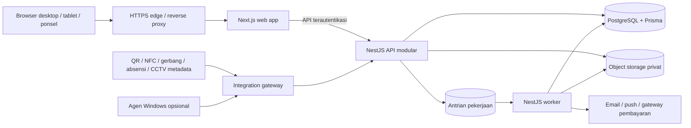

# Smart School — Catatan Induk Produk dan Topologi

Catatan ini menggabungkan **seluruh isi 21 dokumen modul** dalam satu file, lalu menambahkan keputusan arsitektur, jumlah aplikasi, dan rancangan dashboard per peran. Dokumen modul individual tetap menjadi sumber edit; jalankan `python scripts/build_consolidated_note.py` setelah mengubahnya untuk memperbarui catatan ini.

**Asumsi perencanaan:** satu sekolah, dua gedung, aplikasi web responsif sebagai kanal awal, dan ekspansi bertahap. Angka dashboard di bawah adalah **konfigurasi beranda per kelompok peran**, bukan 15 codebase atau 15 produk terpisah. Aturan yang ditandai sebagai keputusan terbuka pada setiap modul perlu disetujui pemilik proses sekolah.

## A. Keputusan arsitektur yang disarankan

### A.1 Ada berapa aplikasi?

| Komponen | Jumlah awal | Fungsi | Terlihat oleh pengguna? |
| --- | ---: | --- | --- |
| **Next.js web app** | **1** | Semua portal dan dashboard; layout serta navigasi menurut peran | Ya, satu aplikasi/URL utama |
| **NestJS API** | **1** | Autentikasi, otorisasi, aturan bisnis, transaksi, audit, integrasi | Tidak langsung |
| **Worker** | **1 proses/deployment** | Impor, notifikasi, ekspor, sinkronisasi, perhitungan laporan | Tidak langsung |
| **PostgreSQL** | **1 cluster/database awal** | Data transaksional melalui Prisma | Tidak |
| **Object storage privat** | **1 layanan** | Dokumen, lampiran, rapor, bukti pembayaran | Tidak langsung |
| **Agen Windows** | **opsional, tahap lanjut** | Telemetri dan tindakan pada PC/lab | Dipasang pada perangkat terkelola |

Jadi, **1 aplikasi yang diakses manusia**; secara operasional ada **3 komponen aplikasi** (web, API, worker). Agen Windows menjadi komponen keempat hanya jika poin 19 benar-benar dikerjakan. Android/iOS native belum diperlukan pada tahap awal: portal siswa, wali, guru, keamanan, teknisi, dan pengemudi memakai web responsif. Kebutuhan offline, kamera/NFC, push, serta uji lapangan menentukan apakah aplikasi native/PWA dibutuhkan kemudian.

Saya menyarankan **modular monolith NestJS**: satu deploy API, tetapi feature module dan pemilik data dipisahkan. Ini mengurangi kompleksitas integrasi antarlayanan pada satu sekolah, sambil menjaga batas yang jelas untuk pemisahan di masa depan. Modul NestJS memang dirancang untuk mengelompokkan kemampuan terkait dan mengekspor antarmuka provider secara eksplisit: [dokumentasi NestJS](https://docs.nestjs.com/modules).

### A.2 Topologi logis



**Batas jaringan:** hanya edge/web dan endpoint API yang diperlukan browser/perangkat yang dibuka ke luar. PostgreSQL, object storage privat, worker, dan dashboard observabilitas tetap di jaringan privat. Perangkat sekolah memakai autentikasi perangkat dan endpoint integrasi khusus. File privat diberikan melalui URL sementara setelah pemeriksaan hak.

`Integration gateway` pada diagram adalah modul/adaptor di dalam deployment NestJS API pada tahap awal, bukan aplikasi atau server tambahan.

**Data dan pekerjaan latar:** transaksi penting disimpan terlebih dahulu di PostgreSQL, kemudian event/outbox memicu worker. Pengiriman pesan, impor, callback gateway, serta sinkronisasi perangkat harus idempoten. Worker dapat memakai antrean berbasis database pada volume awal; pilihan teknologi antrean final ditentukan setelah beban dan kebutuhan retry diukur. Jika memakai connection pool, jalur aplikasi/worker dan jalur migrasi/admin perlu dikonfigurasi sesuai penyedia PostgreSQL; lihat [panduan koneksi Prisma](https://www.prisma.io/docs/orm/prisma-client/setup-and-configuration/databases-connections).

**Keamanan:** autentikasi terpusat, sesi aman, RBAC ditambah scope data (anak, kelas, unit, kasus, gedung), audit tindakan sensitif, backup terenkripsi dan uji restore. Modul keselamatan, UKS/konseling, lokasi, dan keuangan memiliki kebijakan field/file yang lebih ketat. Admin teknis tidak otomatis berhak melihat isi sensitif.

**Lingkungan:** development, staging, dan production terpisah. Staging memakai data sintetis atau data yang telah disamarkan. Migrasi Prisma, backup, dan restore diuji sebelum rilis. Log terstruktur memakai `requestId`; metrik mencakup latensi API, kegagalan job, koneksi database, kesehatan perangkat, dan kesegaran data dashboard.

### A.3 Struktur aplikasi web dan URL

```text
apps/web/app/
  (public)/login
  (portal)/admin/...
  (portal)/management/...
  (portal)/academics/...
  (portal)/teacher/...
  (portal)/staff/...
  (portal)/student/...
  (portal)/guardian/...
  (portal)/finance/...
  (portal)/security/...
  (portal)/operations/...
```

Route Groups dipakai untuk organisasi/layout tanpa menjadi bagian URL. Nested layout berbagi shell; Dynamic Routes mewakili objek. Parallel dan Intercepting Routes dipakai selektif untuk modal detail dari daftar, dengan halaman penuh saat URL dibuka langsung/refresh. Filter, sort, halaman tabel, tab penting, dan periode masuk query string. Browser Back/Forward memulihkan daftar atau modal. Pola ini didukung oleh [Route Groups](https://nextjs.org/docs/app/api-reference/file-conventions/route-groups) dan [Intercepting Routes](https://nextjs.org/docs/app/api-reference/file-conventions/intercepting-routes) pada Next.js.

### A.4 Modul backend dan kepemilikan data

| Kelompok NestJS | Sumber data yang dimiliki | Membaca/merujuk ke |
| --- | --- | --- |
| Identity + School | User, Role, Person, Student, Employee, Guardian, tahun ajaran, rombel, gedung/ruang | Fondasi seluruh modul |
| Academics | Kurikulum, jadwal, tugas, nilai, rapor | Siswa, guru, kelas, ruang |
| Attendance + Staff | Sesi/record absensi, jadwal kerja, cuti | Jadwal, penempatan, pegawai |
| Guardian + Communications | Preferensi portal, pengumuman, pesan, notifikasi | Hubungan wali dan event modul |
| Finance | Plan biaya, tagihan, pembayaran, alokasi | Siswa, wali, kegiatan |
| Operations | Fasilitas, aset, perpustakaan, transportasi, kantin | Lokasi, orang, keuangan |
| Safety + Care | Laporan/kasus, UKS, konseling, lokasi sesuai kebijakan | Identitas minimum, petugas |
| Reporting + Integration | Snapshot metrik, audit integrasi, device event | Event dari modul pemilik |

Satu tabel mempunyai pemilik proses yang jelas. Modul lain menggunakan service/kontrak atau event, bukan mengubah tabel domain lain secara langsung. Prisma schema dapat dipisah per file/domain bila tooling proyek mendukung, tetapi tetap satu migration history yang ditinjau bersama.

## B. Dashboard yang perlu disiapkan

### B.1 Jumlah

Rekomendasi target adalah **15 konfigurasi beranda** dalam satu Next.js app. Setiap konfigurasi memakai komponen bersama (kartu tindakan, tabel, kalender, notifikasi), tetapi memilih data, izin, urutan, dan tampilan yang cocok untuk pekerjaan peran tersebut. Pengguna dengan beberapa peran dapat berpindah konteks; backend selalu memeriksa scope objek.

Untuk **MVP operasional**, bangun **7 konfigurasi terlebih dahulu**: Admin Sekolah, Kepala Sekolah, Kurikulum, Guru/Wali Kelas, Staf, Siswa, dan Wali. Dashboard domain lanjutan ditambahkan seiring modulnya siap. Halaman detail modul tetap memiliki URL sendiri; jumlah dashboard tidak sama dengan jumlah seluruh halaman.

### B.2 Matriks peran dan perangkat

| No. | Konfigurasi beranda | Peran yang dilayani | Isi/action utama | Prioritas perangkat | Tahap |
| ---: | --- | --- | --- | --- | --- |
| 1 | Admin sekolah | Admin, operator data | Verifikasi wali, siswa belum ditempatkan, akun, impor, arsip | Desktop utama; tablet pendamping | MVP |
| 2 | Manajemen | Kepala sekolah, pimpinan | KPI terdefinisi, persetujuan, alert, laporan | Desktop utama; mobile ringkasan | MVP |
| 3 | Kurikulum | Wakil kepala sekolah, admin akademik | Jadwal bentrok, penugasan guru, nilai/rapor belum lengkap | Desktop utama | MVP |
| 4 | Guru dan wali kelas | Guru mapel, wali kelas | Jadwal hari ini, absensi, tugas/nilai, tindak lanjut rombel | Desktop + mobile setara untuk tugas harian | MVP |
| 5 | Staf | Staf non-guru | Shift, tugas, hadir, izin/cuti, pengumuman | Mobile utama; desktop tersedia | MVP |
| 6 | Siswa | Siswa | Jadwal, tugas dekat tenggat, pengumuman, hasil terbit | Mobile utama; desktop tersedia | MVP |
| 7 | Wali | Orang tua/wali | Pemilih anak, absensi, tagihan, pesan, izin | Mobile utama; desktop tersedia | MVP |
| 8 | Keuangan | Petugas/kepala keuangan | Tagihan, pembayaran, rekonsiliasi, piutang | Desktop utama; mobile ringkasan | Lanjutan |
| 9 | Keamanan | Petugas/koordinator keamanan | Tamu aktif, izin keluar, alarm, anomali gerbang | Tablet di pos + mobile; desktop koordinator | Lanjutan |
| 10 | Fasilitas dan teknisi | Pengelola fasilitas, teknisi | Booking/ruang ditutup, tiket, work order | Desktop pengelola; mobile teknisi | Lanjutan |
| 11 | Perpustakaan | Pustakawan | Pinjaman/kembali, reservasi, terlambat, katalog | Desktop atau tablet loket | Lanjutan |
| 12 | UKS dan konseling | Petugas UKS, konselor | Kunjungan/janji/tindak lanjut sesuai penugasan | Desktop utama; tablet privat opsional | Lanjutan |
| 13 | Transportasi | Koordinator, pengemudi, pendamping | Rute/kursi/manifest untuk koordinator; naik/turun untuk petugas lapangan | Desktop koordinator; mobile lapangan | Lanjutan |
| 14 | Kantin dan layanan | Tenant, kasir, petugas layanan | Menu/pesanan atau tiket layanan sesuai peran | Tablet kasir + mobile; desktop pengelola | Lanjutan |
| 15 | IT sekolah | Admin IT, teknisi lab | Perangkat offline, alert, diagnosis, action menunggu | Desktop utama; mobile alert | Lanjutan |

**Catatan batas akses:** UKS dan konselor boleh memakai shell/desain beranda yang sama, tetapi widget, daftar, dan data record tetap dipisahkan oleh izin. Begitu juga koordinator transportasi versus pengemudi, pengelola fasilitas versus teknisi, serta tenant versus petugas layanan. Jika uji pengguna menunjukkan alur mereka terlalu berbeda, satu konfigurasi dapat dipecah tanpa membuat aplikasi baru.

### B.3 Bentuk desktop dan mobile

| Tipe pekerjaan | Bentuk yang disarankan |
| --- | --- |
| Data padat: master data, nilai, rekonsiliasi, laporan, IT | Desktop first; tabel TanStack dengan filter/pagination server dan ekspor berizin |
| Lapangan: absensi kelas, gerbang, perbaikan, manifest bus | Mobile/tablet first; satu tindakan utama per layar, tombol besar, status koneksi jelas |
| Keluarga dan siswa: jadwal, tugas, izin, pembayaran | Mobile first; desktop tetap lengkap |
| Manajemen | Desktop untuk analisis; mobile untuk ringkasan dan persetujuan sederhana |

Semua halaman tetap responsif, bukan dua codebase. Jangan memaksa tabel desktop menjadi tabel sangat lebar di ponsel: tampilkan kolom prioritas, kartu ringkas, dan halaman detail. Loading, empty, error, akses ditolak, data usang, dan transaksi menunggu harus berbeda. Agentation dipakai untuk inspeksi UI selama pengembangan.

### B.4 MVP dan urutan rilis yang realistis

1. **Fondasi:** identitas, hak peran/scope, master sekolah/orang, tahun ajaran/kelas, audit, file privat.
2. **MVP harian:** jadwal, absensi kelas, pengumuman, dashboard guru/siswa/wali/admin/manajemen.
3. **Akademik lengkap:** tugas, penilaian, rapor, kalender dan koreksi.
4. **Operasional:** keuangan, perpustakaan, fasilitas, aset, kegiatan, transportasi, kantin.
5. **Fitur berisiko/berperangkat:** safeguarding/SOS, UKS/konseling, lokasi, gerbang/CCTV, agen Windows—setelah SOP, petugas, privasi, dan pilot siap.

Rilis poin 5 bukan berarti keselamatan siswa ditunda secara operasional: sekolah harus punya kanal dan SOP bantuan sejak awal. Implementasi digital penuh baru aman setelah alur respons nyata tersedia.

## C. Daftar isi modul rinci
- [01. School Administration & Management](#01-school-administration--management)
- [02. Academic Management System](#02-academic-management-system)
- [03. Student Information & Portal](#03-student-information--portal)
- [04. Teacher & Staff Management](#04-teacher--staff-management)
- [05. Attendance Management System](#05-attendance-management-system)
- [06. Student Safety & Safeguarding System](#06-student-safety--safeguarding-system)
- [07. Campus Security & Access Control](#07-campus-security--access-control)
- [08. Student Location & Campus Tracking](#08-student-location--campus-tracking)
- [09. Parent & Guardian Portal](#09-parent--guardian-portal)
- [10. Finance & Payment Management](#10-finance--payment-management)
- [11. Library & Learning Resource Management](#11-library--learning-resource-management)
- [12. Facility & Campus Management](#12-facility--campus-management)
- [13. Maintenance & Asset Management](#13-maintenance--asset-management)
- [14. Extracurricular & School Activities](#14-extracurricular--school-activities)
- [15. Canteen & School Services](#15-canteen--school-services)
- [16. Transportation Management](#16-transportation-management)
- [17. Health & Counseling Management](#17-health--counseling-management)
- [18. Communication & Notification Center](#18-communication--notification-center)
- [19. Windows Utility & School IT Management](#19-windows-utility--school-it-management)
- [20. Cross-Platform Notes & Collaboration](#20-cross-platform-notes--collaboration)
- [21. School Command Center & Analytics](#21-school-command-center--analytics)

---

## 01. School Administration & Management

Dokumen ini merinci modul **Administrasi Sekolah** dari [Smart School Management Ecosystem](smart_school_management_ecosystem.md). Fokusnya adalah data induk dan proses administratif yang menjadi sumber data bagi modul akademik, absensi, keuangan, komunikasi, dan layanan sekolah.

**Status:** rancangan awal untuk dibahas dengan pihak sekolah. Aturan yang belum diputuskan ditandai pada bagian *Keputusan terbuka*.

### 1. Tujuan dan batas modul

Modul ini harus memungkinkan admin membuat satu data resmi untuk sekolah, orang, struktur kelas, periode ajaran, organisasi, akun, dan arsip. Perubahan dapat dilacak dan data historis tetap terbaca setelah siswa pindah kelas, pegawai berganti jabatan, atau tahun ajaran berakhir.

| Termasuk dalam modul ini | Dikelola oleh modul lain |
| --- | --- |
| Profil sekolah, gedung, unit, ruang dasar | Reservasi dan pemeliharaan ruang |
| Identitas dan status administrasi siswa, pegawai, wali | Nilai, absensi, kesehatan, konseling |
| Tahun ajaran, semester, jurusan, rombel, penempatan siswa | Kurikulum, jadwal, tugas, rapor |
| Struktur organisasi dan penugasan jabatan | Penilaian kinerja dan cuti pegawai |
| Akun, undangan, peran, izin, audit administrasi | Proses bisnis khusus setiap modul |
| Dokumen administrasi dan arsip | Materi pembelajaran dan dokumen kasus rahasia |
| Dashboard dan laporan administrasi | Analitik mendalam lintas modul |

### 2. Peran dan kewenangan

Hak akses bersifat gabungan antara **izin tindakan** dan **cakupan data**. Satu pengguna boleh memiliki lebih dari satu peran; backend memeriksa izin pada setiap permintaan.

| Peran | Kewenangan utama | Batasan |
| --- | --- | --- |
| Super admin sistem | Konfigurasi teknis, pemulihan akses, pengaturan izin | Tidak otomatis boleh membaca dokumen pribadi atau kasus sensitif |
| Admin sekolah | Kelola profil sekolah, data induk, kelas, akun, dokumen administrasi | Perubahan berisiko tinggi dapat memerlukan persetujuan |
| Operator data | Input dan perbaiki data siswa/pegawai sesuai unit | Tidak mengubah kebijakan izin atau menghapus arsip |
| Kepala sekolah | Melihat ringkasan, menyetujui perubahan yang ditentukan | Tidak mengedit data teknis akun |
| Wali kelas | Melihat data administrasi siswa di rombel aktif | Tidak melihat rombel lain tanpa penugasan |
| Guru | Melihat identitas minimum siswa yang diajar | Tidak melihat dokumen pribadi siswa |
| Orang tua/wali | Melihat profil anak yang hubungan walinya terverifikasi | Tidak melihat data anak lain atau seluruh data pegawai |
| Siswa | Melihat dan mengajukan koreksi profil sendiri | Perubahan data resmi perlu verifikasi admin |
| Auditor internal | Membaca laporan dan audit sesuai mandat | Akses berbatas waktu, tanpa mutasi |

Izin granular contoh: `student.read`, `student.create`, `student.update`, `student.archive`, `guardian.verify`, `class.assign`, `account.invite`, `role.assign`, `document.download`, `report.export`. Hindari satu izin `admin.*` yang membuka seluruh data sensitif.

### 3. Data sekolah dan konfigurasi dasar

#### 3.1 Profil sekolah

Simpan nama resmi, nama singkat, kode sekolah yang berlaku, jenjang, alamat, zona waktu, kontak resmi, logo, dan status operasional. Perubahan nama atau alamat resmi memiliki tanggal berlaku dan riwayat, karena dokumen lama tetap harus menampilkan identitas sekolah yang berlaku saat diterbitkan.

#### 3.2 Struktur lokasi

Hierarki awal: **sekolah → gedung → lantai → ruang**. Dua gedung awal menjadi data, bukan dua kolom khusus dalam skema. Setiap ruang memiliki kode unik dalam gedung, nama, jenis, kapasitas, status aktif, dan aksesibilitas dasar. Modul fasilitas dapat memperluas atribut peralatan dan pemesanan.

#### 3.3 Konfigurasi administratif

Tetapkan format nomor induk, kalender kerja, bahasa tampilan, zona waktu, pola penamaan kelas, dan kanal kontak resmi. Konfigurasi yang mengubah perilaku sistem harus memiliki aktor, waktu, nilai lama, dan nilai baru. Perubahan tahun ajaran aktif merupakan tindakan eksplisit dengan konfirmasi dan pemeriksaan prasyarat.

### 4. Data induk orang

Pisahkan identitas orang dari peran sekolah: satu `Person` dapat terkait dengan `Student`, `Employee`, atau `Guardian`. Akun login `User` juga terpisah dari profil orang agar data seseorang tetap ada ketika akun belum dibuat atau sudah dinonaktifkan.

#### 4.1 Siswa

Data minimum: ID internal, NIS, nama resmi, nama panggilan bila diperlukan, tanggal lahir, status siswa, tanggal masuk, jenjang, dan kontak darurat melalui wali. Alamat, dokumen identitas, dan atribut sensitif hanya dikumpulkan jika ada kebutuhan operasional yang jelas. Status contoh: calon, aktif, cuti, pindah, lulus, keluar. Perubahan status menyimpan tanggal efektif, alasan, dan dokumen pendukung bila diperlukan.

Admin dapat mencari duplikasi berdasarkan NIS dan kombinasi identitas sebelum membuat siswa. Sistem menolak NIS aktif yang sama sesuai kebijakan sekolah. Penggabungan dua profil yang telanjur duplikat harus menjadi proses khusus dengan pratinjau referensi, persetujuan, dan audit; jangan melakukan penghapusan langsung.

#### 4.2 Guru dan staf

Data minimum: ID internal, NIP/nomor pegawai bila ada, nama resmi, jenis pegawai, unit kerja, tanggal mulai, status kerja, dan kontak kerja. Jabatan organisasi disimpan sebagai penugasan dengan rentang tanggal, bukan satu teks di profil. Informasi kontrak, gaji, kesehatan, dan evaluasi kinerja berada pada domain dengan izin tersendiri.

#### 4.3 Orang tua dan wali

Hubungan `StudentGuardian` menyimpan jenis hubungan, status verifikasi, tanggal berlaku, hak menerima informasi, prioritas kontak darurat, dan batasan yang sah sesuai kebijakan. Satu siswa bisa memiliki beberapa wali; satu wali bisa terkait dengan beberapa siswa. Undangan portal tidak otomatis membuktikan hak akses: admin harus memverifikasi hubungan sebelum data anak tampil. Putusnya hubungan segera mencabut akses portal ke anak tersebut tanpa menghapus riwayat administratif.

#### 4.4 Perubahan dan koreksi data

Bedakan **koreksi kesalahan input** dari **perubahan keadaan**. Koreksi nama memperbaiki data resmi dan meninggalkan audit; pindah kelas, ganti wali, atau perubahan status membuat riwayat berlaku. Siswa dan wali boleh mengajukan koreksi melalui formulir dengan bukti bila diperlukan; admin memutuskan dan mencatat alasan penolakan atau persetujuan.

### 5. Tahun ajaran, jurusan, kelas, dan penempatan

- `AcademicYear`: label, tanggal mulai/akhir, status draf/aktif/ditutup. Rentang tahun ajaran untuk sekolah yang sama tidak boleh ambigu.
- `Term`: semester atau periode lain di dalam tahun ajaran, dengan tanggal dan status publikasi.
- `GradeLevel`: tingkat kelas menurut jenjang sekolah.
- `Program/Major`: jurusan atau program bila sekolah menggunakannya; opsional untuk jenjang yang tidak membutuhkan.
- `ClassGroup`: rombongan belajar dengan kode, tingkat, program, tahun ajaran, kapasitas, ruang utama opsional, dan status.
- `HomeroomAssignment`: wali kelas dan rentang penugasannya.
- `Enrollment`: siswa, rombel, tanggal mulai/akhir, status, alasan perubahan.

Satu siswa hanya boleh memiliki satu penempatan rombel utama yang aktif pada tanggal yang sama dalam satu sekolah. Sistem memeriksa kapasitas sebelum penempatan dan menampilkan daftar tunggu atau pengecualian beralasan jika kebijakan sekolah mengizinkan. Pemindahan siswa menutup penempatan lama lalu membuka yang baru dalam satu transaksi. Penutupan tahun ajaran tidak mengubah riwayat kelas sebelumnya; proses kenaikan kelas menampilkan pratinjau dan daftar pengecualian sebelum diterapkan.

### 6. Struktur organisasi

Modelkan unit organisasi, jabatan, hubungan pelaporan, dan penugasan pegawai dengan tanggal berlaku. Contoh unit: pimpinan sekolah, tata usaha, kesiswaan, kurikulum, sarana-prasarana, perpustakaan, dan UKS. Bagan organisasi menampilkan penugasan aktif pada tanggal yang dipilih, sedangkan riwayat menunjukkan pemegang jabatan sebelumnya.

Penugasan jabatan tidak otomatis memberikan seluruh izin aplikasi. Perubahan jabatan dapat memicu usulan perubahan akses, tetapi pemberian izin tetap mengikuti alur persetujuan akun. Cegah hubungan atasan-bawahan yang membentuk siklus.

### 7. Akun, autentikasi, dan hak akses

#### 7.1 Siklus akun

Alur: admin mengaitkan akun ke profil orang → mengirim undangan ke kanal terverifikasi → pengguna mengaktifkan akun → sistem mencatat persetujuan yang diperlukan → akun aktif. Status: diundang, aktif, terkunci, nonaktif. Proses reset akses, perubahan kontak login, dan penonaktifan harus tercatat. Akun tidak dihapus untuk menyembunyikan aktivitas historis.

#### 7.2 Izin dan cakupan

RBAC menentukan tindakan, sedangkan aturan scope menentukan objek mana yang boleh diakses. Contoh: guru dengan `student.read` hanya membaca siswa pada kelas yang diajar dalam periode penugasan; wali hanya membaca anak pada hubungan yang terverifikasi; operator data hanya pada unit yang ditetapkan. API memilih field yang diizinkan sebelum mengirim respons.

MFA diprioritaskan untuk admin dan peran dengan akses sensitif. Sesi memakai cookie aman dengan masa berlaku dan mekanisme pencabutan. Perubahan peran, ekspor data, dan akses dokumen sensitif masuk audit. Pemeriksaan akses diuji untuk URL langsung, bukan hanya menu yang terlihat.

### 8. Dokumen dan arsip digital

#### 8.1 Kategori dan metadata

Kategori awal: dokumen sekolah, dokumen siswa, dokumen pegawai, surat keputusan, surat keluar/masuk, dan dokumen kelas. Metadata: nomor dokumen bila ada, judul, kategori, pemilik data, tanggal dokumen, tanggal unggah, pembuat, status, versi, label kerahasiaan, serta tanggal retensi. File berada di object storage privat; database menyimpan metadata dan referensi file.

#### 8.2 Siklus dokumen

Draf → ditinjau → disahkan/diterbitkan → diarsipkan. Versi baru tidak menimpa file versi lama. Unduhan menggunakan akses sementara setelah pemeriksaan izin; akses dan ekspor dokumen sensitif dicatat. Validasi unggahan meliputi ukuran, jenis file, pemindaian malware bila tersedia, dan penamaan aman. Retensi dan pemusnahan memerlukan kebijakan sekolah serta catatan tindakan.

Template surat dapat menjadi pengembangan lanjut. Dokumen hasil sistem, seperti surat keterangan, menyimpan snapshot data dan versi template saat dibuat supaya isi historis tidak berubah ketika profil siswa diperbarui.

### 9. Dashboard dan laporan administrasi

Dashboard admin menampilkan pekerjaan yang perlu tindakan: undangan akun tertunda, koreksi profil diajukan, wali belum diverifikasi, siswa belum ditempatkan, kelas melebihi kapasitas, dokumen menunggu persetujuan, serta impor yang gagal. Angka siswa dan pegawai dihitung berdasarkan status serta tanggal efektif; setiap kartu menjelaskan definisi angkanya.

Laporan awal: daftar siswa aktif per tingkat/rombel, mutasi siswa, daftar pegawai aktif, hubungan wali belum lengkap, kapasitas kelas, akun tidak aktif, dan arsip menurut kategori. Filter meliputi tahun ajaran, periode, status, tingkat, program, dan unit. Ekspor mengikuti izin `report.export`, memiliki batas ukuran, dan tercatat di audit. Laporan besar dibuat sebagai pekerjaan latar dan hasilnya memiliki masa unduh terbatas.

### 10. Alur kerja prioritas

#### 10.1 Pendaftaran siswa baru

1. Operator mengisi atau mengimpor data minimum; sistem memeriksa duplikasi.
2. Admin memvalidasi identitas dan menetapkan status administratif.
3. Admin menautkan wali serta memverifikasi hubungan.
4. Admin menempatkan siswa ke rombel yang memiliki kapasitas.
5. Sistem mengundang akun yang diperlukan dan mencatat seluruh tindakan.

#### 10.2 Awal tahun ajaran

1. Admin membuat tahun ajaran dan periode dalam status draf.
2. Admin menyalin struktur tingkat/program/rombel dari periode sebelumnya sebagai pratinjau, lalu menyesuaikannya.
3. Admin meninjau kapasitas, wali kelas, siswa tanpa penempatan, dan duplikasi.
4. Kepala sekolah atau admin berwenang mengaktifkan tahun ajaran.
5. Sistem menyimpan riwayat aktivasi; modul lain membaca periode aktif dari sumber yang sama.

#### 10.3 Mutasi atau keluar sekolah

Admin mencatat tanggal efektif, alasan, dan dokumen pendukung. Sistem menutup penempatan aktif, menandai status siswa, memicu peninjauan akun/akses wali, dan memberi tahu modul terkait melalui event internal. Data nilai, absensi, dan tagihan historis tetap ada sesuai retensi.

#### 10.4 Impor massal

Unggah file → validasi format dan nilai → tampilkan pratinjau baris valid/gagal/duplikat → konfirmasi → proses latar → unduh hasil per baris. Impor memakai idempotency key atau batch ID untuk mencegah data ganda saat diulang. File sumber memiliki masa retensi terbatas.

### 11. Rancangan layar dan URL

Semua halaman penting dapat dibuka langsung, di-refresh, serta mengikuti Back/Forward browser. Filter dan pagination yang perlu dibagikan berada di query string.

| Halaman | URL contoh | Fungsi |
| --- | --- | --- |
| Dashboard admin | `/admin/dashboard` | Ringkasan dan antrean pekerjaan |
| Profil sekolah | `/admin/school/profile` | Identitas dan konfigurasi dasar |
| Gedung dan ruang | `/admin/school/buildings/[buildingId]` | Detail lokasi |
| Daftar siswa | `/admin/students?year=2026&q=&page=1` | Cari, filter, impor, ekspor |
| Detail siswa | `/admin/students/[studentId]` | Profil dan riwayat administratif |
| Hubungan wali | `/admin/students/[studentId]/guardians` | Verifikasi dan hak akses wali |
| Daftar pegawai | `/admin/employees?status=active` | Profil administratif pegawai |
| Tahun ajaran | `/admin/academic-years/[yearId]` | Periode, aktivasi, penutupan |
| Rombel | `/admin/class-groups/[classGroupId]` | Kapasitas dan penempatan |
| Organisasi | `/admin/organization` | Unit dan jabatan aktif |
| Akun dan peran | `/admin/accounts/[userId]` | Status akun serta izin |
| Arsip | `/admin/documents?category=&page=1` | Pencarian dan siklus dokumen |
| Laporan | `/admin/reports` | Filter, buat, dan unduh laporan |

Detail siswa dapat dibuka sebagai modal dari daftar dengan Parallel dan Intercepting Routes; URL yang sama dibuka sebagai halaman penuh ketika diakses langsung atau setelah refresh. Tombol Back menutup modal ke daftar dan Forward membukanya kembali. Formulir panjang tetap lebih cocok sebagai halaman penuh. Loading, kosong, error, akses ditolak, dan konflik perubahan memiliki tampilan tersendiri.

TanStack Table mengelola definisi kolom dan interaksi; filter, sort, dan pagination besar diproses server dan disinkronkan ke URL. Tabel menyediakan label kolom, jumlah hasil, aksi keyboard, serta tampilan ringkas pada layar kecil. Komponen dibuat dengan Next.js App Router, TypeScript, Tailwind CSS, dan shadcn/ui. Agentation digunakan untuk inspeksi responsivitas dan interaksi saat pengembangan.

### 12. Model data konseptual

| Entitas | Field penting | Relasi/constraint |
| --- | --- | --- |
| `School` | kode, nama, zona waktu, status | Kode unik |
| `Building`, `Floor`, `Room` | kode, nama, kapasitas, status | Ruang unik per gedung; lantai milik gedung |
| `Person` | nama resmi, tanggal lahir, kontak terverifikasi | Tidak sama dengan akun login |
| `Student` | personId, NIS, status, tanggal masuk | NIS unik dalam cakupan sekolah |
| `Employee` | personId, nomor pegawai, jenis, status | Nomor pegawai unik bila ada |
| `Guardian` | personId, kontak | Bisa terkait beberapa siswa |
| `StudentGuardian` | studentId, guardianId, hubungan, verifikasi, hak akses, tanggal berlaku | Cegah hubungan aktif duplikat |
| `AcademicYear`, `Term` | label, tanggal, status | Periode tidak ambigu |
| `GradeLevel`, `Program`, `ClassGroup` | kode, tingkat, kapasitas, tahun ajaran | Kode rombel unik per tahun ajaran |
| `Enrollment` | studentId, classGroupId, tanggal berlaku, status | Satu rombel utama aktif per siswa per tanggal |
| `OrgUnit`, `Position`, `PositionAssignment` | nama, atasan, pegawai, tanggal berlaku | Tanpa siklus organisasi |
| `User`, `Role`, `Permission`, `UserRole` | login, status, relasi profil, izin | Peran dapat dibatasi scope dan masa berlaku |
| `Document`, `DocumentVersion` | kategori, pemilik, klasifikasi, status, fileRef | Versi immutable setelah terbit |
| `AuditEvent`, `ImportBatch` | aktor, aksi, waktu, hasil | Jejak perubahan dan impor |

Seluruh tabel operasional memiliki ID internal, waktu pembuatan/perubahan, dan aktor bila relevan. Waktu disimpan sebagai timestamp UTC dan ditampilkan menurut zona waktu sekolah. Index awal mengikuti pencarian nyata: NIS, nomor pegawai, nama, status, tahun ajaran, rombel, dan hubungan wali. Detail Prisma ditetapkan setelah aturan bisnis disetujui.

### 13. Kontrak API awal

NestJS menyediakan API berversi dengan validasi DTO, pemeriksaan izin dan scope, dokumentasi OpenAPI, pagination server, serta format kesalahan konsisten (`code`, `message`, `fieldErrors`, `requestId`). Contoh endpoint:

```text
GET    /api/v1/school
PATCH  /api/v1/school
GET    /api/v1/students?q=&status=&classGroupId=&page=&sort=
POST   /api/v1/students
GET    /api/v1/students/:id
PATCH  /api/v1/students/:id
POST   /api/v1/students/:id/guardians
POST   /api/v1/students/:id/status-transitions
GET    /api/v1/employees
POST   /api/v1/academic-years
POST   /api/v1/academic-years/:id/activate
GET    /api/v1/class-groups/:id/enrollments
POST   /api/v1/class-groups/:id/enrollments
POST   /api/v1/accounts/invitations
PATCH  /api/v1/accounts/:id/roles
GET    /api/v1/documents
POST   /api/v1/documents
POST   /api/v1/import-batches
GET    /api/v1/import-batches/:id
POST   /api/v1/reports/exports
```

Perubahan status, aktivasi tahun ajaran, dan mutasi siswa memakai transaksi database. Mutasi yang dapat diulang memakai idempotency key; pembaruan serentak memakai pemeriksaan versi dan mengembalikan konflik `409`. File diunggah melalui alur privat dengan validasi ukuran dan jenis; URL unduh hanya diterbitkan sesudah otorisasi.

### 14. Keamanan, privasi, dan audit

- Gunakan prinsip akses minimum dan field-level filtering untuk identitas, kontak, dan dokumen.
- Simpan file privat terpisah dari aset publik. Enkripsi saat transit dan di penyimpanan.
- Catat perubahan identitas resmi, hubungan wali, status siswa, penempatan kelas, peran, izin, unduhan dokumen sensitif, impor, dan ekspor.
- Batasi ekspor berdasarkan peran, scope, periode, dan alasan bila dibutuhkan; beri masa berlaku pada berkas hasil.
- Tetapkan retensi serta penghapusan berdasarkan kebijakan dan hukum yang berlaku sebelum produksi. Soft delete sendiri tidak cukup.
- Uji backup dan pemulihan data PostgreSQL serta file dokumen. Log aplikasi tidak boleh memuat data pribadi yang tidak diperlukan.

### 15. Kriteria penerimaan MVP

1. Admin dapat membuat profil siswa, pegawai, dan wali; sistem menolak identifier unik yang duplikat dan menunjukkan pesan field yang jelas.
2. Wali tidak dapat melihat anak sebelum hubungan terverifikasi, termasuk melalui URL detail atau API langsung.
3. Siswa tidak dapat ditempatkan ke dua rombel utama aktif pada tanggal yang sama; pindah kelas mempertahankan riwayat.
4. Perubahan tahun ajaran aktif menolak data prasyarat yang belum lengkap dan tercatat di audit.
5. Pengguna tanpa izin tidak bisa membaca atau mengubah data meskipun mengetahui URL atau ID objek.
6. Daftar siswa mempertahankan filter, sort, dan halaman setelah refresh serta Back/Forward.
7. Detail modal dari daftar mempunyai URL; refresh membuka detail penuh, Back menutup modal, Forward membukanya lagi.
8. Impor menampilkan hasil validasi per baris dan pengulangan batch tidak menciptakan duplikasi.
9. Dokumen privat hanya dapat diunduh oleh pengguna berwenang dan akses sensitif tercatat.
10. Dashboard menjelaskan definisi angka dan memperlihatkan keadaan loading, kosong, serta error.

### 16. Urutan implementasi yang disarankan

1. Konfirmasi aturan identitas, tahun ajaran, rombel, hubungan wali, dan peran.
2. Buat skema Prisma dan migrasi untuk sekolah, orang, akun, periode, rombel, penempatan, audit.
3. Bangun autentikasi, otorisasi backend, dan fondasi layout admin.
4. Selesaikan CRUD data induk, validasi duplikasi, pencarian, serta riwayat perubahan.
5. Tambahkan impor, undangan akun, verifikasi wali, dan dokumen.
6. Bangun dashboard/laporan, lalu uji alur lintas peran serta deep linking.

### 17. Keputusan terbuka

- Jenjang sekolah dan apakah jurusan/program dipakai pada semua tingkat.
- Format dan cakupan keunikan NIS/NIP; data mana yang wajib pada saat pendaftaran.
- Siapa yang berwenang mengesahkan perubahan identitas, mutasi, aktivasi tahun ajaran, dan ekspor.
- Cara verifikasi wali serta penanganan sengketa atau pembatasan akses wali.
- Status siswa/pegawai yang dipakai sekolah dan dampaknya terhadap akun.
- Template dokumen, penomoran surat, masa retensi, dan kategori kerahasiaan.
- Sumber data awal serta volume impor yang diharapkan.
- Target jumlah pengguna serentak dan kebutuhan multi sekolah di masa depan.

Setelah keputusan ini disepakati, dokumen dapat diturunkan menjadi skema Prisma, spesifikasi endpoint, desain layar, dan backlog per fitur.

*Sumber edit: [school_administration_management.md](school_administration_management.md).*

---

## 02. Academic Management System

Dokumen ini merinci poin 2 dari [Smart School Management Ecosystem](smart_school_management_ecosystem.md). Modul akademik mengelola kurikulum, kegiatan belajar, penilaian, dan rapor. Data identitas, tahun ajaran, rombel, serta penempatan siswa bersumber dari [School Administration & Management](school_administration_management.md).

**Status:** rancangan awal. Detail format kurikulum dan rapor perlu disesuaikan dengan jenjang serta kebijakan sekolah sebelum skema Prisma difinalkan.

### 1. Tujuan dan batas modul

Sistem harus membantu sekolah menyusun rencana pembelajaran, menerbitkan jadwal bebas benturan, mengelola tugas dan ujian, mencatat nilai secara terlacak, serta menerbitkan rapor yang konsisten dengan data pada periode tersebut.

| Dalam modul akademik | Sumber atau modul lain |
| --- | --- |
| Kurikulum, mapel, target pembelajaran, alokasi jam | Tahun ajaran, tingkat, program dari administrasi |
| Penugasan mengajar dan jadwal pelajaran | Data guru, rombel, ruang dari administrasi |
| Tugas, ujian, rubrik, pengumpulan, nilai | Identitas siswa dan penempatan rombel dari administrasi |
| Rekap capaian dan rapor digital | Kehadiran dari modul absensi; arsip resmi dari administrasi |
| Kalender kegiatan akademik | Pengumuman dan notifikasi dari modul komunikasi |

Perubahan master data akademik tidak boleh mengubah rapor yang sudah diterbitkan. Setiap tampilan memakai konteks sekolah, tahun ajaran, semester, dan hak akses pengguna yang jelas.

### 2. Peran dan hak akses

| Peran | Kegiatan | Batas akses |
| --- | --- | --- |
| Wakil kepala sekolah bidang kurikulum | Kelola struktur kurikulum, validasi jadwal, konfigurasi penilaian | Hanya sekolah dan periode yang ditugaskan |
| Admin akademik | Input mapel, penugasan guru, kalender, dan jadwal | Tidak mengubah nilai siswa tanpa kewenangan khusus |
| Kepala sekolah | Meninjau dan menyetujui publikasi rapor/laporan | Perubahan setelah terbit mengikuti proses revisi |
| Guru mapel | Kelola tugas, ujian, nilai pada penugasan mengajar aktif | Tidak mengakses nilai kelas/mapel lain |
| Wali kelas | Memantau capaian rombel, menyusun catatan wali kelas, memeriksa kelengkapan rapor | Tidak mengubah nilai mapel tanpa penugasan |
| Siswa | Lihat jadwal, tugas, umpan balik, nilai yang sudah dibuka | Hanya data sendiri |
| Orang tua/wali | Lihat jadwal, tugas, dan rapor anak sesuai kebijakan publikasi | Hanya anak dengan hubungan terverifikasi |

Izin granular contoh: `curriculum.manage`, `timetable.edit`, `timetable.publish`, `assignment.manage`, `submission.review`, `grade.edit`, `grade.publish`, `reportcard.review`, `reportcard.publish`, `academic.export`. Backend harus memeriksa izin sekaligus relasi guru ke rombel/mapel dan relasi wali ke anak pada setiap endpoint.

### 3. Konteks dan struktur akademik

#### 3.1 Tahun ajaran dan semester

Modul memakai `AcademicYear` dan `Term` dari administrasi sebagai sumber tunggal. Semester memiliki status draf, aktif, penguncian input nilai, dan ditutup. Tanggal berlaku dijaga agar tugas, jadwal, dan nilai selalu terkait periode yang tepat. Perpindahan tahun ajaran tidak menyalin nilai lama.

#### 3.2 Kurikulum dan mata pelajaran

`Curriculum` menyimpan nama, versi, jenjang, rentang berlaku, dan status draf/terbit/arsip. `Subject` menyimpan kode, nama, kelompok, dan status. Hubungan `CurriculumSubject` menentukan mapel yang berlaku per tingkat/program, alokasi jam, serta sifat wajib atau pilihan. Jika dibutuhkan, tambahkan `LearningOutcome` atau capaian pembelajaran dengan versi agar rubrik penilaian dapat ditautkan ke target yang tepat.

Perubahan kurikulum yang telah digunakan harus membuat versi baru. Mapel boleh dinonaktifkan untuk penugasan baru tanpa menghapus nilai dan rapor lama. Format detail mengikuti keputusan sekolah mengenai jenjang dan kurikulum yang dipakai.

#### 3.3 Kelas dan penugasan mengajar

`ClassGroup` serta `Enrollment` dimiliki modul administrasi. Modul akademik membuat `TeachingAssignment`: guru, mapel, rombel atau kelompok belajar, semester, tanggal berlaku, dan status. Satu mapel dapat diajar lebih dari satu guru jika kebijakan mendukung tim pengajar; harus jelas siapa yang berwenang memberi dan menerbitkan nilai. Wali kelas diambil dari penugasan wali kelas pada administrasi.

### 4. Jadwal pelajaran

Jadwal dibangun dari slot hari/jam, semester, penugasan mengajar, rombel, dan ruang. Draf jadwal dapat disusun bertahap; hanya jadwal terbit yang muncul di portal siswa dan wali. Validasi publikasi memeriksa:

1. Guru tidak memiliki dua sesi pada waktu yang bertumpang tindih.
2. Rombel atau kelompok belajar tidak memiliki dua sesi wajib pada waktu yang sama.
3. Ruang tidak dipesan oleh dua sesi pada waktu yang sama dan kapasitasnya cukup.
4. Alokasi jam mapel memenuhi atau menjelaskan selisih terhadap kurikulum.
5. Tanggal sesi berada dalam semester dan memperhitungkan hari libur/acara akademik.

Perubahan jadwal terbit menghasilkan versi serta tanggal efektif. Pembatalan atau penggantian satu pertemuan menggunakan `ScheduleException`, sehingga jadwal mingguan dasar tetap utuh. Siswa dan wali melihat penanda perubahan, waktu pembaruan, dan notifikasi jika perubahan mendekati hari pelaksanaan. Jadwal guru dan ruang dapat dilihat sebagai tampilan alternatif dari data yang sama.

### 5. Tugas dan ujian

#### 5.1 Pembuatan kegiatan

Guru membuat `LearningActivity` dengan jenis tugas, kuis, ujian, atau praktik; judul, instruksi, penugasan mengajar, tanggal buka/tenggat, bobot atau komponen penilaian, lampiran, dan status. Status minimal: draf, dijadwalkan, terbuka, ditutup, dibatalkan. Kegiatan dapat ditautkan ke capaian pembelajaran dan rubrik.

#### 5.2 Pengumpulan

Siswa mengirim teks atau file sesuai tipe tugas. Simpan waktu pengumpulan, versi kiriman, status tepat waktu/terlambat, dan bukti penerimaan. Guru dapat mengatur apakah pengiriman ulang diperbolehkan dan sampai kapan. File disimpan privat dengan batas ukuran/jenis dan pemeriksaan keamanan. Kegagalan unggah tidak boleh dianggap sebagai pengumpulan berhasil.

#### 5.3 Ujian

MVP dapat memakai ujian sebagai kegiatan dengan jadwal, instruksi, dan pencatatan hasil. Bank soal, ujian online bertimer, pengacakan soal, pengawasan, dan analisis butir adalah tahap lanjut karena memerlukan aturan keamanan dan operasional tersendiri. Akomodasi siswa dan ujian susulan dicatat sebagai pengecualian resmi, bukan perubahan tenggat umum.

### 6. Penilaian dan nilai

#### 6.1 Skema penilaian

Setiap mapel/semester memiliki `GradeScheme` berisi komponen, bobot, rentang nilai, aturan pembulatan, nilai minimum, dan kebijakan data kosong. Skema harus berversi serta divalidasi sebelum dipakai; jumlah bobot sesuai aturan yang ditetapkan sekolah. `Assessment` mengacu ke komponen, tanggal, penugasan mengajar, dan rubrik bila ada.

#### 6.2 Pencatatan nilai

Nilai per siswa disimpan sebagai draf dengan aktor, waktu, dan sumber penilaian. Nilai `0`, belum dinilai, tidak mengumpulkan, dan tidak berlaku adalah keadaan yang berbeda. Masukan di luar rentang ditolak. Guru dapat memberi umpan balik yang terlihat setelah publikasi. Perubahan massal melalui tabel atau impor menampilkan pratinjau, jumlah perubahan, serta kesalahan per baris.

#### 6.3 Publikasi dan koreksi

Nilai draf → diperiksa → diterbitkan. Hanya nilai terbit yang muncul di portal siswa/wali. Setelah rapor diterbitkan, koreksi nilai wajib memiliki alasan, aktor, waktu, persetujuan jika diperlukan, dan menghasilkan revisi rapor. Audit menyimpan nilai sebelum dan sesudah; pembaruan bersamaan memakai pemeriksaan versi agar satu guru tidak menimpa pekerjaan guru lain.

#### 6.4 Perhitungan

Perhitungan nilai akhir dilakukan backend dengan aturan versi `GradeScheme`. Sistem menampilkan rincian komponen agar hasil dapat diaudit. Pembulatan hanya pada titik yang disepakati, bukan berulang di setiap langkah. Apabila nilai belum lengkap, tampilkan status belum lengkap dan daftar penyebab; jangan otomatis menganggap kosong sebagai nol. Perhitungan ulang setelah skema berubah tidak boleh diam-diam mengubah hasil terbit.

### 7. Rapor digital

Rapor adalah snapshot resmi per siswa, semester, dan versi publikasi. Isinya dapat meliputi identitas siswa dan kelas pada waktu terbit, nilai dan predikat mapel, deskripsi capaian, kehadiran dari modul absensi, kegiatan tertentu, catatan wali kelas, serta keputusan kenaikan kelas bila digunakan. Isi final bergantung pada format rapor sekolah.

Alur: guru menuntaskan nilai → wali kelas memeriksa kelengkapan → kurikulum memvalidasi → pejabat berwenang menyetujui → rapor diterbitkan. Setiap tahap menampilkan pekerjaan yang masih tertunda. Dokumen yang diterbitkan memiliki nomor/versi, waktu, aktor, dan salinan yang tidak berubah. Revisi menghasilkan versi baru dan alasan; versi lama tetap tersimpan sesuai retensi. Siswa dan wali hanya dapat melihat rapor yang sudah terbit.

Ekspor PDF/print memakai template berversi, identitas sekolah yang berlaku saat terbit, dan data snapshot. Unduhan mengikuti hak akses serta dicatat bila kebijakan mengharuskan. Opsi tanda tangan digital atau verifikasi publik dibahas terpisah.

### 8. Kalender akademik

Kalender memuat awal/akhir semester, masa ujian, libur, pembagian rapor, tenggat administrasi akademik, serta acara belajar lintas kelas. Setiap entri punya kategori, pemilik, audiens, tanggal/waktu, lokasi opsional, status draf/terbit, dan versi perubahan. Benturan penting dengan ujian atau jadwal ditandai untuk peninjauan. Kalender akademik yang terbit dapat menjadi sumber notifikasi, tetapi modul komunikasi mengelola pengiriman dan preferensi penerima.

### 9. Evaluasi perkembangan akademik

Dashboard guru menampilkan tugas belum dinilai, nilai belum lengkap, dan siswa yang perlu tindak lanjut dalam kelas yang diajar. Wali kelas melihat tren capaian per siswa dan rombel; manajemen melihat agregat per tingkat/mapel. Grafik harus menyertakan periode, ukuran sampel, dan definisi metrik. Data siswa tidak ditampilkan di dashboard agregat untuk pengguna tanpa izin.

Indikator awal yang berguna: kelengkapan nilai, rerata per komponen, perubahan hasil antarperiode, tugas terlambat, dan siswa dengan capaian di bawah ambang yang ditetapkan. Indikator hanya membantu peninjauan; keputusan intervensi dicatat oleh guru/wali kelas. Jangan menyimpulkan penyebab atau memberi label permanen kepada siswa dari satu angka.

### 10. Alur kerja utama

#### 10.1 Persiapan semester

1. Admin memastikan tahun ajaran, semester, rombel, dan penempatan siswa siap.
2. Kurikulum memilih versi kurikulum serta mapel per tingkat/program.
3. Admin akademik menautkan guru ke mapel dan rombel.
4. Jadwal disusun, benturan diperbaiki, lalu diterbitkan.
5. Portal guru/siswa/wali menampilkan jadwal sesuai scope masing-masing.

#### 10.2 Penilaian sampai rapor

1. Guru membuat skema dan kegiatan penilaian.
2. Siswa mengumpulkan tugas; guru menilai dan memberi umpan balik.
3. Guru memeriksa kelengkapan lalu menerbitkan nilai.
4. Wali kelas dan kurikulum memeriksa rapor pratinjau serta daftar masalah.
5. Pejabat berwenang menyetujui publikasi; sistem membuat snapshot rapor.
6. Koreksi sesudah terbit dilakukan lewat alur revisi yang terlacak.

### 11. Model data konseptual

| Entitas | Field kunci | Aturan/relasi |
| --- | --- | --- |
| `Curriculum`, `CurriculumVersion` | nama, jenjang, berlaku, status | Versi terbit tidak diubah langsung |
| `Subject`, `CurriculumSubject` | kode, nama, tingkat, program, alokasi jam | Mapel terhubung ke versi kurikulum |
| `LearningOutcome` | kode, deskripsi, urutan | Opsional, berversi mengikuti kurikulum |
| `TeachingAssignment` | teacherId, subjectId, classGroupId, termId, role | Guru/rombel dari administrasi |
| `TimetableVersion`, `TimetableSlot` | hari, jam, ruang, penugasan, status | Tidak ada benturan pada versi terbit |
| `ScheduleException` | slotId, tanggal, pengganti, alasan | Satu perubahan per kejadian |
| `LearningActivity` | jenis, judul, buka, tenggat, status | Terkait penugasan mengajar |
| `Submission`, `SubmissionVersion` | studentId, waktu, fileRef, status | Hanya siswa peserta penugasan |
| `GradeScheme`, `GradeComponent` | bobot, rentang, aturan pembulatan | Berversi per mapel/semester |
| `Assessment`, `GradeEntry`, `GradeChange` | komponen, skor, status, alasan | Satu nilai aktif per siswa/assessment; riwayat perubahan |
| `ReportCard`, `ReportCardVersion` | studentId, termId, snapshot, status | Versi terbit immutable |
| `AcademicCalendarEvent` | kategori, waktu, audiens, status | Hanya event terbit tampil di portal |

Gunakan UUID internal, waktu UTC, serta indeks pada `termId`, `classGroupId`, `teacherId`, `studentId`, dan status. Data sumber administrasi direferensikan melalui ID; jangan menduplikasi profil siswa/guru sebagai master baru. Snapshot pada rapor adalah pengecualian yang disengaja untuk menjaga dokumen historis.

### 12. Rancangan halaman dan navigasi

| Halaman | URL contoh | Kegunaan |
| --- | --- | --- |
| Dashboard akademik | `/academics/dashboard?term=...` | Pekerjaan dan status semester |
| Kurikulum | `/academics/curricula/[curriculumId]` | Versi, mapel, capaian |
| Penugasan mengajar | `/academics/teaching-assignments?term=...` | Guru-mapel-rombel |
| Jadwal rombel | `/academics/timetable/classes/[classGroupId]?week=...` | Jadwal dan perubahan |
| Jadwal guru | `/teacher/timetable?week=...` | Agenda mengajar pribadi |
| Tugas kelas | `/teacher/classes/[classGroupId]/assignments` | Daftar kegiatan |
| Detail tugas | `/teacher/assignments/[activityId]` | Instruksi, kiriman, penilaian |
| Buku nilai | `/teacher/classes/[classGroupId]/grades?subject=...` | Nilai per komponen |
| Tugas siswa | `/student/assignments/[activityId]` | Detail dan pengumpulan |
| Rapor siswa | `/student/report-cards/[reportCardId]` | Rapor terbit |
| Rapor anak | `/guardian/children/[studentId]/report-cards/[reportCardId]` | Rapor sesuai hak wali |
| Kalender | `/academics/calendar?month=...` | Agenda akademik |

Dynamic Routes dipakai untuk detail. Nested layouts memisahkan konteks admin, guru, siswa, dan wali. Filter, tab yang bisa dibagikan, semester, dan pagination disimpan di URL. Detail tugas atau nilai dapat memakai Intercepting dan Parallel Routes sebagai modal dari daftar bila konteksnya membantu; URL langsung dan refresh harus membuka halaman penuh. Back/Forward mengembalikan daftar, filter, dan modal secara benar.

Gunakan Next.js App Router + TypeScript, Tailwind CSS + shadcn/ui, dan TanStack Table untuk buku nilai serta daftar tugas. Tabel besar memakai pagination/filter/sort server. Mobile menampilkan informasi pokok dan jalur jelas ke detail; buku nilai lebar dapat memakai scroll horizontal dengan header dan kolom identitas yang tetap terbaca. Agentation dipakai saat inspeksi UI untuk menemukan masalah layout/interaksi.

### 13. Kontrak API awal

NestJS menyediakan endpoint berversi dengan DTO tervalidasi, pemeriksaan izin dan scope, pagination, serta kesalahan konsisten (`code`, `message`, `fieldErrors`, `requestId`). Contoh:

```text
GET    /api/v1/curricula?gradeLevelId=&status=
POST   /api/v1/curricula
POST   /api/v1/curricula/:id/versions/:versionId/publish
GET    /api/v1/teaching-assignments?termId=&teacherId=
POST   /api/v1/teaching-assignments
GET    /api/v1/timetable?termId=&classGroupId=&week=
POST   /api/v1/timetable/versions
POST   /api/v1/timetable/versions/:id/publish
GET    /api/v1/learning-activities?assignmentId=&status=
POST   /api/v1/learning-activities
POST   /api/v1/learning-activities/:id/submissions
GET    /api/v1/gradebooks?teachingAssignmentId=
PUT    /api/v1/assessments/:id/grades/:studentId
POST   /api/v1/assessments/:id/publish
GET    /api/v1/report-cards?termId=&classGroupId=
POST   /api/v1/report-cards/:id/publish
POST   /api/v1/report-cards/:id/revisions
GET    /api/v1/academic-calendar?termId=&from=&to=
```

Publikasi jadwal, nilai, dan rapor memakai transaksi serta pemeriksaan versi. Konflik jadwal atau perubahan serentak menghasilkan `409` dengan detail yang dapat ditindaklanjuti. Pembuatan kiriman/tugas yang berpotensi diulang memakai idempotency key. Lampiran diakses melalui URL sementara setelah otorisasi.

### 14. Keadaan UI dan aksesibilitas

Setiap halaman memiliki loading, kosong, error, akses ditolak, dan konflik perubahan. Empty state menjelaskan apakah belum ada data, filter tidak menemukan hasil, atau data belum terbit. Formulir menjaga isi saat validasi gagal. Status draf/terbit dan tenggat disampaikan dengan teks selain warna. Modal mengelola fokus dan dapat ditutup lewat keyboard; tabel memiliki label kolom, navigasi keyboard, dan ringkasan hasil. Pengumuman setelah menyimpan atau menerbitkan memakai pesan yang terbaca teknologi bantu.

### 15. Pengujian dan kriteria penerimaan MVP

1. Hanya guru yang ditugaskan dapat membuat tugas dan mengubah nilai pada mapel/rombel aktif; percobaan melalui API langsung ditolak.
2. Publikasi jadwal ditolak saat guru, rombel, atau ruang bentrok, dengan rincian konflik.
3. Perubahan satu pertemuan tidak mengubah seluruh jadwal mingguan dan terlihat pada portal terkait.
4. Siswa hanya dapat mengirim tugas yang dibuka untuk kelasnya; kegagalan unggah tidak membuat status terkumpul.
5. Nilai kosong, nol, dan belum dinilai menghasilkan hasil perhitungan yang berbeda sesuai aturan skema.
6. Nilai draf tidak terlihat oleh siswa/wali. Publikasi dan koreksi mencatat aktor, waktu, alasan, dan nilai lama/baru.
7. Rapor tidak dapat terbit jika komponen wajib belum lengkap; rapor terbit tetap sama setelah data sumber berubah.
8. Wali hanya dapat membuka rapor anak terverifikasi, termasuk melalui deep link langsung.
9. Filter buku nilai dan kalender bertahan setelah refresh serta Back/Forward.
10. Modal detail dari daftar mengikuti URL; Back menutupnya dan URL langsung membuka halaman penuh.
11. Alur utama dapat digunakan pada layar kecil dan dengan keyboard; loading, kosong, dan error memiliki pesan yang jelas.

### 16. Urutan implementasi

1. Selesaikan entitas administrasi yang diperlukan: tahun ajaran, semester, rombel, penempatan, guru, ruang, dan hubungan wali.
2. Tetapkan versi kurikulum, mapel, serta penugasan mengajar.
3. Bangun jadwal draf, pemeriksaan benturan, publikasi, dan tampilan portal.
4. Bangun tugas, pengumpulan, serta buku nilai dengan skema penilaian berversi.
5. Tambahkan publikasi nilai dan rapor snapshot dengan alur persetujuan.
6. Tambahkan kalender, indikator perkembangan, ekspor, dan inspeksi lintas peran.

### 17. Keputusan terbuka

- Jenjang, kurikulum, struktur mapel, serta cara memodelkan mata pelajaran pilihan.
- Jumlah semester/periode, alokasi jam, durasi sesi, dan aturan benturan yang boleh dikecualikan.
- Apakah pembelajaran lintas rombel, tim pengajar, atau guru pengganti digunakan.
- Komponen nilai, bobot, skala, pembulatan, remedial, susulan, dan nilai minimum.
- Batas waktu pengumpulan, kebijakan keterlambatan, unggah ulang, dan ukuran file.
- Format rapor, deskripsi capaian, catatan wali kelas, penandatangan, serta alur persetujuan.
- Kapan nilai dan rapor boleh dilihat siswa/orang tua, termasuk koreksi pascapublikasi.
- Data absensi dan kegiatan lain yang masuk rapor serta sumber resminya.
- Kebutuhan ujian online, bank soal, atau integrasi LMS pada tahap berikutnya.

Keputusan tersebut menjadi dasar skema Prisma, validasi NestJS, desain halaman Next.js, dan backlog implementasi terukur.

*Sumber edit: [academic_management_system.md](academic_management_system.md).*

---

## 03. Student Information & Portal

Dokumen ini merinci poin 3 dari [Smart School Management Ecosystem](smart_school_management_ecosystem.md). Portal siswa menjadi satu tempat untuk melihat informasi pribadi, kegiatan belajar, layanan, dan pengumuman yang relevan. Data resmi tetap dimiliki modul sumbernya: [Administrasi Sekolah](school_administration_management.md) dan [Akademik](academic_management_system.md).

**Status:** rancangan awal. Detail informasi perilaku, prestasi, dan layanan siswa perlu mengikuti kebijakan akses sekolah sebelum implementasi.

### 1. Tujuan dan batas modul

Portal harus membantu siswa menjawab pertanyaan harian: jadwal hari ini, tugas yang perlu dikerjakan, status kehadiran, hasil belajar yang sudah terbit, pengumuman, kegiatan, serta cara meminta bantuan atau koreksi data. Portal menyatukan tampilan dan alur pengajuan; ia tidak membuat salinan master data baru.

| Ditampilkan atau diajukan melalui portal | Pemilik data/proses |
| --- | --- |
| Profil diri dan permintaan koreksi | Administrasi sekolah |
| Rombel, jadwal, tugas, nilai, rapor | Administrasi dan akademik |
| Kehadiran dan pengajuan koreksi/izin | Absensi |
| Pengumuman dan notifikasi | Komunikasi |
| Ekstrakurikuler dan kegiatan | Kegiatan sekolah |
| Prestasi dan catatan perilaku yang boleh dilihat | Kesiswaan sesuai kebijakan |
| Permintaan bantuan, layanan, dan status tiket | Modul layanan terkait |

Informasi yang belum diterbitkan oleh modul pemilik tidak boleh muncul hanya karena record sudah ada di database. Portal web responsif adalah cakupan awal; aplikasi native dan mode offline diputuskan setelah kebutuhan nyata teruji.

### 2. Pengguna, akses, dan konteks

Siswa yang login hanya dapat membaca data dirinya. Guru atau admin membuka data siswa dari portal kerja masing-masing, bukan dengan menyamar sebagai siswa. Bila akun siswa belum aktif, sekolah dapat menyediakan proses aktivasi yang memverifikasi identitas tanpa memperlihatkan data sebelum verifikasi selesai.

Backend memeriksa `studentId` yang terhubung ke sesi pada setiap permintaan. URL yang memuat ID siswa lain tetap ditolak. Perubahan rombel, status sekolah, atau penutupan akun langsung memengaruhi akses ke fitur baru; akses ke dokumen historis mengikuti kebijakan retensi dan status siswa. Untuk pengguna di bawah umur, kontak, lokasi, kesehatan, dan catatan kasus memakai aturan akses tersendiri.

### 3. Beranda siswa

Beranda memprioritaskan hal yang membutuhkan tindakan dan informasi yang waktunya dekat:

1. Jadwal hari ini dan perubahan sesi.
2. Tugas mendekati tenggat, terlambat, atau belum dikumpulkan.
3. Pengumuman penting yang belum dibaca.
4. Status kehadiran terbaru dan pengajuan yang menunggu keputusan.
5. Kegiatan terdaftar berikutnya.
6. Jalan cepat ke rapor terbit dan layanan bantuan.

Setiap kartu menjelaskan sumber dan waktu pembaruan. Jika satu modul sumber sedang gagal, bagian lain tetap dapat digunakan; kartu bermasalah menampilkan pesan yang jelas dan opsi coba lagi. Angka ringkasan tidak boleh menyamakan data belum tersedia dengan nilai nol.

### 4. Profil siswa

Tampilan profil memuat nama resmi, nama panggilan bila ada, nomor induk, foto jika disetujui, rombel aktif, tahun ajaran, serta kontak sekolah yang relevan. Data kontak pribadi dan wali ditampilkan seperlunya. Detail dokumen identitas, kesehatan, kasus keselamatan, dan informasi keluarga sensitif tidak masuk profil umum.

Siswa dapat mengajukan perubahan data yang diperbolehkan, misalnya nama panggilan atau kontak, dengan bukti bila dibutuhkan. Perubahan data resmi seperti nama legal dan tanggal lahir masuk antrean verifikasi admin. Formulir menampilkan status diajukan, perlu perbaikan, disetujui, atau ditolak beserta alasan yang aman untuk ditampilkan. Data lama tetap berlaku sampai perubahan disetujui.

### 5. Riwayat akademik dan kehadiran

#### 5.1 Akademik

Siswa melihat mapel dan guru pada semester aktif, tugas, umpan balik, nilai yang telah dipublikasikan, serta rapor yang telah terbit. Nilai draf guru dan rapor dalam proses persetujuan tidak muncul. Untuk setiap hasil, tampilkan periode, komponen, tanggal publikasi, dan status revisi bila ada. Riwayat semester lama tetap dapat diakses sesuai kebijakan sekolah tanpa mengubah catatan historis.

#### 5.2 Kehadiran

Tampilkan kalender dan ringkasan hadir, izin, sakit, alpa, serta terlambat per periode. Setiap catatan menunjukkan tanggal, sesi, status, dan waktu pembaruan. Jika koreksi diajukan, status awal dan status pengajuan dibedakan sampai keputusan final. Pengajuan izin atau koreksi memakai alasan, lampiran opsional, dan batas waktu sesuai aturan absensi. Siswa tidak dapat mengubah catatan absensi secara langsung.

Data kehadiran yang masih menunggu sinkronisasi perangkat diberi label belum final. Ringkasan tidak menghitung ganda koreksi maupun sesi yang dibatalkan.

### 6. Jadwal pribadi dan kalender

Jadwal pribadi berasal dari penempatan rombel, mapel pilihan, dan pengecualian jadwal yang telah terbit. Tampilan hari/minggu menunjukkan waktu, mapel, guru, ruang/gedung, serta perubahan atau pembatalan. Kalender menggabungkan agenda akademik, tenggat tugas, ujian, dan kegiatan siswa yang relevan. Setiap item menautkan ke detail dengan URL yang dapat dibuka langsung.

Zona waktu sekolah dipakai konsisten. Perubahan jadwal mendadak menampilkan waktu pembaruan; notifikasi dikirim melalui modul komunikasi sesuai kebijakan. Jika penempatan siswa berubah di tengah semester, jadwal baru berlaku sejak tanggal efektif, sedangkan riwayat lama tetap dapat dilihat.

### 7. Pengumuman dan notifikasi

Pengumuman resmi mempunyai judul, isi, penerbit, audiens, waktu terbit, dan masa tampil. Siswa hanya melihat pengumuman untuk dirinya, rombel, tingkat, atau seluruh sekolah sesuai audiens. Pengumuman penting dapat memerlukan tanda sudah dibaca, tetapi status baca tidak boleh dipakai sebagai bukti persetujuan kebijakan tanpa alur khusus.

Pusat notifikasi membedakan tugas, jadwal, nilai/rapor, kehadiran, kegiatan, dan pesan layanan. Notifikasi berisi ringkasan aman dan tautan ke halaman detail; konten sensitif tidak dikirim lengkap melalui kanal eksternal. Preferensi kanal dan jam pengiriman mengikuti kebijakan sekolah, sementara pemberitahuan darurat memiliki aturan terpisah.

### 8. Kegiatan dan ekstrakurikuler

Siswa dapat melihat katalog kegiatan yang dibuka untuk tingkat/rombelnya, persyaratan, pembina, jadwal, lokasi, kapasitas, dan tenggat pendaftaran. Status pendaftaran: diajukan, diterima, daftar tunggu, ditolak, atau dibatalkan. Jika kegiatan membutuhkan persetujuan wali, pendaftaran tetap menunggu sampai persetujuan diterima. Benturan jadwal ditampilkan sebelum pengajuan; sekolah menetapkan apakah benturan boleh dikecualikan.

Portal menampilkan agenda, kehadiran kegiatan yang sudah final, dan prestasi yang telah dipublikasikan. Detail pembayaran kegiatan, bila ada, ditautkan ke modul keuangan; portal tidak menyimpan transaksi sendiri.

### 9. Prestasi, pelanggaran, dan informasi sensitif

Prestasi yang telah diverifikasi dapat tampil dengan kategori, tanggal, penyelenggara, dan bukti publikasi sesuai izin. Catatan pelanggaran atau pembinaan tidak otomatis ditampilkan seluruhnya. Sekolah perlu menetapkan kategori yang dapat dilihat siswa, waktu publikasi, proses koreksi, hak jawab, dan peran yang boleh melihat. Hindari label permanen atau peringkat yang menstigma siswa.

Kasus bullying, konseling, kesehatan, identitas pelapor, dan catatan investigasi tidak masuk riwayat umum. Jika siswa perlu melihat status laporannya, tampilkan status layanan dan pesan aman pada kanal khusus dengan pemeriksaan akses yang lebih ketat. Informasi orang lain dalam kasus harus disembunyikan.

### 10. Portal layanan siswa

Katalog layanan awal dapat mencakup permintaan surat, koreksi data, izin/absensi, bantuan teknis akun, pertanyaan perpustakaan, dan laporan fasilitas. Setiap jenis permintaan memiliki formulir, persyaratan, unit penanggung jawab, status, dan target respons yang disepakati. Status umum: draf, diajukan, ditinjau, perlu informasi, selesai, ditolak, dibatalkan. Setiap perubahan status mencatat waktu, petugas, dan pesan yang aman untuk siswa.

Siswa dapat melihat daftar permintaan sendiri, melengkapi informasi, dan mengunduh hasil jika berwenang. Permintaan darurat atau keselamatan tidak dicampur dengan tiket layanan biasa; tampilkan jalur bantuan resmi yang jelas. Nomor tiket dan `requestId` memudahkan dukungan tanpa menampilkan data sensitif di URL publik.

### 11. Alur kerja utama

#### 11.1 Hari belajar

1. Siswa membuka beranda dan melihat jadwal serta perubahan hari itu.
2. Siswa membuka tugas dari kartu tenggat, membaca instruksi, lalu mengirim pekerjaan.
3. Portal menampilkan bukti waktu pengumpulan dan status yang berasal dari akademik.
4. Siswa membaca pengumuman relevan dan melihat notifikasi baru.

#### 11.2 Koreksi profil atau kehadiran

1. Siswa membuka data yang dianggap keliru.
2. Portal menjelaskan data resmi saat ini, batas pengajuan, dan bukti yang diperlukan.
3. Siswa mengirim permintaan; sistem memberikan nomor dan status.
4. Petugas modul pemilik memutuskan; portal memperlihatkan hasil serta alasan yang layak ditampilkan.
5. Riwayat permintaan tersimpan tanpa memberi siswa akses mengedit record resmi langsung.

#### 11.3 Pendaftaran kegiatan

Siswa melihat syarat dan kapasitas, mengajukan pendaftaran, memperoleh status sementara, melengkapi persetujuan wali bila wajib, lalu menerima hasil. Pembatalan mengikuti tenggat dan aturan kegiatan. Sistem mencegah pendaftaran ganda.

### 12. Model data konseptual

Portal sebaiknya memakai layanan baca yang menyusun data dari modul pemilik. Entitas khusus portal hanya untuk preferensi tampilan atau status baca, bukan salinan permanen profil/nilai/absensi.

| Entitas | Sumber | Kegunaan |
| --- | --- | --- |
| `Student`, `Person`, `Enrollment` | Administrasi | Identitas dan rombel aktif |
| `TeachingAssignment`, `TimetableSlot`, `ScheduleException` | Akademik | Jadwal pribadi |
| `LearningActivity`, `Submission`, `GradeEntry`, `ReportCardVersion` | Akademik | Tugas dan hasil terbit |
| `AttendanceRecord`, `AttendanceCorrection` | Absensi | Riwayat dan pengajuan koreksi |
| `Announcement`, `Notification`, `ReadReceipt` | Komunikasi | Informasi dan status baca |
| `Activity`, `ActivityRegistration` | Kegiatan | Katalog dan pendaftaran |
| `Achievement`, `ConductRecord` | Kesiswaan | Catatan yang boleh ditampilkan |
| `ServiceRequest`, `ServiceRequestEvent` | Layanan terkait | Pelacakan permintaan |
| `StudentPreference` | Portal | Preferensi UI yang tidak sensitif |

Jika dashboard memakai read model atau cache untuk performa, data harus memiliki sumber, waktu pembaruan, dan strategi invalidasi. Keputusan akses tetap dievaluasi saat membaca; cache tidak boleh membocorkan data antar siswa.

### 13. Rancangan halaman dan navigasi

| Halaman | URL contoh | Isi |
| --- | --- | --- |
| Beranda | `/student/dashboard` | Jadwal, tugas, pengumuman, tindakan |
| Profil | `/student/profile` | Identitas dan permintaan koreksi |
| Riwayat akademik | `/student/academics?term=...` | Mapel dan hasil yang terbit |
| Jadwal | `/student/timetable?week=...` | Sesi dan perubahan |
| Tugas | `/student/assignments?status=open&page=1` | Daftar tugas |
| Detail tugas | `/student/assignments/[activityId]` | Instruksi dan pengumpulan |
| Kehadiran | `/student/attendance?term=...` | Kalender, ringkasan, koreksi |
| Rapor | `/student/report-cards/[reportCardId]` | Rapor terbit |
| Pengumuman | `/student/announcements/[announcementId]` | Isi resmi |
| Kegiatan | `/student/activities/[activityId]` | Detail dan pendaftaran |
| Layanan | `/student/services/requests/[requestId]` | Status permintaan |
| Notifikasi | `/student/notifications` | Kotak masuk pribadi |

Next.js App Router memakai nested layout untuk navigasi siswa dan Dynamic Routes untuk detail. Query string menyimpan filter, semester, minggu, dan pagination yang perlu dibagikan. Intercepting dan Parallel Routes dapat membuka detail pengumuman atau kegiatan sebagai modal dari daftar; akses URL langsung atau refresh menampilkan halaman penuh. Browser Back menutup modal dan Forward membukanya kembali. Detail tugas dengan formulir pengumpulan dan rapor lebih sesuai sebagai halaman penuh.

UI dibuat dengan TypeScript, Tailwind CSS, dan shadcn/ui. TanStack Table digunakan untuk daftar yang membutuhkan sort/filter, dengan pagination server jika data besar. Pada mobile, kartu jadwal/tugas harus mudah dipindai dan aksi utama tetap terlihat. Agentation dipakai untuk inspeksi responsivitas, fokus keyboard, dan perilaku modal.

### 14. Kontrak API awal

NestJS menyediakan endpoint berversi. Untuk data siswa sendiri, gunakan konteks sesi seperti `/me` agar klien tidak bebas memilih ID; backend tetap memeriksa identitas dan scope.

```text
GET    /api/v1/students/me/dashboard
GET    /api/v1/students/me/profile
POST   /api/v1/students/me/profile-correction-requests
GET    /api/v1/students/me/timetable?week=
GET    /api/v1/students/me/assignments?status=&page=
GET    /api/v1/students/me/attendance?termId=
POST   /api/v1/students/me/attendance-correction-requests
GET    /api/v1/students/me/report-cards
GET    /api/v1/students/me/announcements
GET    /api/v1/students/me/activities
POST   /api/v1/students/me/activity-registrations
GET    /api/v1/students/me/service-requests
POST   /api/v1/students/me/service-requests
GET    /api/v1/students/me/notifications
```

Endpoint detail memeriksa hubungan record dengan siswa dalam sesi dan status publikasi. Respons daftar memakai pagination serta filter tervalidasi. Kesalahan konsisten memuat `code`, `message`, `fieldErrors` bila ada, dan `requestId`. Mutasi pengajuan/pendaftaran memakai idempotency key atau constraint unik agar klik ulang tidak menggandakan permintaan.

### 15. Keamanan, privasi, dan aksesibilitas

- Jangan menaruh data pribadi lengkap di URL, query string, log, atau notifikasi eksternal.
- Backend menyaring field dan memeriksa kepemilikan record untuk setiap detail, file, serta ekspor.
- File tugas, rapor, dan lampiran layanan memakai penyimpanan privat serta URL unduh sementara.
- Perubahan data resmi dan akses informasi sensitif dicatat sesuai kebijakan audit.
- Data belum terbit, kasus keselamatan, kesehatan, dan konseling tidak masuk hasil pencarian umum portal.
- Status ditulis dengan teks, tidak hanya warna. Formulir memiliki label dan pesan kesalahan dekat field.
- Loading, data kosong, error, akses ditolak, dan data belum dipublikasikan dibedakan dengan jelas.
- Fokus kembali ke pemicu setelah modal ditutup; semua aksi utama dapat dipakai dengan keyboard dan target sentuh yang memadai.

### 16. Kriteria penerimaan MVP

1. Siswa hanya melihat profil, jadwal, tugas, kehadiran, serta hasil terbit miliknya; URL/API siswa lain ditolak.
2. Beranda memuat informasi dari modul sumber dengan waktu pembaruan dan tetap berguna bila satu sumber gagal.
3. Jadwal berubah sesuai tanggal efektif penempatan rombel dan pengecualian jadwal terbit.
4. Tugas yang belum dibuka atau bukan untuk siswa tersebut tidak dapat diakses melalui deep link.
5. Pengumpulan tugas berhasil hanya setelah file/isi tersimpan dan siswa menerima bukti waktu.
6. Nilai draf dan rapor belum terbit tidak muncul di portal atau respons API.
7. Kehadiran membedakan status final dan koreksi yang masih menunggu.
8. Siswa dapat mengajukan koreksi profil tanpa mengubah data resmi sebelum disetujui.
9. Pengumuman mengikuti audiens; perubahan audiens segera memengaruhi akses.
10. Filter, minggu jadwal, dan halaman daftar bertahan setelah refresh serta Back/Forward.
11. Modal yang dipakai mengikuti URL dan dapat dibuka sebagai halaman penuh melalui direct link.
12. Tampilan mobile, keyboard, loading, kosong, dan error diuji pada alur utama.

### 17. Urutan implementasi

1. Siapkan autentikasi siswa, relasi akun ke profil, dan pemeriksaan scope `/me`.
2. Bangun shell portal, beranda, profil baca, jadwal, serta pengumuman.
3. Hubungkan tugas/pengumpulan dan riwayat akademik dari modul akademik.
4. Tambahkan kehadiran, rapor, serta pengajuan koreksi.
5. Tambahkan kegiatan dan katalog layanan berdasarkan kesiapan modul pemilik.
6. Lakukan pengujian lintas peran, deep link, mobile, dan aksesibilitas.

### 18. Keputusan terbuka

- Usia/jenjang siswa dan kebutuhan pembatasan fitur menurut kelompok umur.
- Data profil apa yang boleh dilihat atau diajukan perubahannya oleh siswa.
- Kapan nilai, umpan balik, kehadiran, dan rapor dianggap resmi untuk ditampilkan.
- Kebijakan akses riwayat setelah siswa lulus atau keluar.
- Kategori prestasi dan catatan perilaku yang boleh tampil, beserta proses keberatan/koreksi.
- Jenis layanan awal, penanggung jawab, target respons, serta lampiran yang diperlukan.
- Apakah kegiatan membutuhkan persetujuan wali, pembatasan kapasitas, atau pembayaran.
- Kanal notifikasi dan informasi apa yang boleh keluar dari aplikasi.

Keputusan ini perlu disepakati bersama pemilik proses sebelum desain database dan layar portal difinalkan.

*Sumber edit: [student_information_portal.md](student_information_portal.md).*

---

## 04. Teacher & Staff Management

Dokumen ini merinci poin 4 dari [Smart School Management Ecosystem](smart_school_management_ecosystem.md). Modul ini mengelola siklus kerja guru dan staf: penugasan, jadwal kerja, kehadiran pegawai, cuti/izin, beban kerja, dan evaluasi kinerja. Identitas resmi pegawai, akun, unit organisasi, dan jabatan bersumber dari [School Administration & Management](school_administration_management.md). Penugasan mengajar dan jadwal pelajaran terhubung dengan [Academic Management System](academic_management_system.md).

**Status:** rancangan awal. Aturan ketenagakerjaan, jadwal kerja, cuti, dan evaluasi harus disepakati sekolah sebelum implementasi.

### 1. Tujuan dan batas modul

Modul harus menjawab siapa bertugas pada periode tertentu, kapan ia dijadwalkan bekerja atau mengajar, bagaimana kehadiran dan izin dicatat, serta apakah beban kerja dan tindak lanjut kinerja dapat ditelusuri. Riwayat tidak boleh hilang ketika pegawai pindah unit, berganti jabatan, atau berhenti bekerja.

| Dalam modul ini | Sumber atau modul lain |
| --- | --- |
| Profil kerja tambahan, status penugasan, jadwal kerja nonakademik | Identitas, status pegawai, unit dan jabatan resmi dari administrasi |
| Penugasan tugas tambahan dan tanggung jawab | Penugasan mapel/rombel dan jadwal mengajar dari akademik |
| Kehadiran, koreksi, cuti, izin, dan pengganti sementara | Perangkat check-in dari modul absensi/integrasi |
| Perhitungan beban kerja dan evaluasi kinerja | Penggajian atau kompensasi, jika kelak ada, merupakan domain terpisah |

Data gaji, kontrak, catatan kesehatan, dan kasus disiplin tidak otomatis masuk modul ini. Bila diperlukan, masing-masing harus memiliki akses dan retensi khusus.

### 2. Peran dan kewenangan

| Peran | Kewenangan utama | Batasan |
| --- | --- | --- |
| Admin SDM/kepegawaian | Mengelola aturan kerja, penugasan, koreksi administratif, laporan | Akses data sensitif sesuai mandat |
| Kepala sekolah | Menyetujui penugasan dan izin tertentu, melihat agregat | Tidak otomatis melihat seluruh catatan evaluasi pribadi |
| Kepala unit/atasan | Menyetujui izin, memantau tim, melakukan evaluasi yang ditugaskan | Hanya pegawai dalam struktur dan periode berlaku |
| Koordinator kurikulum | Meninjau penugasan dan beban mengajar | Tidak mengubah catatan kehadiran tanpa izin |
| Guru/staf | Melihat jadwal, kehadiran, tugas, mengajukan izin/cuti dan koreksi | Hanya data pribadi dan tugas sendiri |
| Petugas absensi | Meninjau anomali dan koreksi kehadiran | Tidak melihat evaluasi kinerja |
| Auditor internal | Membaca catatan sesuai mandat berbatas waktu | Tanpa mutasi |

Contoh izin: `employee.work.read`, `assignment.manage`, `work-schedule.publish`, `staff-attendance.review`, `leave.approve`, `workload.read`, `performance.evaluate`, `staff-report.export`. Semua izin tetap dibatasi scope pegawai, unit, sekolah, dan tanggal penugasan. Atasan lama kehilangan akses evaluasi aktif ketika hubungan pelaporan berakhir, kecuali ada mandat audit.

### 3. Profil kerja dan siklus pegawai

Profil kerja menampilkan jenis pegawai, unit aktif, jabatan, atasan, lokasi kerja utama, tanggal mulai, status kerja, dan kontak kerja. `Employee` dan `Person` tetap dimiliki administrasi. Modul ini menyimpan preferensi kerja serta aturan yang terkait operasional, misalnya pola jadwal, kelayakan cuti, dan keterampilan/sertifikasi jika dibutuhkan.

Status administratif contoh: aktif, cuti panjang, nonaktif sementara, dan berhenti. Tanggal efektif mengendalikan akses tugas baru. Perubahan status tidak menghapus kehadiran atau evaluasi lama. Saat pegawai berhenti, sistem menutup penugasan aktif, menandai cuti terbuka untuk penyelesaian, dan meminta peninjauan akun melalui modul administrasi.

### 4. Penugasan dan tanggung jawab

#### 4.1 Jenis penugasan

- **Mengajar:** guru, mapel, rombel/kelompok, semester, peran guru utama atau pendamping; sumber resmi modul akademik.
- **Wali kelas:** penugasan pada rombel dengan tanggal mulai/akhir; sumber resmi administrasi.
- **Tugas tambahan:** koordinator, pembina ekstrakurikuler, piket, pengawas ujian, pengelola laboratorium/perpustakaan, atau proyek sekolah.
- **Tugas operasional:** shift keamanan, layanan administrasi, UKS, teknisi, dan tugas berbasis unit.

Setiap penugasan memuat pemberi tugas, penerima, unit, cakupan, tanggal berlaku, estimasi beban, status draf/aktif/selesai/dibatalkan, serta dokumen persetujuan bila diperlukan. Hindari satu kolom teks bebas yang menimpa tugas lama. Penugasan dapat memiliki pengganti sementara; pengganti memperoleh akses terbatas selama periode tersebut, lalu akses dicabut otomatis.

#### 4.2 Aturan benturan

Sistem menandai benturan waktu antar jadwal mengajar, shift, piket, cuti yang disetujui, dan penugasan lain yang wajib hadir. Benturan tidak selalu berarti larangan: beberapa tugas asinkron boleh tumpang tindih. Aturan jenis penugasan menentukan apakah benturan diblokir atau memerlukan alasan pengecualian. Perubahan jadwal terbit memicu pemeriksaan ulang dan pemberitahuan pihak terkait.

### 5. Jadwal kerja dan tugas

`WorkSchedule` memuat pola hari kerja atau shift per pegawai/unit, jam mulai/akhir, lokasi, periode berlaku, dan aturan toleransi. `WorkShift` adalah kejadian terjadwal; libur dan pengecualian dicatat terpisah. Jadwal mengajar dari akademik ditampilkan dalam kalender pegawai yang sama, tetapi tidak disalin sebagai master baru.

Tampilan pegawai menunjukkan jadwal hari/minggu, lokasi dan tugas, perubahan mendadak, serta siapa yang harus dihubungi bila berhalangan. Admin/atasan melihat cakupan tim dan celah penugasan. Kalender lintas modul perlu menandai sumber setiap item agar perubahan dilakukan di modul pemilik.

### 6. Kehadiran guru dan staf

#### 6.1 Pencatatan

Kehadiran dapat berasal dari input petugas, web check-in, QR/NFC, atau perangkat lain setelah integrasi dinilai layak. Catatan mentah `AttendanceEvent` menyimpan sumber, waktu, lokasi/perangkat jika relevan, dan identitas yang dipetakan. Hasil harian `StaffAttendanceRecord` mengolah event terhadap jadwal, libur, serta izin yang disetujui. Kehadiran mengajar per sesi, bila diperlukan, dibedakan dari kehadiran kerja harian.

Status contoh: hadir, terlambat, pulang awal, izin, sakit, cuti, dinas luar, alpa, dan belum diverifikasi. Satu hari bisa memiliki beberapa event check-in/out tetapi satu hasil rekap final per aturan. Sistem tidak menyamakan event perangkat yang hilang dengan alpa sebelum proses verifikasi. Pegawai dapat melihat sumber dan status, lalu mengajukan koreksi dengan alasan/bukti.

#### 6.2 Koreksi dan persetujuan

Koreksi membuat permintaan terpisah berisi catatan awal, nilai usulan, alasan, lampiran, pemohon, dan batas pengajuan. Atasan atau petugas berwenang menyetujui/menolak; petugas yang mengajukan tidak menyetujui permintaannya sendiri jika kebijakan memerlukan pemisahan tugas. Hasil final menyimpan nilai lama, nilai baru, waktu, serta aktor. Data perangkat mentah tidak dihapus untuk menutupi koreksi.

### 7. Cuti dan izin

Jenis cuti/izin dikonfigurasi sesuai kebijakan sekolah: cuti tahunan, sakit, izin pribadi, dinas luar, dan jenis lain. `LeavePolicy` berisi kelayakan, kuota bila ada, satuan hari/jam, aturan hari libur, bukti, tenggat, dan jalur persetujuan. Saldo cuti dihitung dari hak, penyesuaian, serta cuti yang disetujui; setiap penyesuaian memiliki alasan dan audit.

Alur: pegawai memilih jenis dan rentang waktu → sistem menampilkan dampak pada jadwal/tugas serta saldo → atasan/SDM meninjau → disetujui, ditolak, atau diminta perbaikan → jadwal dan kehadiran diperbarui sesuai tanggal efektif. Permintaan tidak boleh disetujui bila melampaui hak tanpa pengecualian resmi. Pembatalan setelah persetujuan membutuhkan alur dan jejak perubahan.

Untuk guru, cuti yang menyentuh sesi mengajar harus masuk antrean penetapan guru pengganti atau penjadwalan ulang. Persetujuan cuti dan penetapan pengganti adalah dua keputusan yang dapat memiliki penanggung jawab berbeda; UI harus memperlihatkan status keduanya.

### 8. Beban kerja

Beban kerja menggabungkan jam mengajar terjadwal, wali kelas, piket, pembinaan, tugas organisasi, dan tugas operasional menurut bobot kebijakan sekolah. Definisi `WorkloadRule` berversi per periode; laporan memperlihatkan sumber jam/bobot, bukan hanya angka total. Perbandingan dengan target minimum/maksimum menandai kekurangan atau kelebihan, tetapi tidak otomatis menilai kinerja pegawai.

Perhitungan harus menangani penugasan parsial, tanggal efektif, pengganti sementara, kelas yang dibatalkan, dan tugas yang tidak dihitung sebagai jam tatap muka. Data beban kerja historis dipertahankan berdasarkan aturan yang berlaku saat periode ditutup. Koordinator dapat memodelkan perubahan penugasan sebelum menerbitkannya.

### 9. Evaluasi kinerja

Evaluasi menggunakan siklus yang jelas: periode, kriteria/rubrik berversi, evaluator, pegawai yang dinilai, bukti, skor atau narasi, umpan balik, dan status. Status contoh: draf evaluator, diajukan, ditinjau, dibagikan ke pegawai, ditanggapi, final. Pegawai dapat melihat hasil yang telah dibagikan dan mengajukan tanggapan menurut kebijakan. Perubahan setelah final membuat revisi beralasan, bukan menimpa hasil lama.

Kriteria dapat mencakup pelaksanaan tugas, ketepatan administrasi, pengembangan profesional, dan kontribusi sekolah; detailnya ditetapkan sekolah. Kehadiran atau nilai siswa tidak boleh otomatis menjadi satu-satunya ukuran kinerja. Akses bukti dan komentar dibatasi evaluator, pegawai, atasan, dan SDM yang berwenang. Laporan manajemen memakai agregat yang sesuai, tanpa membuka catatan pribadi secara luas.

### 10. Dashboard dan laporan

Dashboard pegawai: agenda hari ini, tugas yang perlu tindakan, status kehadiran, saldo cuti bila relevan, permintaan yang menunggu, serta pemberitahuan pengganti. Dashboard atasan: celah jadwal, permintaan izin menunggu, anomali kehadiran, dan penugasan yang akan berakhir. Dashboard SDM: kelengkapan data, beban kerja, status persetujuan, serta tren agregat.

Laporan awal: daftar penugasan per periode/unit, jadwal kerja, rekap kehadiran, keterlambatan, cuti/izin, saldo cuti, beban kerja, dan status siklus evaluasi. Filter mencakup periode, unit, jenis pegawai, status, serta lokasi. Ekspor mengikuti izin dan tercatat dalam audit; data evaluasi pribadi tidak tercampur ke ekspor umum.

### 11. Alur kerja prioritas

#### 11.1 Persiapan semester

1. Administrasi menetapkan pegawai, unit, jabatan, rombel, dan tahun ajaran aktif.
2. Akademik membuat penugasan mengajar dan jadwal pelajaran.
3. SDM/atasan membuat shift, piket, dan tugas tambahan.
4. Sistem memeriksa benturan dan beban kerja; pihak berwenang meninjau pengecualian.
5. Jadwal dan penugasan diterbitkan, lalu tampil di kalender pegawai.

#### 11.2 Izin mendadak guru

1. Guru mengajukan izin atau admin mencatat ketidakhadiran dengan alasan.
2. Sistem mengidentifikasi sesi mengajar serta tugas yang terdampak.
3. Atasan memutuskan izin; koordinator akademik menetapkan pengganti atau perubahan jadwal.
4. Pegawai, pengganti, dan kelas terkait menerima informasi yang telah disetujui.
5. Kehadiran dan riwayat penugasan mencerminkan keputusan final.

#### 11.3 Koreksi kehadiran

Pegawai memilih tanggal dan menjelaskan perbedaan, melampirkan bukti bila wajib. Petugas membandingkan jadwal, event mentah, dan izin. Keputusan memperbarui rekap final dan audit, sedangkan event mentah tetap tersimpan.

### 12. Model data konseptual

| Entitas | Field penting | Aturan/relasi |
| --- | --- | --- |
| `Employee` | personId, status, unit | Master dari administrasi |
| `StaffAssignment` | employeeId, jenis, unit, mulai/akhir, status | Tugas tambahan/operasional; berversi waktu |
| `AssignmentSubstitute` | assignmentId, substituteId, periode | Akses sementara mengikuti periode |
| `WorkSchedule`, `WorkShift` | pola, tanggal, jam, lokasi | Tidak menyalin jadwal akademik |
| `StaffAttendanceEvent` | employeeId, timestamp, sumber, deviceRef | Event mentah immutable |
| `StaffAttendanceRecord` | employeeId, tanggal, status, waktu efektif | Satu hasil final per aturan harian |
| `StaffAttendanceCorrection` | recordId, usulan, alasan, keputusan | Riwayat nilai lama/baru |
| `LeavePolicy`, `LeaveEntitlement`, `LeaveRequest` | jenis, kuota, periode, status | Saldo dihitung dari transaksi hak/cuti |
| `WorkloadRule`, `WorkloadSnapshot` | bobot, sumber, total, periode | Aturan dan hasil historis berversi |
| `PerformanceCycle`, `PerformanceCriterion` | periode, rubrik, evaluator | Rubrik tidak berubah setelah digunakan |
| `PerformanceReview`, `ReviewEvidence`, `ReviewResponse` | skor/narasi, bukti, status | Akses ketat dan revisi terlacak |

Gunakan UUID internal dan timestamp UTC. Index utama: `employeeId`, `unitId`, tanggal, status, periode, serta evaluator. Constraint mencegah permintaan cuti duplikat yang tumpang tindih pada jenis/status tertentu, tetapi aturan pengecualian harus eksplisit. Perhitungan lintas modul mengambil ID dan kejadian dari sumber, bukan membuat profil pegawai kedua.

### 13. Rancangan halaman dan URL

| Halaman | URL contoh | Fungsi |
| --- | --- | --- |
| Beranda pegawai | `/staff/dashboard` | Agenda dan tindakan pribadi |
| Profil kerja | `/staff/profile` | Unit, jabatan, tugas, status |
| Kalender kerja | `/staff/schedule?week=...` | Shift, mengajar, tugas |
| Kehadiran pribadi | `/staff/attendance?month=...` | Rekap dan koreksi |
| Permintaan cuti | `/staff/leave/requests/[requestId]` | Detail dan status |
| Tugas pribadi | `/staff/assignments/[assignmentId]` | Tanggung jawab dan periode |
| Tim unit | `/management/teams/[unitId]?term=...` | Penugasan, kehadiran agregat |
| Persetujuan | `/management/approvals?type=leave&status=pending` | Antrean keputusan |
| Beban kerja | `/management/workload?term=...` | Rincian per pegawai |
| Evaluasi | `/management/performance/reviews/[reviewId]` | Formulir dan riwayat |
| Administrasi SDM | `/admin/staff/assignments?unit=...` | Pengelolaan penugasan |

Next.js App Router memakai nested layout per peran, Dynamic Routes untuk detail, serta query string untuk periode, filter, sort, dan pagination. Detail permintaan dari daftar dapat memakai Intercepting/Parallel Routes sebagai modal; URL langsung dan refresh membuka halaman penuh. Back menutup modal dan Forward membukanya kembali. Formulir evaluasi yang panjang tetap halaman penuh.

Gunakan TypeScript, Tailwind CSS, shadcn/ui, dan TanStack Table untuk daftar pegawai, persetujuan, serta laporan. Filter/sort/pagination besar dikerjakan server dan tercermin di URL. Pada mobile, agenda dan tindakan pribadi diprioritaskan. Agentation digunakan untuk inspeksi layout, fokus, dan interaksi.

### 14. Kontrak API awal

NestJS menyediakan endpoint berversi dengan validasi DTO, otorisasi peran dan scope, pagination, serta format kesalahan `code`, `message`, `fieldErrors`, `requestId`.

```text
GET    /api/v1/staff/me/dashboard
GET    /api/v1/staff/me/schedule?week=
GET    /api/v1/staff/me/attendance?month=
POST   /api/v1/staff/me/attendance-corrections
GET    /api/v1/staff/me/leave-requests
POST   /api/v1/staff/me/leave-requests
POST   /api/v1/staff/me/leave-requests/:id/cancel
GET    /api/v1/staff-assignments?unitId=&termId=
POST   /api/v1/staff-assignments
POST   /api/v1/staff-assignments/:id/publish
GET    /api/v1/leave-requests?status=&unitId=
POST   /api/v1/leave-requests/:id/decisions
GET    /api/v1/workloads?termId=&unitId=
GET    /api/v1/performance-cycles/:id/reviews
POST   /api/v1/performance-reviews/:id/submit
POST   /api/v1/performance-reviews/:id/responses
```

Keputusan izin, koreksi kehadiran, serta publikasi penugasan memakai transaksi dan pemeriksaan versi. Benturan atau perubahan serentak menghasilkan `409` dengan rincian yang dapat diperbaiki. Permintaan yang dapat terkirim ulang memakai idempotency key. File bukti diakses melalui URL sementara setelah pemeriksaan izin.

### 15. Keamanan, privasi, dan aksesibilitas

- Backend memilih field sesuai peran; guru lain tidak boleh membaca evaluasi, cuti pribadi, atau bukti sakit pegawai.
- Detail alasan sakit dan lampiran kesehatan tidak masuk kalender umum atau notifikasi ke siswa.
- Catat penetapan/pencabutan tugas, keputusan izin, koreksi kehadiran, akses evaluasi, serta ekspor sensitif.
- Batasi retensi event perangkat dan bukti cuti sesuai kebijakan; akses perangkat tidak otomatis menjadi bukti tunggal kehadiran.
- Semua daftar dan formulir memiliki loading, kosong, error, akses ditolak, serta konflik perubahan yang jelas.
- Status ditulis dengan teks selain warna; formulir memiliki label, pesan kesalahan dekat field, dan alur keyboard.
- Modal mengelola fokus; tampilan mobile memberi akses cepat pada check-in, agenda, dan pengajuan izin bila fitur tersebut digunakan.

### 16. Kriteria penerimaan MVP

1. Pegawai hanya melihat jadwal, kehadiran, cuti, dan evaluasi miliknya; atasan hanya melihat anggota tim dalam periode kewenangannya.
2. Perubahan unit atau jabatan mempertahankan riwayat dan memperbarui scope akses sejak tanggal efektif.
3. Jadwal kerja menampilkan sesi mengajar dari modul akademik tanpa membuat master jadwal kedua.
4. Penugasan atau shift yang berbenturan ditandai dan diblokir sesuai aturan jenisnya.
5. Event check-in mentah tetap ada setelah rekap kehadiran dikoreksi; koreksi menyimpan aktor, alasan, dan nilai lama/baru.
6. Cuti yang disetujui memperbarui saldo dan status kehadiran tanpa menghitung dua kali; pembatalan tercatat.
7. Izin guru yang memengaruhi jadwal mengajar memperlihatkan status pengganti secara terpisah.
8. Beban kerja dapat ditelusuri ke sumber jam/bobot dan versi aturan periode tersebut.
9. Evaluasi draf tidak terlihat oleh pegawai sebelum dibagikan; evaluasi final tidak ditimpa tanpa revisi.
10. Filter tabel dan periode kalender bertahan setelah refresh serta Back/Forward; modal detail mengikuti URL.
11. Alur pegawai dan atasan dapat digunakan pada mobile dan keyboard dengan loading/empty/error yang jelas.

### 17. Urutan implementasi

1. Tetapkan jenis pegawai, unit, atasan, kebijakan jam kerja, serta jenis cuti/izin.
2. Hubungkan data pegawai dari administrasi dan penugasan mengajar dari akademik.
3. Bangun tugas tambahan, jadwal kerja, kalender pegawai, dan pemeriksaan benturan.
4. Bangun kehadiran pegawai, koreksi, serta cuti/izin dan persetujuannya.
5. Tambahkan beban kerja berversi, laporan, dan evaluasi kinerja.
6. Uji otorisasi lintas peran, kejadian tanggal efektif, akses mobile, dan deep linking.

### 18. Keputusan terbuka

- Status dan jenis pegawai yang dipakai sekolah, termasuk pegawai paruh waktu dan pihak luar.
- Jam kerja, shift, toleransi keterlambatan, hari libur, lokasi check-in, dan kebijakan dinas luar.
- Apakah kehadiran kerja dan kehadiran mengajar dihitung terpisah.
- Jenis cuti/izin, saldo awal, akumulasi hak, bukti, batas pengajuan, serta jalur persetujuan.
- Siapa yang boleh mengoreksi kehadiran dan apakah perlu persetujuan kedua.
- Bobot tugas tambahan dan target beban kerja per jenis pegawai.
- Rubrik, frekuensi, evaluator, hak tanggapan, serta retensi evaluasi kinerja.
- Perangkat absensi yang tersedia dan cara memvalidasi kegagalan sinkronisasi.
- Apakah integrasi penggajian diperlukan; jika ya, data apa yang boleh dibagikan.

Keputusan ini menjadi dasar skema Prisma, aturan NestJS, halaman Next.js, dan backlog implementasi per fitur.

*Sumber edit: [teacher_staff_management.md](teacher_staff_management.md).*

---

## 05. Attendance Management System

Dokumen ini merinci poin 5 dari [Smart School Management Ecosystem](smart_school_management_ecosystem.md). Modul absensi mencatat kehadiran siswa dan pegawai, memproses koreksi, menyediakan rekap, serta mengirim peristiwa untuk notifikasi. Identitas, rombel, dan tahun ajaran berasal dari [Administrasi Sekolah](school_administration_management.md); jadwal pelajaran dari [Akademik](academic_management_system.md); jadwal kerja dan cuti pegawai dari [Teacher & Staff Management](teacher_staff_management.md).

**Status:** rancangan awal. Kebijakan jam, status, batas koreksi, serta perangkat absensi harus diputuskan sekolah sebelum implementasi.

### 1. Tujuan dan batas modul

Sistem harus menghasilkan catatan kehadiran yang akurat, dapat dikoreksi secara terlacak, dan mudah dipahami oleh siswa, wali, guru, pegawai, serta manajemen sesuai hak akses. Event dari perangkat adalah bukti input; status absensi final dihasilkan oleh aturan sekolah dan verifikasi petugas.

| Dalam modul absensi | Pemilik data/proses terkait |
| --- | --- |
| Sesi absensi siswa, catatan per siswa, koreksi, rekap | Jadwal, rombel, penempatan siswa dari administrasi/akademik |
| Event check-in/out pegawai, hasil harian, anomali | Jadwal kerja dan cuti dari modul pegawai |
| Pemetaan identitas perangkat dan hasil sinkronisasi | Konfigurasi perangkat dari integrasi/IT |
| Peristiwa ketidakhadiran yang perlu notifikasi | Pengiriman pesan dan preferensi kanal dari komunikasi |
| Laporan kehadiran | Rapor memakai ringkasan yang sudah final |

Modul ini tidak menentukan hukuman disiplin atau diagnosis kesehatan. Alasan sensitif dan lampiran izin disimpan dengan akses terbatas.

### 2. Jenis absensi dan definisi

#### 2.1 Siswa

Sekolah perlu memilih apakah absensi resmi dihitung **per hari**, **per sesi pelajaran**, atau keduanya. Rancangan mendukung keduanya: `StudentAttendanceSession` mewakili sesi kelas atau pemeriksaan harian; `StudentAttendanceRecord` adalah satu hasil per siswa per sesi. Bila ada rekap harian dari beberapa sesi, aturan agregasinya harus eksplisit dan berversi.

Status awal: `present` (hadir), `late` (terlambat), `excused` (izin), `sick` (sakit), `absent` (alpa), `pending` (belum final), dan `not_applicable` (tidak berlaku). Nilai belum diisi berbeda dari alpa. Sesi yang dibatalkan tidak dihitung dalam denominator rekap.

#### 2.2 Pegawai

Absensi kerja harian dibedakan dari kehadiran mengajar pada sesi kelas. Event masuk/keluar dapat berasal dari perangkat, input petugas, atau kanal lain yang disetujui. Hasil harian mempertimbangkan jadwal kerja, cuti, dinas luar, hari libur, dan toleransi keterlambatan. Satu hari dapat memiliki beberapa event mentah, tetapi rekap final harus memiliki aturan yang konsisten. Kehadiran mengajar tidak otomatis menyatakan pegawai hadir sepanjang hari kerja.

### 3. Peran dan hak akses

| Peran | Kewenangan | Batas akses |
| --- | --- | --- |
| Guru pengajar | Membuka dan mengisi sesi siswa pada kelas yang diajar | Tidak mengubah kelas lain |
| Wali kelas | Memantau dan meninjau absensi rombel | Koreksi hanya sesuai kebijakan |
| Petugas absensi/admin | Meninjau anomali, memproses koreksi, menutup periode | Akses sesuai unit dan mandat |
| Pegawai | Melihat absensi sendiri, mengajukan koreksi | Tidak mengubah catatan final langsung |
| Siswa | Melihat catatan sendiri, mengajukan izin/koreksi bila diizinkan | Tidak melihat siswa lain |
| Orang tua/wali | Melihat anak terverifikasi, mengajukan izin bila diizinkan | Tidak melihat anak lain |
| Kepala sekolah/manajemen | Ringkasan dan laporan agregat | Detail individual hanya bila diperlukan |
| Petugas integrasi | Memantau kesehatan perangkat dan sinkronisasi | Tidak membaca alasan izin pribadi |

Contoh izin: `student-attendance.record`, `student-attendance.review`, `attendance-correction.approve`, `staff-attendance.review`, `attendance-report.export`, `device-event.reconcile`. Backend memeriksa izin dan relasi kelas/anak/pegawai untuk setiap endpoint, termasuk unduhan laporan.

### 4. Sesi absensi siswa

Sesi dapat dibuat otomatis dari jadwal terbit atau secara manual dengan alasan (misalnya kegiatan khusus). Sesi menyimpan rombel/kelompok, tanggal, waktu, jenis, penanggung jawab, lokasi opsional, status `planned/open/closed/cancelled`, dan versi jadwal yang dipakai. Saat sesi dibuka, daftar peserta dihitung dari penempatan yang berlaku pada tanggal tersebut; perubahan kelas setelahnya tidak mengubah daftar historis diam-diam.

Guru mengisi status siswa, dapat menyimpan draf, lalu mengonfirmasi sesi. Sistem menampilkan siswa belum terisi dan mencegah penutupan jika aturan mewajibkan kelengkapan. Batas waktu input serta masa koreksi ditetapkan sekolah. Sesi ditutup dengan waktu dan aktor; perubahan setelahnya melalui alur koreksi, bukan edit langsung.

Untuk siswa pindah kelas di tengah hari atau kegiatan lintas rombel, petugas dapat menandai pengecualian peserta dengan alasan dan audit. Keunikan `sessionId + studentId` mencegah record ganda.

### 5. Check-in, check-out, dan keterlambatan

Event mentah menyimpan identitas perangkat/kartu yang dipetakan, timestamp perangkat, timestamp diterima server, sumber, lokasi jika relevan, dan ID event eksternal. Simpan kedua waktu tersebut agar keterlambatan sinkronisasi terlihat. Jam perangkat yang melenceng ditandai anomali; sistem tidak mengubahnya diam-diam.

Aturan keterlambatan memakai jadwal yang berlaku, zona waktu sekolah, toleransi, serta pengecualian resmi. Contoh: `checkIn > startAt + graceMinutes` menghasilkan kandidat terlambat, lalu diverifikasi terhadap izin/dinas luar. Check-out hilang, dua tap berdekatan, kartu tidak dikenal, dan event di luar jam kerja masuk antrean anomali. Event perangkat tidak boleh otomatis mengubah absensi siswa per mapel jika kebijakan hanya menggunakannya untuk akses gerbang.

### 6. Izin, sakit, dan koreksi

Pengajuan izin/sakit memuat subjek, tanggal/rentang, alasan sesuai kategori, lampiran bila wajib, pemohon, serta status. Wali yang terverifikasi dapat mengajukan untuk anak jika sekolah mengizinkan. Untuk pegawai, permintaan cuti/izin berasal dari modul pegawai dan diterjemahkan ke absensi setelah disetujui. Lampiran kesehatan tidak boleh terlihat oleh guru/atasan yang hanya membutuhkan status kehadiran.

Koreksi absensi menyimpan catatan awal, status usulan, alasan, bukti, pemohon, reviewer, keputusan, dan waktu. Status: diajukan, perlu informasi, disetujui, ditolak, dibatalkan. Keputusan yang disetujui membuat revisi record dengan nilai lama/baru dan audit. Petugas tidak menyetujui pengajuan sendiri jika sekolah mensyaratkan pemisahan tugas. Batas pengajuan dan siapa yang dapat membuka kembali periode tertutup harus eksplisit.

### 7. Notifikasi ketidakhadiran

Notifikasi kepada wali dikirim hanya setelah status memenuhi kondisi yang disetujui sekolah, misalnya siswa belum hadir setelah batas waktu verifikasi. Alur: record final atau kandidat yang telah diverifikasi → event internal → modul komunikasi memilih penerima dan kanal → hasil pengiriman dicatat. Satu kejadian tidak boleh mengirim pesan berulang karena retry; gunakan ID event dan idempotency key.

Pesan menyebut tanggal, konteks, status, dan tindakan yang dapat dilakukan tanpa memuat alasan kesehatan atau data siswa lain. Bila status kemudian dikoreksi, kirim pemberitahuan koreksi sesuai kebijakan. Kegagalan pengiriman tidak mengubah status absensi dan harus terlihat di antrean operasional. Sekolah menetapkan siapa yang menerima ketika ada beberapa wali dan apakah siswa juga diberi notifikasi.

### 8. Integrasi QR, NFC, kartu, dan perangkat

Mulai dengan adaptor terpisah per jenis perangkat. `Device` menyimpan jenis, lokasi, status, kunci autentikasi, waktu sinkron terakhir, dan versi konfigurasi. `DeviceIdentityMap` menghubungkan token kartu/QR ke orang dengan masa berlaku; token tidak boleh menjadi ID siswa yang mudah ditebak. QR statis untuk absensi berisiko dipinjamkan, sehingga tingkat kepercayaan dan metode verifikasi harus ditetapkan.

Ingest event memverifikasi sumber, skema, timestamp, dan ID unik, lalu menyimpan event secara idempoten. Proses pencocokan menghasilkan status dipetakan, duplikat, terlambat sinkron, tidak dikenal, atau perlu tinjauan. Jika perangkat offline, event disimpan lokal oleh perangkat sesuai kemampuannya dan disinkronkan kemudian; UI menampilkan bahwa data terbaru belum lengkap. Kegagalan perangkat memiliki jalur input manual yang terlacak.

Integrasi akses gerbang, CCTV, dan lokasi siswa tetap menjadi domain berbeda. Kehadiran gerbang tidak otomatis membuktikan siswa mengikuti pelajaran.

### 9. Rekap dan laporan

Rekap siswa tersedia per hari, sesi, rombel, semester, dan siswa. Rekap pegawai tersedia per hari, unit, bulan, dan jenis jadwal. Semua laporan menjelaskan definisi denominator, status yang dihitung, jumlah sesi dibatalkan, record pending, serta waktu pembaruan. Tren keterlambatan dan ketidakhadiran adalah indikator peninjauan, bukan diagnosis atau keputusan disiplin otomatis.

Rapor memakai snapshot/rekap final sesuai aturan periode. Jika koreksi disetujui setelah rapor terbit, sistem menandai rapor terdampak untuk alur revisi akademik; tidak mengubah dokumen terbit diam-diam. Ekspor CSV/PDF mengikuti izin, scope, dan audit.

### 10. Alur kerja prioritas

#### 10.1 Absensi kelas harian

1. Jadwal terbit menghasilkan sesi dan daftar siswa berdasarkan penempatan efektif.
2. Guru membuka sesi, mengisi status, dan meninjau siswa yang belum tercatat.
3. Guru mengonfirmasi dan menutup sesi.
4. Sistem menghitung rekap serta memicu notifikasi yang memenuhi kebijakan.
5. Koreksi setelah penutupan diajukan dan diputuskan melalui alur terpisah.

#### 10.2 Absensi pegawai dari perangkat

1. Perangkat mengirim event dengan ID unik dan waktu kejadian.
2. Sistem memverifikasi serta memetakan identitas pegawai.
3. Aturan jadwal/izin menghasilkan hasil sementara dan daftar anomali.
4. Petugas meninjau anomali; hasil final disimpan dengan sumber yang dapat ditelusuri.
5. Pegawai melihat rekap dan dapat mengajukan koreksi.

#### 10.3 Pengajuan izin siswa

Siswa atau wali terverifikasi mengajukan izin untuk tanggal/sesi tertentu. Petugas meninjau bukti, menyetujui atau menolak, lalu record yang relevan diperbarui sesuai tanggal efektif. Portal memperlihatkan status permintaan dan hasil final secara terpisah.

### 11. Model data konseptual

| Entitas | Field penting | Aturan/relasi |
| --- | --- | --- |
| `StudentAttendanceSession` | jadwalRef, tanggal, rombel, status, owner | Sesi historis memakai peserta saat tanggal berlaku |
| `SessionParticipant` | sessionId, studentId, sumber penempatan | Unik per sesi-siswa |
| `StudentAttendanceRecord` | sessionId, studentId, status, waktu, versi | Satu hasil aktif per peserta |
| `AttendanceCorrection` | target, nilai lama/usulan, alasan, keputusan | Semua perubahan setelah final terlacak |
| `AbsenceRequest` | subjek, rentang, jenis, bukti, status | Pemohon bisa siswa, wali, atau pegawai sesuai aturan |
| `StaffAttendanceEvent` | externalEventId, deviceId, eventAt, receivedAt | Event mentah immutable dan idempoten |
| `StaffAttendanceRecord` | employeeId, tanggal, jadwalRef, status | Rekap harian final |
| `Device`, `DeviceIdentityMap` | jenis, lokasi, tokenRef, masa berlaku | Token privat, pemetaan historis |
| `AttendanceRuleVersion` | jenis, periode berlaku, toleransi | Perhitungan dapat direproduksi |
| `AttendanceNotificationEvent` | recordRef, recipientRef, eventType | Mencegah notifikasi ganda |

Gunakan UUID internal dan timestamp UTC. Index utama: siswa/pegawai + tanggal, sesi + siswa, perangkat + externalEventId, status pending, dan tanggal sinkron. Prisma transaction menjaga perubahan record, koreksi, serta audit tetap atomik. Data sumber dari modul lain direferensikan; jangan membuat master siswa/pegawai kedua.

### 12. Rancangan halaman dan URL

| Halaman | URL contoh | Fungsi |
| --- | --- | --- |
| Dashboard absensi | `/attendance/dashboard?date=...` | Sesi, anomali, status hari ini |
| Daftar sesi kelas | `/teacher/attendance?week=...` | Sesi guru |
| Isi sesi | `/teacher/attendance/sessions/[sessionId]` | Status per siswa |
| Absensi siswa | `/student/attendance?term=...` | Kalender dan rekap pribadi |
| Absensi anak | `/guardian/children/[studentId]/attendance?month=...` | Kehadiran dan pengajuan izin |
| Kehadiran pegawai | `/staff/attendance?month=...` | Event dan hasil pribadi |
| Koreksi | `/attendance/corrections/[correctionId]` | Detail serta keputusan |
| Anomali perangkat | `/operations/attendance/device-events?status=pending` | Rekonsiliasi |
| Laporan | `/attendance/reports?term=...&classGroupId=...` | Ringkasan dan ekspor |

Next.js App Router memakai nested layout per portal dan Dynamic Routes untuk detail. Filter, periode, tanggal, sort, dan pagination ada di query string. Detail koreksi dapat dibuka sebagai modal melalui Intercepting/Parallel Routes dari antrean; URL langsung dan refresh menampilkan halaman penuh. Back menutup modal dan Forward membukanya lagi. Formulir pengisian sesi lebih aman sebagai halaman penuh dengan peringatan perubahan belum tersimpan.

UI menggunakan TypeScript, Tailwind CSS, shadcn/ui, dan TanStack Table untuk daftar sesi, koreksi, anomali, serta laporan. Tabel besar memakai filter/sort/pagination server. Pada layar kecil, guru tetap dapat memberi status per siswa dengan target sentuh cukup besar dan ringkasan jumlah yang selalu terlihat. Agentation digunakan untuk inspeksi UI, terutama alur mobile dan modal.

### 13. Kontrak API awal

NestJS menyediakan endpoint berversi dengan DTO tervalidasi, otorisasi peran/scope, pagination, dan kesalahan konsisten (`code`, `message`, `fieldErrors`, `requestId`).

```text
GET    /api/v1/attendance/student-sessions?date=&classGroupId=
POST   /api/v1/attendance/student-sessions
GET    /api/v1/attendance/student-sessions/:id
PUT    /api/v1/attendance/student-sessions/:id/records/:studentId
POST   /api/v1/attendance/student-sessions/:id/close
GET    /api/v1/attendance/students/me?termId=
GET    /api/v1/attendance/guardians/children/:studentId?month=
POST   /api/v1/attendance/absence-requests
POST   /api/v1/attendance/corrections
POST   /api/v1/attendance/corrections/:id/decisions
GET    /api/v1/attendance/staff/me?month=
POST   /api/v1/attendance/device-events
GET    /api/v1/attendance/device-events?status=
GET    /api/v1/attendance/reports?termId=&classGroupId=
```

`PUT` record memakai version check untuk mencegah dua guru saling menimpa. Penutupan sesi, keputusan koreksi, dan rekonsiliasi event dilakukan atomik. Event perangkat dan pengajuan memakai idempotency key atau constraint unik. Konflik perubahan menghasilkan `409` dan mengembalikan versi terbaru yang dapat ditinjau.

### 14. Keamanan, privasi, dan aksesibilitas

- Backend memeriksa kepemilikan data siswa/pegawai serta hubungan wali aktif pada tiap baca dan mutasi.
- Alasan sakit dan lampiran kesehatan disaring dari tampilan kelas, laporan umum, serta notifikasi eksternal.
- Token kartu/QR, secret perangkat, dan file bukti disimpan privat; komunikasi perangkat diautentikasi dan dienkripsi.
- Catat perubahan status, penutupan sesi, koreksi, keputusan izin, ekspor, serta pemetaan identitas perangkat.
- Tetapkan retensi event mentah dan data lokasi perangkat; jangan menyimpan lokasi lebih rinci dari kebutuhan operasional.
- Status tidak ditandai dengan warna saja. Formulir dan tabel mendukung keyboard, label yang jelas, serta pesan validasi dekat field.
- Loading, belum ada sesi, belum diisi, sinkronisasi tertunda, error, dan akses ditolak harus terlihat sebagai keadaan berbeda.

### 15. Kriteria penerimaan MVP

1. Guru hanya dapat mengisi sesi pada kelas/penugasan yang berlaku; akses URL dan API kelas lain ditolak.
2. Daftar peserta sesi mencerminkan penempatan pada tanggal sesi dan tidak berubah diam-diam ketika siswa pindah kelas.
3. Satu sesi hanya mempunyai satu record aktif per siswa; pengiriman ulang tidak menggandakan data.
4. Status belum diisi tidak dihitung sebagai alpa; sesi batal tidak masuk denominator.
5. Guru dapat menyimpan draf dan menutup sesi setelah pemeriksaan kelengkapan sesuai aturan.
6. Koreksi record final menyimpan nilai awal, nilai baru, alasan, aktor, dan waktu.
7. Wali hanya melihat anak yang hubungan walinya terverifikasi; alasan sensitif tidak bocor.
8. Event perangkat duplikat dan terlambat sinkron tidak menggandakan kehadiran atau notifikasi.
9. Check-in tanpa check-out, identitas tidak dikenal, dan jam perangkat menyimpang masuk antrean anomali.
10. Notifikasi ketidakhadiran terkirim setelah kondisi final/terverifikasi dan retry tidak mengirim ganda.
11. Filter dan periode laporan bertahan setelah refresh serta Back/Forward; modal koreksi mengikuti URL.
12. Pengisian absensi pada mobile dan keyboard dapat diselesaikan dengan keadaan loading/error yang jelas.

### 16. Urutan implementasi

1. Sepakati definisi absensi siswa/pegawai, status, tenggat, dan koreksi.
2. Bangun sesi siswa dari jadwal dan penempatan efektif, pengisian, penutupan, serta rekap.
3. Tambahkan izin/koreksi dan portal siswa/wali.
4. Bangun event dan rekap pegawai dari jadwal kerja/cuti.
5. Integrasikan notifikasi serta laporan dengan idempotensi.
6. Tambahkan adaptor QR/NFC/perangkat setelah uji lapangan dan SOP fallback manual.

### 17. Keputusan terbuka

- Absensi siswa resmi per hari, per sesi, atau keduanya; cara menghitung rekap harian.
- Jam mulai, toleransi terlambat, batas pengisian, serta kapan status dianggap final.
- Siapa yang dapat mengajukan dan menyetujui izin/koreksi, termasuk batas waktunya.
- Kapan wali diberi notifikasi dan apa yang terjadi bila status kemudian berubah.
- Aturan kehadiran pegawai shift, dinas luar, hari libur, dan kerja lintas gedung.
- Perangkat yang tersedia, ketahanan offline, akurasi jam, dan siapa yang merawatnya.
- Apakah data kartu gerbang dipakai sebagai bukti absensi atau hanya data akses.
- Retensi event perangkat, lampiran sakit, dan laporan ekspor.
- Definisi angka kehadiran yang masuk rapor serta kapan snapshot diambil.

Keputusan ini menjadi dasar skema Prisma, aturan NestJS, halaman Next.js, dan rencana pengujian integrasi perangkat.

*Sumber edit: [attendance_management_system.md](attendance_management_system.md).*

---

## 06. Student Safety & Safeguarding System

Dokumen ini merinci poin 6 dari [Smart School Management Ecosystem](smart_school_management_ecosystem.md). Modul keselamatan siswa menyediakan kanal pelaporan bullying/kekerasan, penanganan kasus terbatas, serta permintaan bantuan darurat. Identitas dan hubungan wali berasal dari [Administrasi Sekolah](school_administration_management.md); notifikasi dikirim melalui pusat komunikasi dengan aturan khusus untuk informasi sensitif.

**Status:** rancangan produk dan teknis, bukan SOP penanganan kasus. Sekolah harus menetapkan petugas, jalur eskalasi, jam layanan, tindakan darurat, dan kebijakan kerahasiaan sebelum modul ini diluncurkan. Antarmuka tidak boleh menjanjikan pemantauan 24 jam atau respons langsung jika layanan tersebut belum tersedia.

### 1. Tujuan dan prinsip kerja

Tujuan modul adalah membuat siswa, orang tua, guru, dan staf dapat meminta bantuan dengan aman; memastikan laporan diterima oleh petugas yang tepat; mencatat keputusan dan tindak lanjut; serta menjaga identitas dan isi laporan dari pengguna yang tidak berwenang. Sistem mendukung pekerjaan petugas, bukan menggantikan keputusan profesional atau jalur darurat resmi.

Prinsip utama:

1. **Keselamatan lebih dulu:** laporan mendesak memiliki jalur eskalasi yang jelas dan fallback di luar aplikasi.
2. **Akses minimum:** petugas hanya melihat kasus yang ditugaskan atau berada dalam fungsi triase yang berwenang.
3. **Kerahasiaan terukur:** jelaskan kepada pelapor siapa yang mungkin perlu menerima informasi untuk menindaklanjuti laporan; jangan menjanjikan kerahasiaan absolut.
4. **Jejak tindakan:** setiap akses, perubahan status, penugasan, dan pembagian informasi sensitif tercatat.
5. **Tidak menyalahkan pelapor:** formulir tidak mengharuskan bukti lengkap agar permintaan bantuan dapat dikirim.
6. **Bahasa sesuai usia:** instruksi dan pilihan tindakan harus mudah dipahami siswa.

### 2. Batas modul dan hubungan dengan domain lain

| Dalam modul ini | Hubungan dengan modul lain |
| --- | --- |
| Laporan keselamatan dan kanal rahasia | Identitas pelapor hanya diverifikasi bila tersedia/diizinkan |
| Triase urgensi dan penugasan petugas | Struktur organisasi dan akun dari administrasi |
| Catatan kasus, tindakan, eskalasi, dan penutupan | Konselor/UKS hanya menerima data yang diperlukan untuk tugasnya |
| Permintaan bantuan darurat dan status respons | Petugas keamanan dapat menerima lokasi/identitas minimum yang diperlukan |
| Komunikasi aman terkait kasus | Pusat komunikasi mengirim pemberitahuan tanpa isi kasus di kanal eksternal |
| Ringkasan agregat untuk manajemen | Analitik tidak membuka identitas korban/pelapor |

Kasus disiplin, catatan konseling, rekam kesehatan, dan rekaman CCTV mempunyai pemilik proses serta retensi sendiri. Modul ini dapat menyimpan referensi terbatas, bukan menyalin seluruh berkasnya.

### 3. Pengguna dan hak akses

| Peran | Kewenangan | Batasan |
| --- | --- | --- |
| Pelapor (siswa/wali/guru/staf) | Membuat laporan, melihat status aman, menambah informasi bila diminta | Tidak melihat identitas pihak lain atau catatan internal |
| Petugas triase | Menerima laporan, menilai urgensi, menetapkan pemilik kasus | Akses hanya antrean yang menjadi mandatnya |
| Penanggung jawab kasus | Melihat detail kasus, mencatat tindakan, membuat rencana tindak lanjut | Hanya kasus yang ditugaskan |
| Konselor/UKS | Menangani bagian kasus sesuai rujukan | Tidak otomatis melihat seluruh riwayat investigasi |
| Petugas keamanan | Merespons permintaan darurat atau insiden area | Informasi minimum untuk respons lapangan |
| Kepala sekolah/pejabat berwenang | Eskalasi, persetujuan keputusan tertentu, ringkasan | Detail kasus sesuai mandat eksplisit |
| Auditor terbatas | Memeriksa jejak proses sesuai penugasan berbatas waktu | Tanpa perubahan isi kasus |
| Admin sistem | Menjaga sistem dan akun | Tidak otomatis dapat membaca isi laporan/kasus |

Contoh izin: `safety.report.create`, `safety.report.triage`, `safety.case.read-assigned`, `safety.case.assign`, `safety.case.update`, `safety.case.close`, `safety.emergency.respond`, `safety.audit.read`. Pemeriksaan akses menggabungkan izin, penugasan kasus, status penugasan, dan kebutuhan kerja. Daftar kasus juga harus disaring; menyembunyikan tombol saja tidak cukup.

### 4. Kanal pelaporan

#### 4.1 Jenis laporan

Kategori awal dapat mencakup bullying, kekerasan fisik/verbal, pelecehan, ancaman, masalah keamanan area, dan permintaan bantuan lain. Kategori membantu triase, tetapi pelapor boleh memilih “tidak yakin” dan menjelaskan dengan kata sendiri. Formulir meminta apa yang terjadi, kapan, lokasi bila diketahui, apakah ada bahaya saat ini, cara aman untuk dihubungi, dan lampiran opsional. Nama pihak terlibat tidak wajib untuk mengirim laporan.

#### 4.2 Identitas pelapor

Sediakan pilihan yang disetujui sekolah: laporan dengan akun terverifikasi, identitas dirahasiakan dari petugas nonkasus, atau laporan tanpa identitas login. Tiap pilihan memiliki konsekuensi yang dijelaskan sebelum kirim. Laporan tanpa identitas tetap perlu cara aman untuk tindak lanjut, misalnya kode pelacakan dan kanal pesan anonim; kehilangan kode dapat membatasi akses kembali. Jangan menyebut kanal “anonim” bila metadata atau proses operasional masih dapat mengidentifikasi pelapor.

Pengiriman laporan harus berhasil tanpa memaksa pelapor mengulang cerita karena gagal unggah lampiran. Setelah kirim, tampilkan nomor/kode, waktu penerimaan, penjelasan langkah berikutnya, dan jalur bantuan segera bila situasi mendesak.

#### 4.3 Perlindungan pihak yang dilaporkan

Laporan adalah informasi awal, bukan putusan. UI tidak memberi label bersalah atau menyebarkan identitas pihak yang dilaporkan. Akses, verifikasi fakta, komunikasi, dan keputusan ditangani menurut SOP sekolah dengan pencatatan yang adil dan terbatas.

### 5. Triase dan manajemen kasus

#### 5.1 Status proses

`received` → `triaging` → `assigned` → `in_progress` → `monitoring` → `closed`; kasus dapat `reopened`. Laporan yang tidak masuk ruang lingkup sekolah diberi status terarah/dirujuk dengan alasan, bukan dihapus. Status yang terlihat pelapor lebih sederhana, misalnya diterima, ditangani, membutuhkan informasi, selesai, karena detail internal dapat membahayakan pihak terkait.

Triase mencatat tingkat urgensi, jenis risiko, apakah bahaya sedang berlangsung, petugas penerima, keputusan awal, waktu, dan alasan. Tingkat urgensi membantu prioritas kerja tetapi tidak boleh menjadi satu-satunya pemicu tindakan otomatis. Batas respons per tingkat ditetapkan sekolah. Kasus yang belum diambil petugas harus naik ke antrean eskalasi; dashboard menampilkan umur antrean dan siapa penanggung jawabnya.

#### 5.2 Penugasan dan akses kasus

Satu kasus memiliki pemilik utama dan dapat memiliki anggota tim dengan peran spesifik. Penugasan menyimpan tanggal mulai/akhir dan alasan. Perubahan pemilik tidak menghapus riwayat. Akses dicabut saat penugasan berakhir. Kasus yang melibatkan petugas biasa harus memiliki jalur alternatif agar laporan tidak otomatis dikirim ke orang yang dilaporkan atau memiliki konflik kepentingan.

#### 5.3 Catatan tindakan

`CaseEvent` mencatat tindakan faktual, kontak, rujukan, keputusan, tenggat, dan hasil. Bedakan fakta yang dilaporkan, observasi petugas, dan kesimpulan. Lampiran memiliki klasifikasi dan akses tersendiri. Perbaikan catatan dilakukan dengan tambahan atau revisi berjejak; catatan lama tidak ditimpa diam-diam. Sekolah perlu menetapkan siapa yang menyetujui penutupan, kriteria selesai, dan kapan kasus diperiksa kembali.

#### 5.4 Komunikasi dengan pelapor

Pelapor dapat menerima konfirmasi penerimaan, permintaan informasi tambahan, dan pembaruan status aman. Pesan tidak menampilkan catatan investigasi, identitas pihak lain, atau informasi yang dapat membahayakan penanganan. Petugas memilih kanal kontak yang dinyatakan aman oleh pelapor; notifikasi email/push hanya berisi ajakan membuka aplikasi. Jika pelapor tidak aman menerima pesan di perangkatnya, opsi tersebut harus dihormati.

### 6. SOS dan permintaan bantuan darurat

Fitur SOS hanya boleh aktif jika tersedia petugas penerima, jadwal siaga, prosedur eskalasi, dan uji respons. Tombol SOS mengirim permintaan dengan identitas akun jika tersedia, waktu, lokasi yang dipilih/diketahui, jenis bantuan singkat, serta status pengiriman. Geolokasi perangkat diminta secara eksplisit bila digunakan; jika tidak tersedia, siswa dapat memilih gedung/lantai/area. Lokasi terakhir terdeteksi harus diberi label waktu dan akurasi, bukan ditampilkan sebagai lokasi real-time.

Alur minimal: `sent` → `acknowledged` → `responding` → `resolved` atau `cancelled`. Sistem memberi konfirmasi bahwa permintaan **terkirim ke sistem** dan hanya menunjukkan “diterima petugas” setelah petugas benar-benar mengakui. Jika pengiriman gagal atau tidak ada petugas yang merespons dalam ambang waktu, UI menampilkan jalur bantuan alternatif yang ditetapkan sekolah. Pembatalan oleh pelapor tidak boleh menghapus permintaan dari antrean tanpa ditinjau petugas.

Latihan/drill dan permintaan nyata harus dibedakan secara tegas. Cegah kiriman ganda akibat ketukan berulang, tetapi jangan menghalangi permintaan baru saat situasi berubah.

### 7. Notifikasi dan eskalasi

Notifikasi internal berisi ID kasus/permintaan, urgensi, dan tindakan yang diperlukan. Isi sensitif hanya dibuka setelah login dan pemeriksaan akses. Eskalasi bertingkat mengikuti jadwal petugas: penerima utama, cadangan, lalu pejabat berwenang. Kegagalan push/email tidak boleh dianggap sebagai penerimaan; sistem mencatat status pengiriman dan acknowledgment manusia secara terpisah.

Kasus yang melewati target respons, tugas yang jatuh tempo, atau permintaan SOS yang belum diakui masuk antrean tindakan. Notifikasi ke orang tua bukan otomatis untuk semua jenis kasus; keputusan siapa, kapan, dan isi pemberitahuan ditetapkan dalam SOP dengan mempertimbangkan keselamatan siswa.

### 8. Privasi, penyimpanan, dan audit

- Pisahkan data identitas sensitif dari ringkasan kasus yang biasa dibaca; API hanya mengembalikan field sesuai tugas.
- Enkripsi saat transit dan penyimpanan; file privat memakai akses sementara dan tidak dapat diindeks publik.
- Catat pembukaan kasus, unduhan lampiran, penugasan, perubahan status, ekspor, serta akses darurat di audit yang tidak dapat diubah lewat UI operasional.
- Akses darurat di luar penugasan (*break glass*) memerlukan alasan, masa berlaku singkat, pencatatan, dan peninjauan setelahnya.
- Kebijakan retensi, pembatasan salinan, pemusnahan, dan permintaan akses data ditetapkan sekolah sebelum produksi.
- Pencarian global, dashboard umum, dan log teknis tidak boleh memuat narasi kasus atau identitas pelapor.
- Analitik agregat menyembunyikan kelompok sangat kecil yang berisiko mengidentifikasi siswa.
- Backup dan pemulihan harus mempertahankan kontrol akses serta audit.

### 9. Alur kerja prioritas

#### 9.1 Laporan rahasia

1. Pelapor memilih kanal dan membaca batas kerahasiaan serta jalur bantuan darurat.
2. Pelapor mengirim narasi singkat; lampiran opsional diproses terpisah jika gagal.
3. Sistem memberi bukti penerimaan dan menempatkan laporan di antrean triase yang benar.
4. Petugas melakukan triase, menilai urgensi, memeriksa konflik kepentingan, lalu menugaskan pemilik kasus.
5. Pemilik kasus mencatat tindakan, rujukan, dan pembaruan aman untuk pelapor.
6. Pejabat berwenang meninjau penutupan; kasus dapat dibuka kembali dengan alasan.

#### 9.2 SOS di sekolah

1. Siswa menekan SOS, memilih area jika lokasi tidak tersedia, lalu mengirim.
2. UI membedakan status terkirim dan status diakui petugas.
3. Petugas siaga menerima informasi minimum, mengakui, dan bertindak sesuai SOP.
4. Jika tidak diakui dalam ambang waktu, sistem mengeskalasi serta menampilkan fallback.
5. Tindakan, waktu respons, hasil, dan penutupan tercatat.

### 10. Model data konseptual

| Entitas | Field penting | Aturan/relasi |
| --- | --- | --- |
| `SafetyReport` | kategori, narasi, reportedAt, reporterMode, status | Identitas pelapor dipisah dan dilindungi |
| `ReportContactChannel` | reportId, jenis, alamat terenkripsi, safeToContact | Hanya petugas berwenang |
| `SafetyCase` | reportId, urgency, ownerId, status, openedAt | Satu laporan dapat perlu penanganan berbeda sesuai SOP |
| `CaseAssignment` | caseId, userId, role, startAt/endAt | Menentukan scope akses |
| `CaseEvent` | caseId, type, actorId, occurredAt, content, classification | Riwayat tindakan dan revisi terlacak |
| `CaseTask` | caseId, ownerId, dueAt, status | Eskalasi tugas terlambat |
| `CaseAttachment` | fileRef, classification, uploaderId | URL privat sementara |
| `ReporterUpdate` | reportId, safeMessage, publishedAt | Tidak membuka catatan internal |
| `EmergencyRequest` | requesterRef, location, sentAt, acknowledgedAt, status | Status pengiriman dan respons terpisah |
| `EmergencyResponseEvent` | requestId, responderId, action, time | Timeline respons |
| `SensitiveAccessAudit` | actorId, resourceRef, action, reason, time | Termasuk akses break glass |

Gunakan UUID internal, timestamp UTC, serta ID referensi yang tidak mengungkap kategori kasus. Index operasional: status/urgensi/waktu laporan, pemilik kasus, tugas jatuh tempo, dan SOS belum diakui. Hindari indeks pencarian teks umum pada narasi rahasia tanpa rancangan akses yang ketat. Keputusan retensi dan pemisahan database/kolom perlu dilakukan setelah threat model.

### 11. Rancangan halaman dan navigasi

| Halaman | URL contoh | Fungsi |
| --- | --- | --- |
| Bantuan dan pilihan kanal | `/safety/help` | Jalur bantuan, batas layanan, pilihan laporan/SOS |
| Buat laporan | `/safety/reports/new` | Formulir bertahap dengan lampiran opsional |
| Status laporan sendiri | `/safety/reports/[reportId]` | Status aman dan pesan petugas |
| Antrean triase | `/safety/triage?urgency=&status=` | Laporan yang perlu tindakan |
| Detail kasus | `/safety/cases/[caseId]` | Timeline, tugas, penugasan, lampiran |
| Antrean SOS | `/safety/emergencies?status=unacknowledged` | Permintaan darurat |
| Detail SOS | `/safety/emergencies/[requestId]` | Lokasi, status, timeline respons |
| Laporan agregat | `/safety/analytics?period=...` | Tren aman dan SLA |

Next.js App Router memakai Dynamic Routes untuk detail serta nested layout petugas yang terpisah dari portal umum. URL dapat dibuka langsung setelah autentikasi; refresh dan Back/Forward harus benar. Detail kasus sensitif sebaiknya halaman penuh, bukan modal yang mudah terlihat di belakang daftar. Modal boleh dipakai untuk aksi kecil seperti konfirmasi penugasan, tetapi state yang perlu dipulihkan tetap tercermin di URL bila relevan. Query string hanya berisi filter nonrahasia; jangan menaruh narasi, identitas pelapor, atau token akses di URL.

UI memakai TypeScript, Tailwind CSS, shadcn/ui, dan TanStack Table untuk antrean petugas dengan pagination/filter server. Pada mobile, tombol bantuan dan informasi fallback mudah ditemukan, tetapi tidak boleh mudah tertekan tanpa konteks. Agentation digunakan untuk inspeksi UI, termasuk alur fokus, ukuran target sentuh, dan privasi tampilan. Loading, kosong, error, tidak berwenang, dan status pengiriman belum pasti harus dibedakan.

### 12. Kontrak API awal

NestJS menyediakan endpoint berversi, DTO tervalidasi, otorisasi per kasus, rate limiting yang tidak menghalangi laporan darurat sah, dan respons kesalahan dengan `code`, `message`, `fieldErrors`, `requestId`.

```text
GET    /api/v1/safety/help
POST   /api/v1/safety/reports
GET    /api/v1/safety/reports/mine
GET    /api/v1/safety/reports/:id/status
POST   /api/v1/safety/reports/:id/additional-information
GET    /api/v1/safety/triage?status=&urgency=&page=
POST   /api/v1/safety/reports/:id/triage
GET    /api/v1/safety/cases/:id
POST   /api/v1/safety/cases/:id/assignments
POST   /api/v1/safety/cases/:id/events
POST   /api/v1/safety/cases/:id/close
POST   /api/v1/safety/cases/:id/reopen
POST   /api/v1/safety/emergencies
POST   /api/v1/safety/emergencies/:id/acknowledge
POST   /api/v1/safety/emergencies/:id/response-events
GET    /api/v1/safety/analytics?period=
```

Pengiriman laporan/SOS memakai idempotency key untuk ketukan ulang; backend menyimpan hasil sebelum mengirim notifikasi. Triase, penugasan, dan perubahan status memakai transaksi serta version check. Respons 403/404 tidak boleh membocorkan keberadaan kasus kepada pengguna tanpa hak. Lampiran diunggah melalui jalur privat dan diperiksa sebelum dibuka petugas.

### 13. Keadaan UI dan aksesibilitas

Formulir laporan harus sederhana, dapat disimpan sebagai draf lokal hanya jika aman bagi pengguna, dan tidak membuang isi ketika validasi gagal. Pertanyaan sensitif tidak dipaksa bila tidak diperlukan. Sediakan pilihan keluar cepat dari halaman hanya jika perilakunya jelas dan tidak memberikan rasa aman palsu; uji bagaimana riwayat browser serta notifikasi terlihat di perangkat bersama.

Pesan status memakai teks selain warna. Fokus keyboard, pembaca layar, urutan heading, label formulir, kontras, dan target sentuh diperiksa. Konfirmasi pengiriman menjelaskan apakah data sudah diterima server. Error jaringan menampilkan apakah pengiriman dapat diverifikasi dan langkah berikutnya; jangan menyarankan kirim ulang tanpa perlindungan duplikasi. Petugas melihat indikator tugas mendesak dengan waktu, pemilik, dan status acknowledgment yang jelas.

### 14. Kriteria penerimaan MVP

1. Siswa/wali/guru/staf dapat mengirim laporan dengan informasi minimum dan memperoleh bukti penerimaan; lampiran opsional tidak memblokir narasi.
2. Pengguna tanpa penugasan tidak dapat membuka detail kasus melalui URL, API, file, atau daftar pencarian.
3. Petugas yang disebut dalam laporan tidak menerima kasus itu secara otomatis melalui aturan penugasan biasa.
4. Triase mencatat urgensi, aktor, waktu, alasan, dan pemilik kasus; laporan tanpa pemilik tampak di antrean eskalasi.
5. Pelapor hanya melihat status/pesan aman, bukan identitas pihak lain atau catatan internal.
6. Perubahan status, pembukaan lampiran, penugasan, serta akses darurat tercatat di audit.
7. Notifikasi eksternal tidak memuat narasi atau identitas sensitif; kegagalan kirim terlihat oleh petugas.
8. SOS membedakan terkirim dari diakui, mengeskalasi jika tidak diakui, dan menunjukkan jalur fallback yang benar.
9. Ketukan ulang/koneksi tidak stabil tidak menghasilkan laporan atau SOS ganda.
10. Dashboard agregat tidak memungkinkan identifikasi siswa dari kelompok yang terlalu kecil.
11. Akses langsung, refresh, Back/Forward, mobile, keyboard, loading, dan error diuji pada alur pelapor serta petugas.

### 15. Urutan implementasi

1. Sekolah menetapkan SOP, petugas, jadwal siaga, konflik kepentingan, dan jalur bantuan darurat.
2. Lakukan threat model serta tetapkan klasifikasi, retensi, dan audit data kasus.
3. Bangun kanal laporan, bukti penerimaan, antrean triase, dan penugasan kasus.
4. Bangun timeline tindakan, komunikasi aman, eskalasi tugas, serta penutupan/reopen.
5. Uji alur nyata bersama petugas dan pengguna perwakilan, termasuk kegagalan jaringan.
6. Aktifkan SOS hanya setelah jadwal petugas, fallback, dan latihan respons lulus uji.
7. Tambahkan analitik agregat dan integrasi lain secara bertahap.

### 16. Keputusan terbuka

- Siapa petugas penerima, cadangan, dan pejabat eskalasi pada setiap jam/hari.
- Jenis laporan yang diterima, tingkat urgensi, target respons, serta jalur di luar jam layanan.
- Apakah laporan tanpa login/identitas diperbolehkan dan bagaimana tindak lanjut amannya.
- Cara menangani konflik kepentingan jika pelapor menyebut petugas, guru, atau pimpinan.
- Kapan orang tua diberi tahu dan siapa yang memutuskan isi pemberitahuan.
- Syarat penutupan kasus, hak pelapor memberi informasi tambahan, dan proses membuka kembali.
- Kategori lampiran, pembatasan akses, masa retensi, ekspor, dan pemusnahan.
- Ketersediaan respons SOS, lokasi yang dapat ditentukan secara andal, dan fallback saat jaringan gagal.
- Kebutuhan rujukan ke konselor, UKS, keamanan, atau pihak luar dan batas data yang dibagikan.
- Bentuk laporan agregat yang aman untuk ukuran populasi sekolah.

Keputusan operasional tersebut harus menjadi dasar skema Prisma, aturan NestJS, rancangan Next.js, pelatihan petugas, dan pengujian sebelum peluncuran.

*Sumber edit: [student_safety_safeguarding_system.md](student_safety_safeguarding_system.md).*

---

## 07. Campus Security & Access Control

Dokumen ini merinci poin 7 dari [Smart School Management Ecosystem](smart_school_management_ecosystem.md). Modul ini membantu petugas menjaga akses ke dua gedung sekolah, mencatat tamu dan kendaraan, mengelola izin keluar siswa, serta merespons kejadian keamanan. Identitas siswa/pegawai dan struktur gedung berasal dari [Administrasi Sekolah](school_administration_management.md). Permintaan bantuan darurat dan kasus keselamatan siswa tetap dikelola [Student Safety & Safeguarding System](student_safety_safeguarding_system.md).

**Status:** rancangan awal. Kebijakan gerbang, verifikasi pengunjung, penggunaan CCTV, dan respons alarm harus disetujui sekolah sebelum perangkat diintegrasikan.

### 1. Tujuan dan batas modul

Sistem harus menjawab siapa yang diizinkan masuk/keluar, kapan dan melalui titik mana, siapa yang sedang berkunjung, serta tindakan petugas saat ada pengecualian. Catatan digital mendukung pengawasan lapangan; layar aplikasi tidak menggantikan pemeriksaan identitas atau prosedur keselamatan fisik.

| Dalam modul keamanan kampus | Terkait tetapi dimiliki modul lain |
| --- | --- |
| Titik akses, kredensial, kebijakan akses, event gerbang | Profil orang dan status sekolah dari administrasi |
| Registrasi dan kunjungan tamu, kendaraan | Lokasi gedung/ruang dari administrasi/fasilitas |
| Izin keluar siswa dan verifikasi penjemput | Hubungan wali terverifikasi dari administrasi |
| Insiden keamanan area, alarm, referensi CCTV | Kasus bullying/kekerasan dan SOS dari keselamatan siswa |
| Dashboard petugas dan laporan akses | Absensi siswa/pegawai memiliki aturan serta rekap sendiri |

Event gerbang bukan bukti tunggal kehadiran pelajaran. Data lokasi siswa berbasis zona dibahas pada modul terpisah; modul ini hanya mencatat kejadian akses di titik yang disetujui.

### 2. Aktor dan hak akses

| Peran | Kewenangan | Batasan |
| --- | --- | --- |
| Petugas keamanan | Verifikasi tamu, check-in/out, akses gerbang, catat insiden | Data identitas minimum untuk tugasnya |
| Koordinator keamanan | Atur shift/titik akses, tinjau anomali, eskalasi | Akses sesuai lokasi dan masa penugasan |
| Admin sekolah | Kelola kebijakan akses dan identitas resmi | Tidak otomatis membaca semua rekaman CCTV |
| Wali kelas/admin kesiswaan | Menyetujui izin keluar sesuai kebijakan | Tidak mengubah event gerbang |
| Orang tua/wali | Mengajukan izin dan melihat status anak | Hanya anak dengan hubungan terverifikasi |
| Siswa | Melihat status izin keluar diri sendiri | Tidak mengesahkan izin sendiri |
| Operator CCTV/IT | Menjaga perangkat dan referensi rekaman | Akses konten sesuai mandat khusus |
| Auditor | Meninjau log dan insiden sesuai mandat | Tanpa mengubah event historis |

Contoh izin: `access-point.manage`, `access-event.review`, `visitor.register`, `visitor.checkout`, `exit-permit.request`, `exit-permit.approve`, `security-incident.manage`, `cctv-reference.read`, `security-report.export`. Backend memeriksa izin, lokasi, sekolah, serta penugasan aktif. Petugas tidak boleh mendapat akses luas ke data akademik atau kasus rahasia hanya karena bekerja di gerbang.

### 3. Zona, titik akses, dan kebijakan

Struktur fisik: sekolah → gedung → lantai → area/ruang → titik akses. `AccessPoint` adalah gerbang, pintu, atau meja resepsionis yang memiliki ID, nama, lokasi, arah masuk/keluar, jam operasional, status, dan perangkat terkait. Dua gedung awal menjadi data, bukan kondisi khusus di kode. Area dapat berstatus umum, terbatas, atau khusus petugas.

`AccessPolicy` menentukan kelompok yang boleh lewat, jadwal, persyaratan pendamping, dan pengecualian. Kebijakan berversi dengan tanggal berlaku agar keputusan akses historis dapat dijelaskan. Perubahan kebijakan kritis memerlukan persetujuan sesuai SOP. Akses darurat seperti evakuasi mengikuti prosedur terpisah yang tidak boleh terhalang oleh kegagalan aplikasi.

### 4. Identitas dan kredensial

Kartu identitas, QR, atau NFC mengacu pada `Credential` yang terhubung ke orang atau izin kunjungan. Kredensial memiliki jenis, token referensi, penerbit, masa berlaku, status aktif/hilang/dicabut, dan riwayat penerbitan. Jangan memakai NIS/NIP langsung sebagai token yang dapat ditebak atau ditampilkan di kode QR statis. Kredensial hilang segera dicabut; penerbitan ulang membuat token baru tanpa menghapus log lama.

Perangkat gerbang harus bisa membedakan hasil valid, kedaluwarsa, dicabut, tidak dikenal, di luar jadwal, dan perlu pemeriksaan manual. Respons yang ditampilkan pada perangkat tidak boleh membocorkan data pribadi berlebih. Jika jaringan atau pembaca gagal, petugas memakai prosedur manual yang mencatat alasan, identitas pemeriksa, dan waktu; data manual direkonsiliasi kemudian.

### 5. Event masuk dan keluar

`AccessEvent` menyimpan titik akses, arah, waktu kejadian menurut perangkat, waktu diterima server, identitas/kredensial yang dipetakan, keputusan, sumber, dan ID event eksternal. Event mentah tidak ditimpa; koreksi pemetaan atau keputusan dicatat sebagai revisi/penjelasan. Perangkat mengirim event dengan autentikasi dan ID unik agar retry tidak membuat duplikasi.

Anomali yang perlu ditinjau: dua tap berdekatan, keluar tanpa event masuk, masuk di luar jam, kartu dicabut, perangkat dengan jam melenceng, event terlambat sinkron, serta akses ditolak berulang. Sistem dapat memberi peringatan, tetapi keputusan lapangan tetap pada petugas. Dashboard “di dalam kampus” adalah estimasi berdasarkan event yang lengkap; tampilkan waktu pembaruan dan ketidakpastian, terutama saat perangkat offline atau ada pintu tanpa pembaca.

### 6. Registrasi pengunjung

#### 6.1 Praregistrasi dan kedatangan

Tamu dapat dipreregistrasi oleh host/unit atau didaftarkan di resepsionis. Catat nama, organisasi bila relevan, tujuan, host, lokasi tujuan, waktu rencana, kontak yang diperlukan, dan persyaratan pendamping. Pengumpulan dokumen identitas dibatasi pada kebutuhan dan kebijakan sekolah; jangan menyimpan foto dokumen penuh bila pemeriksaan visual cukup.

Saat datang, petugas memverifikasi identitas dan persetujuan host, mencatat waktu masuk, memberi badge sementara, serta menjelaskan area yang boleh diakses. Status: dijadwalkan, menunggu verifikasi, disetujui, di dalam, selesai, ditolak, dibatalkan. Check-out mencatat waktu keluar dan pengembalian badge. Kunjungan yang melewati jadwal atau belum check-out masuk antrean tindak lanjut.

#### 6.2 Pengunjung dengan akses khusus

Vendor, kontraktor, pembicara, dan orang tua yang berkunjung dapat memiliki aturan berbeda. Akses ke area siswa memerlukan pendamping/otorisasi sesuai SOP. Pendaftaran tamu tidak otomatis memberi hak mengambil siswa. Identitas host dan petugas yang menyetujui tercatat.

### 7. Kendaraan dan parkir

`Vehicle` menyimpan jenis, nomor polisi bila diperlukan, pemilik/kategori, dan status izin. `VehicleVisit` menghubungkan kendaraan dengan orang/kunjungan, titik masuk/keluar, area parkir, waktu, dan petugas. Kendaraan sekolah, pegawai, tamu, serta vendor dapat memiliki kebijakan terpisah. Nomor polisi adalah data pribadi operasional; akses dan retensinya dibatasi. Catatan kendaraan tidak boleh dipakai sebagai bukti otomatis bahwa semua penumpangnya telah diverifikasi.

### 8. Izin keluar siswa dan penjemputan

Permintaan izin keluar memuat siswa, tanggal/waktu, alasan kategori, pemohon, rencana penjemput, tujuan bila diperlukan, serta status. Pemohon dapat wali terverifikasi atau petugas sekolah sesuai kebijakan. Alur: diajukan → diverifikasi → disetujui/ditolak → siswa dilepas di gerbang → selesai; pembatalan tercatat. Persetujuan harus memiliki masa berlaku dan titik keluar yang jelas.

Di gerbang, petugas memeriksa izin aktif, identitas siswa, identitas penjemput, hubungan atau otorisasi penjemput, serta waktu. Wali yang memiliki akses portal belum tentu otomatis berwenang menjemput; hak penjemputan harus tercatat terpisah. Jika orang yang datang berbeda dari rencana, petugas mengikuti prosedur verifikasi ulang dan tidak mengubah izin secara sepihak. Event pelepasan mencatat petugas, waktu, titik keluar, dan penjemput yang terverifikasi.

Izin darurat, pembatalan mendadak, dan ketidakcocokan identitas harus memiliki jalur eskalasi manusia. Portal wali menampilkan status izin tanpa mengekspos catatan keamanan internal. Perubahan status keluar dapat dikirim ke wali sesuai kebijakan notifikasi.

### 9. CCTV, alarm, dan insiden keamanan

#### 9.1 CCTV

Modul menyimpan metadata kamera: lokasi, status, pemilik operasional, dan referensi kejadian/rekaman bila diperlukan. Streaming serta penyimpanan video tetap di sistem CCTV, kecuali ada keputusan integrasi dan kapasitas yang jelas. Akses live view atau rekaman memerlukan izin khusus, alasan, dan audit. Masa simpan, area yang boleh direkam, serta proses permintaan rekaman ditetapkan sekolah. Jangan menampilkan CCTV pada dashboard umum.

#### 9.2 Alarm

Alarm kebakaran, pintu, atau intrusi dikirim sebagai `SecuritySignal` dengan sumber, waktu, tingkat prioritas, dan status acknowledgment. Signal perangkat tidak otomatis menjadi insiden terkonfirmasi. Petugas mengakui, memeriksa, lalu mencatat tindakan. Kegagalan koneksi alarm harus terlihat sebagai status perangkat bermasalah. Prosedur evakuasi fisik berlaku walaupun aplikasi tidak tersedia.

#### 9.3 Insiden

`SecurityIncident` mencatat waktu, lokasi, kategori, pelapor, dampak, tindakan awal, petugas, bukti, dan status. Jika insiden menyangkut keselamatan siswa atau kekerasan, buat rujukan ke modul safeguarding dengan akses terbatas; jangan menggandakan narasi sensitif di laporan keamanan umum. Status minimal: dilaporkan, ditriase, ditangani, selesai, dibuka kembali. Tiap perubahan memiliki aktor dan waktu.

### 10. Dashboard dan laporan

Dashboard petugas menampilkan tamu yang sedang berada di kampus, izin keluar yang menunggu atau berlaku hari ini, anomali gerbang, alarm belum diakui, perangkat offline, dan insiden terbuka. Angka okupansi diberi label estimasi jika sumber tidak lengkap. Petugas dapat memfilter menurut gedung, titik akses, shift, dan status.

Laporan awal: log akses per periode, kunjungan tamu, kunjungan belum check-out, izin keluar siswa, kendaraan, anomali perangkat, serta waktu respons alarm/insiden. Ekspor dibatasi peran, lokasi, periode, dan tujuan. Data identitas yang tidak diperlukan disamarkan. Laporan agregat tidak menampilkan detail kasus safeguarding.

### 11. Alur kerja prioritas

#### 11.1 Tamu datang

1. Petugas mencari praregistrasi atau membuat kunjungan baru.
2. Petugas memverifikasi identitas dan menghubungi host bila diwajibkan.
3. Sistem mencatat persetujuan, area tujuan, badge, dan waktu masuk.
4. Petugas menandai check-out dan pengembalian badge saat tamu keluar.
5. Kunjungan tanpa check-out muncul pada antrean akhir shift.

#### 11.2 Siswa pulang lebih awal

1. Wali/petugas berwenang mengajukan izin keluar.
2. Pejabat berwenang memeriksa alasan dan rencana penjemput lalu memutuskan.
3. Gerbang menerima daftar izin aktif; petugas memverifikasi siswa dan penjemput.
4. Pelepasan dicatat dengan waktu serta petugas; wali menerima status sesuai kebijakan.
5. Ketidakcocokan identitas menghentikan pelepasan dan memicu eskalasi.

#### 11.3 Perangkat gerbang offline

1. Dashboard menunjukkan waktu sinkron terakhir dan titik yang terdampak.
2. Petugas mengikuti log manual yang disetujui.
3. Saat perangkat pulih, event disinkronkan secara idempoten.
4. Petugas merekonsiliasi duplikat/urutan yang tidak pasti dan mencatat keputusan.

### 12. Model data konseptual

| Entitas | Field penting | Aturan/relasi |
| --- | --- | --- |
| `SecurityZone`, `AccessPoint` | lokasi, jenis, arah, status | Terhubung ke gedung/area resmi |
| `AccessPolicyVersion` | subjek, zona, jadwal, syarat, berlaku | Kebijakan terbit berversi |
| `Credential` | ownerRef, tokenRef, jenis, berlaku, status | Token tidak sama dengan NIS/NIP |
| `AccessDevice` | accessPointId, jenis, status, lastSyncAt | Secret perangkat terpisah |
| `AccessEvent` | externalId, credentialRef, pointId, eventAt, receivedAt, decision | Event mentah immutable, idempoten |
| `Visitor`, `Visit` | identitas minimum, tujuan, host, badge, masuk/keluar | Kunjungan historis tetap ada |
| `Vehicle`, `VehicleVisit` | nomor, kategori, visitId, masuk/keluar | Retensi data kendaraan dibatasi |
| `StudentExitPermit` | studentId, requesterId, pickupRef, waktu, status | Persetujuan dan masa berlaku eksplisit |
| `StudentReleaseEvent` | permitId, guardId, pickupVerifiedRef, releasedAt | Tidak dapat dibuat tanpa izin valid kecuali alur pengecualian |
| `CameraReference`, `SecuritySignal` | lokasi, deviceRef, waktu, status | Rekaman tetap di sistem CCTV |
| `SecurityIncident`, `IncidentEvent` | kategori, lokasi, status, tindakan | Rujukan safeguarding tanpa salin detail |

Gunakan UUID internal dan timestamp UTC. Index utama: titik akses + waktu, external event ID + perangkat, kunjungan aktif, izin keluar siswa + tanggal/status, serta alarm/insiden terbuka. Mutasi izin, pelepasan siswa, dan keputusan perangkat memakai transaksi serta audit.

### 13. Rancangan halaman dan URL

| Halaman | URL contoh | Fungsi |
| --- | --- | --- |
| Dashboard keamanan | `/security/dashboard?buildingId=...` | Antrean dan status perangkat |
| Titik akses | `/security/access-points/[accessPointId]` | Kebijakan dan perangkat |
| Log gerbang | `/security/access-events?date=...&pointId=...` | Pencarian dan anomali |
| Tamu | `/security/visits?status=inside` | Daftar kunjungan aktif |
| Detail kunjungan | `/security/visits/[visitId]` | Identitas minimum dan check-out |
| Kendaraan | `/security/vehicles?status=inside` | Catatan kendaraan |
| Izin keluar | `/security/student-exit-permits?date=...` | Verifikasi gerbang |
| Detail izin | `/security/student-exit-permits/[permitId]` | Persetujuan dan pelepasan |
| Insiden | `/security/incidents/[incidentId]` | Tindakan dan eskalasi |
| Perangkat/alarm | `/security/devices?status=offline` | Kesehatan integrasi |
| Izin wali | `/guardian/children/[studentId]/exit-permits/[permitId]` | Pengajuan dan status aman |

Next.js App Router memakai nested layout per peran dan Dynamic Routes untuk detail. Filter, tanggal, gedung, sort, dan pagination yang perlu dibagikan disimpan di query string. Detail kunjungan atau izin dari daftar dapat memakai Intercepting/Parallel Routes sebagai modal; URL langsung/refresh menampilkan halaman penuh, Back menutup modal, Forward membukanya lagi. Formulir verifikasi pelepasan sebaiknya halaman atau panel yang jelas agar identitas tidak tertukar. Jangan menaruh nomor identitas, token kartu, atau detail insiden di URL.

UI dibangun dengan TypeScript, Tailwind CSS, shadcn/ui, dan TanStack Table untuk log serta antrean, dengan filter/sort/pagination server. Pada tablet gerbang, tombol verifikasi harus mudah disentuh dan hasil validasi tidak hanya mengandalkan warna. Agentation dipakai untuk inspeksi alur petugas, responsivitas, serta fokus modal.

### 14. Kontrak API awal

NestJS menyediakan API berversi dengan DTO tervalidasi, pemeriksaan peran dan lokasi, pagination, serta kesalahan konsisten (`code`, `message`, `fieldErrors`, `requestId`).

```text
GET    /api/v1/security/dashboard?buildingId=
GET    /api/v1/security/access-points
POST   /api/v1/security/access-points
GET    /api/v1/security/access-events?from=&to=&pointId=&status=
POST   /api/v1/security/device-events
GET    /api/v1/security/visits?status=&date=
POST   /api/v1/security/visits
POST   /api/v1/security/visits/:id/check-in
POST   /api/v1/security/visits/:id/check-out
POST   /api/v1/security/student-exit-permits
POST   /api/v1/security/student-exit-permits/:id/decisions
POST   /api/v1/security/student-exit-permits/:id/release
GET    /api/v1/security/signals?status=unacknowledged
POST   /api/v1/security/signals/:id/acknowledge
GET    /api/v1/security/incidents
POST   /api/v1/security/incidents
POST   /api/v1/security/incidents/:id/events
```

Ingest perangkat memakai autentikasi kuat, external event ID unik, dan idempotensi. Keputusan izin serta pelepasan siswa memakai transaksi dan version check; konflik menghasilkan `409` dengan keadaan terbaru. Respons detail meminimalkan field sesuai peran. Unduhan referensi rekaman CCTV memakai otorisasi khusus dan audit.

### 15. Keamanan, privasi, dan keandalan

- Terapkan akses minimum berdasarkan lokasi dan shift; akses gerbang tidak membuka data akademik/kesehatan.
- Simpan token kredensial dan secret perangkat secara aman; rotasi dan pencabutan dapat dilakukan tanpa menghapus log.
- Catat siapa melihat data tamu, menyetujui izin keluar, melepas siswa, membuka rekaman, atau menutup insiden.
- Tetapkan retensi log gerbang, data pengunjung/kendaraan, rekaman CCTV, dan dokumen identitas sesuai kebijakan sekolah.
- Sistem menampilkan waktu sinkron terakhir dan status offline; tidak menyatakan seseorang pasti berada di kampus dari event yang tidak lengkap.
- Siapkan prosedur manual untuk jaringan/power/perangkat gagal dan rekonsiliasi sesudahnya.
- Loading, tidak ada data, sinkronisasi tertunda, error, dan akses ditolak dibedakan pada UI; semua aksi utama dapat diakses keyboard.

### 16. Kriteria penerimaan MVP

1. Petugas hanya melihat titik akses/kunjungan pada lokasi yang ditugaskan; URL dan API lokasi lain ditolak.
2. Event perangkat yang sama tidak menghasilkan log ganda setelah retry; event terlambat sinkron mempertahankan waktu asli dan waktu diterima.
3. Kredensial yang dicabut ditolak, sedangkan log penggunaan lama tetap dapat diaudit.
4. Tamu tidak berstatus “di dalam” sebelum check-in terverifikasi; kunjungan tanpa check-out terlihat di akhir shift.
5. Izin keluar siswa membutuhkan persetujuan aktif dan verifikasi penjemput sebelum event pelepasan dibuat.
6. Wali portal yang terverifikasi tidak otomatis dianggap berhak menjemput tanpa hak penjemputan yang sesuai.
7. Identitas penjemput tidak cocok menghentikan alur normal dan membuka jalur eskalasi petugas.
8. Dashboard perangkat offline dan alarm belum diakui menampilkan waktu/status yang jelas.
9. Rekaman CCTV hanya dapat dibuka oleh peran khusus, dengan alasan dan audit.
10. Filter log, status tamu, dan tanggal bertahan setelah refresh serta Back/Forward; modal detail mengikuti URL.
11. Alur tablet/mobile, keyboard, loading, kosong, dan error diuji bersama petugas lapangan.

### 17. Urutan implementasi

1. Sepakati SOP gerbang, tamu, penjemputan, alarm, CCTV, serta retensi data.
2. Bangun titik akses, kebijakan dasar, registrasi tamu, dan izin keluar siswa dengan alur manual terverifikasi.
3. Bangun dashboard petugas, insiden, laporan, dan audit.
4. Integrasikan kartu/QR/NFC serta perangkat gerbang setelah pemetaan dan uji offline.
5. Integrasikan alarm dan referensi CCTV sesuai kemampuan perangkat serta mandat akses.
6. Uji skenario lapangan, termasuk jaringan gagal, penjemput tidak cocok, dan dua gedung serentak.

### 18. Keputusan terbuka

- Titik masuk/keluar yang benar-benar dijaga dan area terbatas pada tiap gedung.
- Jam operasional, kebijakan siswa keluar, serta siapa yang berwenang menyetujui pengecualian.
- Cara verifikasi pengunjung dan penjemput, termasuk hak wali yang berbeda dari hak portal.
- Informasi tamu/kendaraan yang perlu dicatat dan masa retensinya.
- Jenis kartu/QR/NFC, perangkat gerbang, kemampuan offline, dan pemilik pemeliharaan.
- Apakah semua pintu memiliki pembaca; jika tidak, batas keandalan estimasi okupansi.
- Akses live view/rekaman CCTV, masa simpan, dan proses permintaan bukti.
- Jenis alarm, petugas penerima, target respons, serta fallback saat sistem gagal.
- Kapan insiden keamanan harus dirujuk ke modul safeguarding dan siapa yang memutuskan.

Keputusan ini menjadi dasar skema Prisma, aturan NestJS, halaman Next.js, serta pengujian perangkat dan SOP lapangan.

*Sumber edit: [campus_security_access_control.md](campus_security_access_control.md).*

---

## 08. Student Location & Campus Tracking

Dokumen ini merinci poin 8 dari [Smart School Management Ecosystem](smart_school_management_ecosystem.md). Fitur ini bertujuan membantu petugas menemukan **area terakhir yang terdeteksi** saat ada kebutuhan operasional atau permintaan bantuan, serta memberi informasi yang pantas kepada wali terverifikasi. Struktur gedung/ruang dan identitas siswa bersumber dari [Administrasi Sekolah](school_administration_management.md); titik akses dari [Campus Security & Access Control](campus_security_access_control.md); permintaan SOS dari [Student Safety & Safeguarding System](student_safety_safeguarding_system.md).

**Status:** eksplorasi rancangan. Fitur pelacakan tidak termasuk MVP awal sampai tujuan, akurasi teknologi, kebijakan privasi, hak akses, dan prosedur respons disepakati serta diuji di dua gedung. UI tidak boleh memberi kesan bahwa sekolah selalu mengetahui posisi siswa.

### 1. Tujuan, istilah, dan batas sistem

Tujuan awal yang layak diuji: membantu petugas mengidentifikasi zona terakhir saat siswa meminta bantuan, mengurangi waktu pencarian di kampus, dan memberi wali informasi terbatas yang disetujui sekolah. Data lokasi tidak dipakai untuk menilai disiplin atau kehadiran kelas secara otomatis.

| Istilah | Makna yang harus ditampilkan di UI |
| --- | --- |
| `deteksi zona` | Sinyal perangkat menunjukkan siswa mungkin berada di area tertentu pada waktu tertentu |
| `lokasi terakhir terdeteksi` | Zona dari sinyal valid terbaru; bukan jaminan posisi saat ini |
| `lokasi real-time` | Posisi yang diperbarui terus menerus dengan batas keterlambatan dan akurasi yang terukur; hanya boleh disebut demikian jika benar-benar tersedia |
| `tidak diketahui` | Tidak ada sinyal yang cukup baru atau cukup terpercaya untuk menyimpulkan zona |
| `di luar cakupan` | Sistem tidak memantau pada waktu/tempat tersebut menurut kebijakan |

Setiap tampilan lokasi harus menampilkan **zona, waktu deteksi, sumber/tingkat keyakinan yang dapat dipahami, dan status kesegaran**. Hindari titik presisi pada peta bila teknologi hanya mampu menentukan gedung atau area.

### 2. Cakupan data dan hubungan antar modul

| Dalam modul lokasi | Sumber atau pemilik proses lain |
| --- | --- |
| Zona yang dapat dideteksi, event sinyal, estimasi lokasi terakhir, kualitas sinyal | Gedung, lantai, ruang dari administrasi |
| Aturan jam aktif, izin akses, retensi, audit pembacaan | Akun, hubungan wali, peran dari administrasi |
| Permintaan melihat lokasi dalam konteks bantuan | SOS/kasus dari safeguarding |
| Pemberitahuan lokasi terbatas sesuai kebijakan | Pusat komunikasi mengirim pesan, tanpa detail sensitif di kanal luar |
| Status perangkat dan ingest | IT/perangkat kampus |

Event gerbang, absensi kelas, dan data transportasi tidak otomatis menjadi lokasi siswa yang terus menerus. Masing-masing hanya dapat menjadi petunjuk dengan waktu dan konteks yang jelas.

### 3. Kasus penggunaan yang diizinkan

1. **Siswa meminta bantuan:** petugas respons melihat zona terakhir terdeteksi agar dapat memulai pencarian.
2. **Operasional sekolah yang disetujui:** petugas berwenang mencari siswa pada jam sekolah dengan alasan yang dicatat.
3. **Portal wali:** wali terverifikasi melihat informasi yang sekolah izinkan, misalnya status “terdeteksi di kampus” dan gedung terakhir, tanpa detail yang tidak diperlukan.
4. **Insiden keselamatan:** akses sementara oleh petugas yang ditugaskan dengan audit dan alasan.

Penggunaan untuk memantau setiap gerakan, membuat peringkat perilaku, atau menyimpulkan pelanggaran dari sinyal tunggal tidak termasuk rancangan ini. Jika kebutuhan berubah, sekolah harus meninjau tujuan, dampak, dan kebijakan sebelum memperluas pemakaian.

### 4. Pengguna dan hak akses

| Peran | Data yang mungkin diperlukan | Syarat |
| --- | --- | --- |
| Siswa | Status apakah pelacakan aktif dan kapan data terakhir tersedia | Data diri sendiri |
| Wali | Ringkasan lokasi anak sesuai kebijakan | Hubungan wali terverifikasi dan hak lokasi aktif |
| Petugas keamanan/respons | Zona terakhir siswa tertentu | Penugasan atau alasan operasional tercatat |
| Petugas safeguarding | Zona terkait SOS/kasus | Penugasan kasus dan masa akses terbatas |
| Admin kebijakan | Konfigurasi zona, jam, retensi, izin | Tidak otomatis membaca riwayat lokasi individual |
| IT/perangkat | Kesehatan sensor dan ingest | Tidak membaca identitas siswa jika tidak perlu |
| Auditor terbatas | Log akses dan perubahan kebijakan | Mandat berbatas waktu |

Contoh izin: `location.self.read`, `location.guardian.read`, `location.operational.lookup`, `location.emergency.lookup`, `location.policy.manage`, `location.audit.read`. Hak wali ke profil anak tidak otomatis berarti hak lokasi. Akses petugas per siswa harus memiliki alasan dan scope waktu; pencarian massal dibatasi atau memerlukan mandat khusus.

### 5. Zona kampus dan teknologi kandidat

`CampusZone` mewakili area yang bermakna secara operasional: gedung, lantai, koridor, lapangan, perpustakaan, atau laboratorium. Zona punya hierarki, batas deskriptif, tingkat presisi, status aktif, dan sensor/titik deteksi terkait. Dua gedung ditangani sebagai data biasa. Peta atau denah harus sesuai tata letak nyata dan mudah diperbarui.

| Teknologi | Sinyal yang diberikan | Keterbatasan utama |
| --- | --- | --- |
| QR scan di titik tertentu | Kehadiran di titik scan pada waktu tertentu | Tidak menunjukkan posisi setelah siswa bergerak; scan dapat terlewat |
| NFC/kartu di pintu | Lewat titik akses pada waktu tertentu | Pintu tanpa pembaca dan peminjaman kartu membuat riwayat tidak lengkap |
| Wi-Fi association | Perkiraan area dari access point | Perangkat harus tersambung; cakupan dan roaming memengaruhi akurasi |
| Bluetooth beacon | Perkiraan dekat beacon | Membutuhkan perangkat dan kalibrasi; sinyal dapat terhalang |
| GPS perangkat | Koordinat saat izin dan sinyal tersedia | Umumnya kurang tepat di dalam gedung, boros baterai, dan tergantung izin OS |

Pilih teknologi setelah uji lapangan pada kedua gedung, bukan hanya berdasarkan fitur vendor. Ukur cakupan, keterlambatan, tingkat salah zona, baterai, perangkat siswa yang tersedia, serta beban pemeliharaan. Jika sinyal berbeda saling bertentangan, tampilkan “tidak pasti” atau beberapa petunjuk dengan waktu, bukan satu posisi pasti.

### 6. Alur data dan estimasi lokasi

1. Sensor/perangkat mengirim `LocationSignal` dengan ID event, identitas token, sumber, zona/titik, waktu kejadian, dan waktu diterima.
2. Gateway memverifikasi sumber, menghapus duplikat, memetakan token ke siswa yang berlaku pada waktu itu, dan menandai kualitas event.
3. Resolver menghitung `LastKnownZone` berdasarkan aturan sumber, kesegaran, dan konflik sinyal.
4. API mengembalikan zona, `detectedAt`, `receivedAt`, `staleAfter`, tingkat keyakinan, serta alasan jika tidak diketahui.
5. UI menampilkan keterbatasan secara jelas; permintaan akses individual masuk audit.

Aturan kesegaran harus berversi. Contoh konseptual: sinyal yang melewati ambang usia tidak ditampilkan sebagai lokasi aktif; nilainya tetap dapat muncul sebagai riwayat jika pengguna berwenang. Angka ambang ditentukan lewat uji lapangan. Sistem tidak boleh mengisi celah waktu dengan asumsi bahwa siswa tetap di tempat yang sama.

Jika perangkat offline, event datang terlambat dan disimpan dengan dua timestamp. Event yang terlambat tidak boleh menimpa lokasi yang lebih baru. Resolver mempertimbangkan urutan waktu kejadian, sumber, dan kualitas. Keputusan estimasi dapat dihitung ulang, tetapi hasil yang pernah ditampilkan untuk keputusan insiden perlu jejak audit.

### 7. Jam aktif, persetujuan, dan retensi

Pelacakan hanya aktif pada waktu dan area yang disetujui. `TrackingPolicy` menentukan tujuan, kelompok siswa, jam aktif, zona, sumber sinyal, siapa yang boleh membaca, masa retensi, dan versi kebijakan. Di luar jam aktif, ingestor menolak atau membatasi pemrosesan menurut desain privasi yang diputuskan; jangan hanya menyembunyikan data di UI sementara tetap mengumpulkannya tanpa alasan.

Sekolah harus menetapkan dasar persetujuan/pemberitahuan yang berlaku, cara mencatatnya, prosedur keberatan, dan alternatif bagi siswa tanpa perangkat. Wali yang kehilangan hak akses langsung tidak boleh melihat lokasi historis setelah hak dicabut, kecuali ada dasar akses lain yang sah. Riwayat detail disimpan sesingkat mungkin sesuai tujuan; agregat anonim untuk kesehatan sensor dipisahkan dari riwayat siswa.

### 8. Portal wali dan siswa

Portal wali menampilkan informasi yang proporsional, misalnya “terakhir terdeteksi di Gedung A, pukul 10.42” atau “lokasi tidak tersedia”. Jika data berasal dari pintu gerbang, tulis “terdeteksi melewati gerbang” alih-alih “berada di gedung”. Detail lantai/ruang hanya diberikan bila teknologi dan kebijakan mendukung. Wali tidak melihat riwayat lengkap secara default.

Portal siswa menjelaskan kapan fitur aktif, jenis informasi yang dapat dilihat wali/petugas, serta cara meminta bantuan atau melaporkan kesalahan. Pengaturan yang bisa dipilih siswa bergantung pada kebijakan sekolah dan usia; UI tidak menjanjikan tombol opt-out jika sekolah tidak menyediakannya. Perubahan kebijakan penting diumumkan secara jelas.

### 9. Bantuan darurat dan eskalasi

Saat SOS dibuat, petugas yang ditugaskan dapat melihat lokasi terakhir terdeteksi beserta waktu dan keyakinannya. Jika tidak ada data, sistem meminta siswa memilih area atau memberi deskripsi. Petugas tidak boleh menunda respons hanya untuk menunggu lokasi otomatis. Lokasi yang dilihat untuk SOS dicatat dengan konteks permintaan dan masa akses. Jika lokasi berubah, petugas melihat pembaruan sebagai petunjuk tambahan, bukan kebenaran tunggal.

Notifikasi kepada wali atau petugas mengikuti SOP safeguarding. Isi notifikasi eksternal tidak memuat koordinat atau detail lokasi sensitif; penerima membuka aplikasi dan melewati pemeriksaan akses. Permintaan bantuan harus tetap bisa dikirim meski layanan lokasi gagal.

### 10. Dashboard dan operasional perangkat

Dashboard IT menampilkan sensor aktif/offline, waktu sinkron terakhir, antrian event, zona tanpa cakupan, serta tingkat error pemetaan token. Dashboard petugas menampilkan pencarian individual berbasis alasan, bukan peta seluruh siswa secara default. Peta agregat okupansi hanya dibuat jika data cukup andal dan ukuran kelompok tidak membuka identitas.

Operasional harus mempunyai prosedur kalibrasi, penggantian sensor, pergantian token, penanganan jam perangkat melenceng, serta uji ulang setelah perubahan denah atau Wi-Fi. Status gangguan memengaruhi UI wali/petugas secara langsung agar data usang tidak terlihat segar.

### 11. Alur kerja prioritas

#### 11.1 Pencarian saat SOS

1. Siswa mengirim SOS dengan lokasi pilihan atau deskripsi bila ada.
2. Petugas menerima permintaan dan melihat zona terakhir, waktu, sumber, serta keyakinan.
3. Petugas merespons sesuai SOP dan tidak menunggu sinyal yang lebih baru.
4. Akses lokasi dan tindakan dicatat pada timeline permintaan.
5. Setelah selesai, hak akses khusus SOS berakhir sesuai kebijakan.

#### 11.2 Wali melihat status lokasi

1. Backend memeriksa hubungan wali, hak lokasi, jam aktif, dan versi kebijakan.
2. Resolver mengembalikan lokasi terakhir atau alasan tidak tersedia.
3. UI menunjukkan zona dan waktu deteksi dengan label akurasi.
4. Pembacaan dicatat sesuai kebijakan audit; data tidak disimpan di cache publik.

#### 11.3 Sensor offline

Sistem menandai sensor offline setelah ambang yang ditetapkan, memperbarui status zona terdampak, dan tidak menampilkan estimasi lama sebagai lokasi saat ini. Event yang datang setelah pulih direkonsiliasi secara idempoten tanpa menimpa sinyal lebih baru.

### 12. Model data konseptual

| Entitas | Field penting | Aturan/relasi |
| --- | --- | --- |
| `CampusZone` | buildingId, parentZoneId, name, granularity, status | Hierarki zona dapat berubah berversi |
| `LocationSensor` | zoneId, type, status, lastSyncAt | Terhubung ke perangkat fisik |
| `LocationTokenMap` | tokenRef, studentId, validFrom/To | Token privat; tidak memakai NIS langsung |
| `TrackingPolicyVersion` | purpose, activeHours, sources, retention, accessRules | Versi terbit immutable |
| `TrackingEligibility` | studentId, policyId, status, effectiveAt | Dasar cakupan/persetujuan tercatat |
| `LocationSignal` | externalId, sensorId, tokenRef, eventAt, receivedAt, quality | Event mentah idempoten dan terbatas retensi |
| `LastKnownZone` | studentId, zoneId, detectedAt, staleAt, confidence | Proyeksi, bukan fakta permanen |
| `LocationLookupAudit` | actorId, studentId, purpose, contextRef, time | Akses individual dapat ditinjau |
| `LocationResolutionEvent` | signalRefs, outcome, reason, resolvedAt | Menjelaskan konflik/estimasi penting |

Gunakan UUID internal dan timestamp UTC. Index pada token + waktu berlaku, siswa + waktu event, sensor + external ID, serta status sensor. Partisi/retensi sinyal dipertimbangkan jika volume tinggi. Data lokasi tidak dicampur ke tabel profil siswa atau disalin ke laporan umum. Prisma mengelola metadata dan transaksi; pemrosesan sinyal dapat berjalan melalui worker dengan idempotensi.

### 13. Rancangan halaman dan URL

| Halaman | URL contoh | Fungsi |
| --- | --- | --- |
| Penjelasan lokasi siswa | `/student/location` | Kebijakan dan status pribadi |
| Status anak bagi wali | `/guardian/children/[studentId]/location` | Zona terakhir sesuai hak |
| Pencarian petugas | `/operations/location/lookup` | Cari siswa dengan alasan |
| Detail hasil petugas | `/operations/location/students/[studentId]` | Lokasi terakhir dan kualitas |
| Zona kampus | `/admin/location/zones/[zoneId]` | Struktur serta cakupan sensor |
| Kesehatan sensor | `/operations/location/sensors?status=offline` | Gangguan dan sinkronisasi |
| Kebijakan | `/admin/location/policies/[policyId]` | Jam aktif, retensi, hak akses |
| Audit akses | `/admin/location/access-audit?date=...` | Peninjauan akses individual |

Next.js App Router memakai nested layouts per portal dan Dynamic Routes untuk detail. Filter nonrahasia, tanggal, dan pagination dapat berada di query string; alasan pencarian dan data lokasi tidak ditaruh di URL. Halaman detail petugas sebaiknya halaman penuh. Bila daftar sensor membuka modal detail melalui Intercepting/Parallel Routes, URL langsung/refresh menampilkan halaman penuh dan Back/Forward memulihkan modal. Hak akses diperiksa lagi oleh NestJS pada setiap refresh dan deep link.

UI memakai TypeScript, Tailwind CSS, shadcn/ui, dan TanStack Table untuk sensor/audit dengan filter server. Peta hanya ditambahkan jika benar-benar membantu dan presisinya sesuai data; daftar zona berlabel waktu sering lebih jujur. Agentation dipakai untuk inspeksi mobile, label akurasi, dan keadaan tidak tersedia.

### 14. Kontrak API awal

NestJS menyediakan endpoint berversi dengan DTO tervalidasi, pemeriksaan izin/scope/purpose, pagination, dan kesalahan konsisten (`code`, `message`, `fieldErrors`, `requestId`).

```text
GET    /api/v1/location/me/status
GET    /api/v1/location/guardian/children/:studentId/status
POST   /api/v1/location/operational-lookups
GET    /api/v1/location/operational-lookups/:id/result
GET    /api/v1/location/zones
POST   /api/v1/location/zones
GET    /api/v1/location/sensors?status=
POST   /api/v1/location/device-signals
GET    /api/v1/location/policies
POST   /api/v1/location/policies/:id/publish
GET    /api/v1/location/access-audit?from=&to=
```

`operational-lookups` menerima siswa dan alasan dalam body, memeriksa kewenangan, lalu mencatat audit sebelum hasil diberikan. Ingest sinyal diautentikasi, memiliki external ID unik, dan idempoten. Respons status selalu memuat `detectedAt`, `staleAt`, granularity, dan status kualitas; jika tidak tersedia, respons menjelaskan kategori alasan tanpa membocorkan data internal perangkat kepada wali.

### 15. Keamanan, privasi, dan aksesibilitas

- Batasi pembacaan lokasi individual berdasarkan hubungan wali atau penugasan petugas serta tujuan yang dicatat.
- Jangan menampilkan daftar posisi semua siswa kepada pengguna biasa atau menyertakan lokasi dalam log/notifikasi eksternal.
- Simpan token perangkat dan secret secara aman; pisahkan identitas dari sinyal mentah bila memungkinkan.
- Enkripsi data saat transit dan di penyimpanan; tetapkan retensi pendek untuk event rinci sesuai tujuan.
- Catat perubahan kebijakan, akses lokasi individual, ekspor, dan akses darurat; tinjau akses yang tidak biasa.
- Tampilkan status “tidak diketahui”, “di luar cakupan”, dan “data usang” sebagai kondisi berbeda.
- Label zona dan waktu harus dapat dibaca tanpa warna/peta; semua informasi inti tersedia bagi pembaca layar.
- Loading dan gangguan perangkat tidak boleh menampilkan hasil lama sebagai kondisi terkini.

### 16. Kriteria penerimaan pilot

1. Pengujian di dua gedung mengukur cakupan, keterlambatan, dan kesalahan zona; hasilnya didokumentasikan sebelum fitur wali diaktifkan.
2. UI selalu menampilkan waktu deteksi, granularity, dan status kesegaran; data usang tidak disebut real-time.
3. Wali tanpa hak lokasi aktif tidak dapat melihat lokasi anak melalui URL, API, atau cache.
4. Petugas harus memasukkan alasan sebelum pencarian individual; akses masuk audit.
5. Pelacakan berhenti atau dibatasi di luar jam/area kebijakan pada tingkat ingest sesuai desain yang disetujui.
6. Event terlambat, duplikat, dan jam perangkat menyimpang tidak menimpa lokasi yang lebih baru.
7. Sensor offline membuat zona terdampak berstatus tidak pasti dan terlihat di dashboard IT.
8. SOS tetap dapat dikirim ketika layanan lokasi gagal; petugas melihat fallback area manual.
9. Token yang dicabut tidak menghasilkan pemetaan siswa baru, sedangkan riwayat yang sah tetap dapat diaudit sesuai retensi.
10. Deep link, refresh, Back/Forward, mobile, keyboard, loading, dan error diuji pada portal wali serta petugas.

### 17. Urutan implementasi

1. Tetapkan tujuan, kebijakan privasi, jam aktif, hak akses, retensi, dan SOP penggunaan lokasi.
2. Survei dua gedung, inventaris perangkat, dan pilih zona yang memang dapat dideteksi.
3. Bangun model kebijakan, zona, token, ingest sinyal, resolver, serta audit akses.
4. Jalankan pilot internal dengan data uji dan ukur akurasi/keterlambatan.
5. Uji alur SOS petugas dan kondisi perangkat gagal.
6. Aktifkan tampilan siswa/wali secara terbatas setelah hasil pilot memenuhi kriteria sekolah.

### 18. Keputusan terbuka

- Tujuan operasional spesifik yang membenarkan pengumpulan lokasi siswa.
- Teknologi yang tersedia dan hasil uji akurasi nyata per gedung/lantai/area.
- Apakah sekolah akan menyediakan perangkat/token untuk siswa tanpa ponsel.
- Jam aktif, area cakupan, masa retensi sinyal rinci dan lokasi terakhir.
- Hak wali, cara pemberitahuan/persetujuan, dan kondisi pencabutan akses.
- Siapa boleh melakukan pencarian individual serta alasan yang sah.
- Ambang kesegaran, aturan konflik sinyal, dan istilah akurasi yang digunakan UI.
- Apakah fitur wali menampilkan gedung saja atau zona yang lebih rinci.
- Prosedur respons saat lokasi tidak tersedia atau salah, termasuk saat SOS.
- Apakah data akses gerbang boleh menjadi petunjuk lokasi dan bagaimana keterbatasannya dijelaskan.

Keputusan ini wajib mendahului skema Prisma final, integrasi perangkat, dan peluncuran fitur pelacakan.

*Sumber edit: [student_location_campus_tracking.md](student_location_campus_tracking.md).*

---

## 09. Parent & Guardian Portal

Dokumen ini merinci poin 9 dari [Smart School Management Ecosystem](smart_school_management_ecosystem.md). Portal wali menyatukan informasi anak yang boleh diakses dan menyediakan jalur tindakan resmi antara rumah dan sekolah. Identitas serta hubungan wali bersumber dari [Administrasi Sekolah](school_administration_management.md); informasi akademik dari [Academic Management System](academic_management_system.md); kehadiran dari [Attendance Management System](attendance_management_system.md). Tampilan lokasi mengikuti kebijakan [Student Location & Campus Tracking](student_location_campus_tracking.md).

**Status:** rancangan awal. Hak setiap wali, terutama untuk pembayaran, penjemputan, lokasi, dan informasi keselamatan, perlu diputuskan sekolah sebelum implementasi.

### 1. Tujuan dan batas portal

Portal harus membantu wali mengetahui informasi yang sudah resmi diterbitkan, menindaklanjuti tugas administratif, dan berkomunikasi dengan sekolah tanpa perlu mencari di banyak kanal. Portal adalah antarmuka lintas modul; data nilai, absensi, tagihan, dan kasus tidak dibuat ulang sebagai master portal.

| Melalui portal wali | Pemilik proses |
| --- | --- |
| Profil anak, hubungan wali, permintaan koreksi | Administrasi sekolah |
| Jadwal, tugas, nilai, rapor, kalender | Akademik |
| Kehadiran, izin, koreksi | Absensi |
| Tagihan, pembayaran, bukti transaksi | Keuangan |
| Pengumuman, pesan, notifikasi | Komunikasi |
| Kegiatan dan persetujuan | Ekstrakurikuler/kegiatan |
| Izin keluar/penjemputan | Keamanan kampus |
| Lokasi terbatas, status insiden yang boleh dibagikan | Lokasi dan safeguarding sesuai kebijakan khusus |

Portal web responsif menjadi cakupan awal. Notifikasi email/push mengarahkan wali ke halaman yang tepat setelah login; konten pribadi tidak dikirim lengkap di kanal eksternal.

### 2. Identitas wali, hubungan anak, dan hak per anak

Satu wali dapat terkait dengan beberapa anak dan seorang anak dapat memiliki beberapa wali. `StudentGuardian` menyimpan jenis hubungan, status verifikasi, tanggal berlaku, serta hak per kategori: melihat akademik, menerima notifikasi absensi, mengajukan izin, membayar tagihan, menerima informasi lokasi, dan menjadi penjemput bila diizinkan. Hak tersebut tidak perlu selalu sama untuk semua wali.

Alur aktivasi: admin membuat hubungan → undangan dikirim ke kontak yang diverifikasi → wali mengaktifkan akun → sekolah memverifikasi hubungan/hak → anak muncul di portal. Sebelum verifikasi, portal tidak menampilkan nama atau data anak yang dapat mengungkap relasi. Perubahan hak atau berakhirnya hubungan berlaku segera pada API dan unduhan file. Pengajuan akses anak tambahan harus ditinjau, bukan dicocokkan hanya dari nama/NIS yang dimasukkan pengguna.

Pada portal beberapa anak, pemilih anak selalu menunjukkan nama dan rombel yang aman, dengan konteks anak aktif terlihat di semua halaman. Mutasi seperti izin atau pembayaran menampilkan nama anak sekali lagi sebelum dikirim agar tidak salah sasaran. URL menggunakan ID internal; backend tetap memeriksa hubungan wali aktif pada setiap permintaan.

### 3. Beranda dan navigasi wali

Beranda menunjukkan kartu per anak: jadwal atau kegiatan terdekat, tugas yang perlu perhatian, kehadiran terbaru, pengumuman belum dibaca, tagihan jatuh tempo, dan permintaan yang menunggu keputusan. Prioritas dan jumlah harus memiliki definisi serta waktu pembaruan. Jika modul sumber gagal, kartu terkait menampilkan error lokal sementara kartu lain tetap berfungsi.

Navigasi utama yang disarankan: Beranda, Anak, Akademik, Kehadiran, Kalender, Tagihan, Pesan, Pengumuman, Layanan, dan Pengaturan. Untuk lebih dari satu anak, setiap halaman detail menampilkan identitas anak aktif dan tautan cepat untuk beralih anak tanpa kehilangan jenis halaman jika data tersedia.

### 4. Profil dan perkembangan akademik anak

Wali melihat profil administratif minimum anak: nama resmi, rombel aktif, tahun ajaran, wali kelas, dan kontak sekolah. Data pribadi atau dokumen sensitif hanya tersedia bila haknya mengizinkan. Wali dapat mengajukan koreksi identitas atau kontak melalui alur administrasi; perubahan tidak langsung mengubah data resmi.

Halaman akademik menampilkan jadwal terbit, tugas dan tenggat, hasil yang sudah dipublikasikan, serta rapor digital terbit. Nilai draf, rapor dalam proses persetujuan, atau catatan internal guru tidak muncul. Untuk siswa yang pindah kelas, riwayat ditampilkan menurut periode dan rombel yang berlaku saat itu. Rapor yang pernah diterbitkan disajikan sebagai versi snapshot; revisi diberi label dan alasan yang layak dibagikan.

Wali dapat melihat ringkasan perkembangan dengan definisi metrik yang jelas, misalnya tugas belum dikumpulkan atau nilai yang sudah terbit. Grafik tidak boleh membuat diagnosis atau menyimpulkan penyebab kesulitan belajar. Pertanyaan tentang hasil belajar diarahkan ke kanal komunikasi resmi dengan guru/wali kelas.

### 5. Kehadiran dan pengajuan izin

Wali melihat kalender/ringkasan kehadiran anak sesuai periode dan status final. Catatan sementara, terlambat sinkron, atau sedang dikoreksi diberi label berbeda. Ringkasan menjelaskan cara menghitung hari/sesi serta tidak menyamakan belum diisi dengan alpa.

Jika sekolah mengizinkan, wali mengajukan izin/sakit dengan tanggal/sesi, kategori, alasan, dan lampiran yang diperlukan. Portal menampilkan batas waktu serta status: diajukan, perlu informasi, disetujui, ditolak, atau dibatalkan. Wali dapat meminta koreksi absensi, tetapi tidak mengubah catatan final sendiri. Lampiran kesehatan disimpan privat dan tidak muncul pada pesan atau dashboard umum.

Notifikasi ketidakhadiran dikirim setelah kondisi yang ditentukan sekolah terpenuhi. Jika status berubah, wali menerima koreksi sesuai kebijakan. Portal menampilkan waktu pencatatan dan waktu pembaruan agar keterlambatan perangkat tidak disalahartikan sebagai kejadian baru.

### 6. Jadwal, kalender, dan kegiatan

Jadwal mingguan anak menampilkan mapel, guru, waktu, ruang/gedung, serta perubahan atau pembatalan sesi. Kalender menggabungkan kegiatan akademik terbit, ujian, tenggat tugas, dan kegiatan ekstrakurikuler anak. Setiap agenda memiliki halaman detail yang dapat dibuka melalui URL langsung.

Untuk ekstrakurikuler, wali dapat melihat pendaftaran anak dan memberi persetujuan bila diwajibkan. Persetujuan menampilkan kegiatan, jadwal, biaya bila ada, risiko/persyaratan yang relevan, serta masa berlaku. Pembatalan persetujuan mengikuti aturan kegiatan dan tercatat. Pembayaran kegiatan dikelola modul keuangan, bukan formulir kegiatan.

### 7. Pengumuman dan pesan resmi

Pengumuman ditargetkan ke seluruh sekolah, tingkat, rombel, kegiatan, atau wali tertentu. Wali hanya melihat pengumuman yang audiensnya mencakup dirinya atau anak terkait. Pengumuman penting dapat meminta tanda baca, tetapi tanda baca tidak disamakan dengan persetujuan substantif.

Pesan resmi antara wali dan wali kelas/guru/staf memiliki topik, peserta, anak terkait, waktu, lampiran, serta status. Aturan siapa boleh memulai percakapan, jam respons, eskalasi, dan arsip ditetapkan sekolah. Pesan tidak dipakai untuk keadaan darurat; portal menampilkan jalur bantuan yang benar. Guru hanya melihat pesan untuk siswa/kelas yang menjadi penugasannya pada periode berlaku. Saat penugasan guru berakhir, akses percakapan historis mengikuti kebijakan dan kebutuhan kerja.

### 8. Tagihan dan pembayaran

Wali dengan hak pembayaran dapat melihat tagihan anak, komponen biaya, jatuh tempo, status belum dibayar/sebagian/lunas/dibatalkan, riwayat pembayaran, dan bukti transaksi. Untuk wali dengan beberapa anak, pembayaran harus jelas dialokasikan ke tagihan anak yang mana. Jika pembayaran diproses gateway, portal menampilkan status menunggu verifikasi sampai callback terkonfirmasi; tampilan sukses di browser saja bukan bukti final.

Hak melihat tagihan dan hak membayar dapat dipisah. Informasi beasiswa/keringanan hanya muncul sesuai kebijakan privasi. Ketidaksesuaian pembayaran menyediakan jalur laporan masalah dengan nomor transaksi, tanpa meminta wali mengirim data kartu atau rahasia pembayaran lewat pesan biasa.

### 9. Informasi keselamatan, insiden, lokasi, dan penjemputan

#### 9.1 Keselamatan dan insiden

Portal hanya menampilkan informasi keselamatan anak yang telah diputuskan boleh dibagikan oleh petugas berwenang. Detail pelapor, korban lain, pihak terlapor, catatan konseling, dan investigasi tidak muncul pada ringkasan. Notifikasi eksternal cukup menyebut ada pembaruan penting dan meminta wali membuka aplikasi. Alur pelaporan dari wali menuju kanal safeguarding dengan penjelasan batas kerahasiaan serta bantuan darurat.

#### 9.2 Lokasi

Hak lokasi terpisah dari hak profil anak. Jika diaktifkan, tampilkan zona terakhir terdeteksi, waktu deteksi, dan status kesegaran/akurasi. “Tidak tersedia”, “di luar jam cakupan”, dan “data usang” dibedakan. Jangan menampilkan lokasi real-time bila sistem hanya menerima event gerbang atau sinyal berkala. Riwayat detail tidak tersedia secara default. Semua pembacaan mengikuti kebijakan lokasi dan audit.

#### 9.3 Izin keluar dan penjemputan

Wali yang berwenang dapat mengajukan izin keluar lebih awal dan memilih penjemput yang diizinkan. Hak portal atau hubungan wali tidak otomatis memberi hak menjemput. Portal menunjukkan status persetujuan dan status pelepasan, sedangkan verifikasi fisik tetap dilakukan petugas gerbang. Perubahan penjemput mendadak memerlukan alur verifikasi ulang dan tidak boleh cukup dengan mengubah teks di aplikasi.

### 10. Pusat notifikasi dan preferensi

Notifikasi dikelompokkan menurut anak dan jenis: akademik, absensi, administrasi, pembayaran, kegiatan, komunikasi, serta keselamatan. Setiap item menautkan ke halaman yang masih memeriksa izin saat dibuka. Wali dapat mengatur kanal untuk notifikasi biasa sesuai kebijakan; pemberitahuan keselamatan mendesak memiliki aturan terpisah. Status terkirim, gagal, dibaca, dan tindakan selesai adalah keadaan berbeda.

Jika satu keluarga memiliki beberapa wali, sekolah menentukan penerima per kategori. Jangan menganggap nomor telepon utama otomatis berhak menerima semua informasi. Notifikasi yang sudah terlanjur dikirim tidak dapat ditarik dari kanal eksternal; karena itu payload harus minim data pribadi.

### 11. Layanan dan permintaan wali

Katalog layanan awal dapat mencakup koreksi profil anak, izin absensi, surat administrasi, pertanyaan tagihan, perubahan kontak, persetujuan kegiatan, dan izin keluar. Setiap permintaan memiliki nomor, anak terkait, status, unit penanggung jawab, waktu, lampiran, serta riwayat keputusan. Permintaan yang diajukan untuk anak yang hak aksesnya telah dicabut tidak boleh tetap bisa dibuka hanya lewat tautan lama.

Portal memperlihatkan langkah berikutnya, misalnya “lengkapi dokumen”, “menunggu sekolah”, atau “selesai”. Pesan penolakan menjelaskan alasan yang aman untuk dibagikan dan cara mengajukan ulang bila relevan. Kasus keselamatan menggunakan kanal khusus, bukan tiket layanan umum.

### 12. Alur kerja utama

#### 12.1 Aktivasi wali

1. Admin membuat hubungan wali-anak dan hak yang diperlukan.
2. Undangan dikirim ke kontak terverifikasi; wali mengaktifkan akun.
3. Admin menyelesaikan verifikasi hubungan dan batas hak.
4. Anak muncul di portal; setiap modul hanya membuka data sesuai hak kategori.
5. Perubahan atau pencabutan hak berlaku segera pada API dan file privat.

#### 12.2 Wali menindaklanjuti ketidakhadiran

1. Wali menerima notifikasi ringkas setelah status memenuhi aturan sekolah.
2. Wali membuka detail kehadiran anak setelah login.
3. Jika perlu, wali mengajukan izin/koreksi dengan alasan dan bukti.
4. Petugas absensi meninjau dan memutuskan; portal menampilkan hasil final.

#### 12.3 Membayar tagihan

1. Wali memilih anak dan tagihan, lalu meninjau komponen serta nominal.
2. Portal mengarahkan ke metode pembayaran yang disediakan.
3. Status menunggu ditampilkan sampai konfirmasi backend/gateway diterima.
4. Setelah rekonsiliasi, bukti dan alokasi pembayaran tersedia untuk wali berwenang.

### 13. Model data konseptual

Portal memakai data dari modul pemilik. Entitas lokal hanya untuk preferensi dan ringkasan baca yang memang diperlukan; jangan membuat salinan master nilai, absensi, dan tagihan.

| Entitas | Sumber | Kegunaan |
| --- | --- | --- |
| `Guardian`, `StudentGuardian`, `GuardianPermission` | Administrasi | Relasi terverifikasi dan hak per anak |
| `Student`, `Enrollment`, `ClassGroup` | Administrasi | Konteks anak dan rombel |
| `TimetableSlot`, `LearningActivity`, `GradeEntry`, `ReportCardVersion` | Akademik | Jadwal, tugas, hasil terbit |
| `StudentAttendanceRecord`, `AbsenceRequest` | Absensi | Kehadiran dan izin |
| `Invoice`, `Payment`, `PaymentAllocation` | Keuangan | Tagihan dan transaksi |
| `Announcement`, `MessageThread`, `Notification`, `ReadReceipt` | Komunikasi | Informasi serta percakapan |
| `ActivityRegistration`, `GuardianConsent` | Kegiatan | Persetujuan dan status |
| `StudentExitPermit`, `PickupAuthorization` | Keamanan | Izin keluar dan penjemput |
| `LastKnownZone`, `TrackingPolicyVersion` | Lokasi | Status terbatas sesuai hak |
| `GuardianPreference`, `GuardianServiceRequest` | Portal/layanan | Preferensi serta permintaan lintas modul |

Jika dashboard memakai cache/read model, setiap item menyimpan sumber dan waktu pembaruan. Kunci cache harus mencakup akun wali, anak, dan versi hak akses; pencabutan hak menginvalidasi cache. Field yang tidak boleh dibaca tidak dikirim lalu disembunyikan di frontend.

### 14. Rancangan halaman dan URL

| Halaman | URL contoh | Fungsi |
| --- | --- | --- |
| Beranda wali | `/guardian/dashboard` | Ringkasan semua anak dan tindakan |
| Profil anak | `/guardian/children/[studentId]` | Data resmi yang boleh dilihat |
| Akademik | `/guardian/children/[studentId]/academics?term=...` | Mapel dan hasil terbit |
| Jadwal | `/guardian/children/[studentId]/timetable?week=...` | Jadwal pribadi |
| Kehadiran | `/guardian/children/[studentId]/attendance?month=...` | Rekap dan izin |
| Rapor | `/guardian/children/[studentId]/report-cards/[reportCardId]` | Rapor terbit |
| Tagihan | `/guardian/children/[studentId]/invoices/[invoiceId]` | Detail dan pembayaran |
| Kegiatan | `/guardian/children/[studentId]/activities/[activityId]` | Persetujuan |
| Izin keluar | `/guardian/children/[studentId]/exit-permits/[permitId]` | Status izin |
| Lokasi | `/guardian/children/[studentId]/location` | Informasi terbatas |
| Pengumuman | `/guardian/announcements/[announcementId]` | Informasi resmi |
| Pesan | `/guardian/messages/[threadId]` | Percakapan resmi |
| Permintaan | `/guardian/requests/[requestId]` | Status layanan |
| Pengaturan | `/guardian/settings` | Kontak dan preferensi |

Next.js App Router memakai nested layout portal wali, Dynamic Routes untuk anak/detail, serta query string untuk periode, minggu, filter, dan pagination. Intercepting/Parallel Routes cocok untuk detail pengumuman atau tagihan dari daftar jika modal membantu; URL langsung/refresh menampilkan halaman penuh. Back menutup modal, Forward membukanya lagi. Alur pembayaran dan formulir izin yang panjang lebih aman sebagai halaman penuh. Setiap pergantian anak memicu pemeriksaan izin baru di NestJS.

UI memakai TypeScript, Tailwind CSS, shadcn/ui, serta TanStack Table untuk daftar tagihan/permintaan bila diperlukan. Mobile memprioritaskan pemilih anak yang selalu jelas dan aksi yang dekat tenggat. Agentation dipakai untuk inspeksi responsivitas, fokus modal, dan kemungkinan salah memilih anak.

### 15. Kontrak API awal

NestJS menyediakan endpoint berversi, DTO tervalidasi, pemeriksaan hak per anak, pagination, serta kesalahan konsisten (`code`, `message`, `fieldErrors`, `requestId`).

```text
GET    /api/v1/guardians/me/children
GET    /api/v1/guardians/me/dashboard
GET    /api/v1/guardians/me/children/:studentId/profile
GET    /api/v1/guardians/me/children/:studentId/timetable?week=
GET    /api/v1/guardians/me/children/:studentId/academics?termId=
GET    /api/v1/guardians/me/children/:studentId/attendance?month=
POST   /api/v1/guardians/me/children/:studentId/absence-requests
GET    /api/v1/guardians/me/children/:studentId/report-cards
GET    /api/v1/guardians/me/children/:studentId/invoices
GET    /api/v1/guardians/me/children/:studentId/location
POST   /api/v1/guardians/me/children/:studentId/exit-permits
GET    /api/v1/guardians/me/messages
POST   /api/v1/guardians/me/messages
GET    /api/v1/guardians/me/notifications
```

Setiap endpoint detail memeriksa hubungan wali aktif, izin kategori, status publikasi sumber, dan hak file. Respons 403/404 tidak boleh membuka keberadaan anak atau kasus kepada wali yang tidak berwenang. Mutasi izin, persetujuan, dan pembayaran memakai idempotency key/constraint unik; perubahan bersamaan menghasilkan `409` dengan keadaan terbaru.

### 16. Keamanan, privasi, dan aksesibilitas

- Terapkan hak per anak dan per kategori pada backend; menu tersembunyi bukan kontrol keamanan.
- Sesi aman dan MFA untuk tindakan berisiko sesuai kebijakan; perubahan kontak login memerlukan verifikasi ulang.
- Jangan menaruh nama anak, alasan sakit, lokasi, atau isi pesan sensitif di URL, log, dan notifikasi eksternal.
- File rapor, bukti pembayaran, serta lampiran izin memakai penyimpanan privat dan URL sementara.
- Catat perubahan hak wali, unduhan dokumen sensitif, akses lokasi, pembayaran, dan pengajuan penting.
- Tampilkan loading, belum ada data, data belum terbit, error sumber, akses ditolak, dan hak dicabut sebagai keadaan berbeda.
- Semua formulir memiliki label, pesan validasi dekat field, ringkasan anak yang sedang diproses, serta navigasi keyboard.
- Status dan tenggat tidak hanya memakai warna; modal mengembalikan fokus saat ditutup.

### 17. Kriteria penerimaan MVP

1. Wali hanya melihat anak yang hubungan dan haknya terverifikasi; ID atau URL anak lain ditolak oleh API.
2. Pencabutan hak segera menutup halaman, file, dan cache yang sebelumnya dapat diakses.
3. Pemilih anak terlihat jelas pada semua halaman detail dan mutasi menegaskan anak yang dipilih.
4. Nilai draf, rapor belum terbit, alasan kesehatan pribadi, dan catatan kasus internal tidak muncul.
5. Kehadiran membedakan catatan final, pending, dan koreksi yang sedang diproses.
6. Tagihan menampilkan status menunggu sampai pembayaran benar-benar terkonfirmasi di backend.
7. Lokasi hanya muncul jika hak khusus aktif dan selalu mencantumkan waktu/akurasi; data usang tidak disebut real-time.
8. Izin keluar tidak otomatis mengesahkan penjemput tanpa verifikasi terpisah.
9. Pengumuman dan pesan hanya tersedia untuk audiens serta penugasan yang sesuai.
10. Filter, periode, pemilih anak, dan modal yang memakai URL bertahan setelah refresh serta Back/Forward.
11. Alur mobile/keyboard, loading, kosong, error, dan akses ditolak diuji pada dua anak dengan hak berbeda.

### 18. Urutan implementasi

1. Finalkan verifikasi hubungan wali dan matriks hak per anak.
2. Bangun autentikasi, pemilih anak, shell portal, profil baca, jadwal, dan pengumuman.
3. Hubungkan akademik, absensi, izin, serta rapor terbit.
4. Tambahkan tagihan/pembayaran dan komunikasi resmi setelah modul sumber siap.
5. Tambahkan kegiatan, penjemputan, dan layanan sesuai SOP masing-masing.
6. Aktifkan lokasi serta informasi insiden hanya setelah kebijakan khusus dan pengujian akses selesai.

### 19. Keputusan terbuka

- Jenis wali dan hak default tiap jenis; bagaimana sengketa atau pembatasan hak ditangani.
- Metode verifikasi hubungan, perubahan kontak, serta penambahan anak ke akun yang sudah aktif.
- Informasi akademik/absensi yang boleh dilihat dan kapan data dianggap terbit.
- Siapa dapat mengajukan izin, menyetujui kegiatan, melihat tagihan, dan membayar.
- Apakah hak penjemput terpisah dari hak wali portal dan bagaimana verifikasinya.
- Kapan orang tua diberi informasi insiden dan siapa menyetujui isi pesan.
- Apakah lokasi ditampilkan, pada jam apa, dengan tingkat rincian apa, dan berapa lama riwayat disimpan.
- Kanal komunikasi, jam layanan guru/staf, dan kebijakan arsip pesan.
- Jenis notifikasi wajib vs opsional serta penerima ketika ada beberapa wali.
- Akses portal setelah siswa lulus, pindah, atau hubungan wali berakhir.

Keputusan ini menjadi dasar skema Prisma, aturan izin NestJS, halaman Next.js, dan pengujian lintas wali-anak.

*Sumber edit: [parent_guardian_portal.md](parent_guardian_portal.md).*

---

## 10. Finance & Payment Management

Dokumen ini merinci poin 10 dari [Smart School Management Ecosystem](smart_school_management_ecosystem.md). Modul keuangan mengelola biaya pendidikan, tagihan, pembayaran, keringanan, dan laporan operasional. Identitas siswa, wali, tahun ajaran, serta hubungan hak akses bersumber dari [Administrasi Sekolah](school_administration_management.md). Wali melihat data yang diizinkan melalui [Parent & Guardian Portal](parent_guardian_portal.md).

**Status:** rancangan awal untuk sistem administrasi tagihan dan penerimaan sekolah. Kebijakan akuntansi, pajak, kontrak payment gateway, dan format laporan resmi harus disepakati dengan tim keuangan sebelum implementasi. Modul ini belum otomatis menjadi buku besar akuntansi lengkap.

### 1. Tujuan dan batas modul

Sistem harus menjawab biaya apa yang berlaku untuk siswa, tagihan mana yang sudah diterbitkan, berapa yang dibayar, bagaimana pembayaran dialokasikan, dan tindakan apa yang dilakukan saat terjadi selisih. Setiap nominal dan perubahan harus dapat ditelusuri ke dokumen serta aktor. Portal wali hanya menampilkan tagihan dan bukti yang telah resmi tersedia.

| Dalam modul ini | Di luar cakupan awal atau pemilik lain |
| --- | --- |
| Katalog biaya, rencana biaya, tagihan, potongan, pembayaran, alokasi | Identitas siswa/wali dan status penempatan dari administrasi |
| Rekonsiliasi pembayaran manual dan gateway | Pemrosesan kartu/rekening oleh penyedia pembayaran |
| Beasiswa/keringanan dan persetujuan | Kriteria penerima dari kebijakan sekolah |
| Pengingat, kuitansi, laporan penerimaan dan piutang | Pengiriman kanal oleh pusat komunikasi |
| Koreksi, pembatalan, refund operasional | Buku besar, payroll, pengadaan, dan laporan pajak bila diperlukan terpisah |

Nominal memakai tipe desimal dalam PostgreSQL/Prisma, bukan floating point. Mata uang awal diasumsikan IDR, tetapi field mata uang tetap eksplisit pada transaksi. Semua tanggal jatuh tempo ditafsirkan dalam zona waktu sekolah.

### 2. Peran dan pemisahan tugas

| Peran | Kewenangan | Pembatasan |
| --- | --- | --- |
| Admin keuangan | Kelola katalog biaya, terbitkan tagihan, tinjau pembayaran | Pembatalan/penyesuaian bernilai besar dapat perlu persetujuan kedua |
| Kasir/petugas pembayaran | Catat penerimaan manual dan bukti | Tidak mengubah aturan biaya atau mengesahkan transaksinya sendiri jika kebijakan melarang |
| Peninjau/atasan keuangan | Setujui keringanan, refund, pembatalan, tutup periode | Tidak mengubah event gateway mentah |
| Kepala sekolah/manajemen | Melihat ringkasan dan menyetujui kebijakan tertentu | Data individual hanya sesuai mandat |
| Wali | Lihat/bayar tagihan anak sesuai hak | Hak melihat dan membayar dapat berbeda |
| Siswa | Lihat informasi biaya jika sekolah mengizinkan | Tidak otomatis dapat membayar atau melihat data wali |
| Auditor | Baca laporan, transaksi, dan jejak perubahan | Tanpa mutasi |
| Integrasi gateway | Mengirim callback terverifikasi | Hanya endpoint khusus, tanpa hak baca umum |

Contoh izin: `fee-plan.manage`, `invoice.draft`, `invoice.publish`, `payment.record`, `payment.reconcile`, `discount.approve`, `refund.approve`, `finance-report.export`. Pemeriksaan backend menggabungkan izin, sekolah, tahun ajaran, siswa, dan hubungan wali yang aktif. Perubahan aturan harga tidak otomatis mengubah tagihan yang telah terbit.

### 3. Katalog biaya dan rencana penagihan

`FeeItem` adalah jenis biaya seperti SPP, pendaftaran, kegiatan, ujian, transportasi, atau layanan lain. Atributnya: kode, nama, kategori, deskripsi, mata uang, status, dan aturan pajak bila relevan. `FeePlan` menentukan siapa yang dikenai biaya berdasarkan tahun ajaran, tingkat, program, rombel, layanan pilihan, dan periode berlaku. Plan dapat memiliki frekuensi sekali, bulanan, per semester, atau sesuai kegiatan.

Sebelum diterbitkan, admin melihat pratinjau siswa terdampak, nominal, tanggal jatuh tempo, serta pengecualian. Aturan biaya berversi. Ketika siswa pindah kelas, masuk terlambat, atau keluar, sistem tidak secara diam-diam menghitung ulang tagihan lama; petugas meninjau dampak dan menerbitkan penyesuaian yang terlacak. Kebutuhan prorata dan pembulatan diputuskan sekolah.

### 4. Tagihan

`Invoice` memiliki nomor unik, siswa, wali penanggung jawab bila ada, periode, tanggal terbit, tanggal jatuh tempo, status, nominal total, serta versi. `InvoiceLine` menyimpan jenis biaya, kuantitas, harga satuan, diskon, dan total baris. Status operasional: draf, terbit, sebagian dibayar, lunas, lewat jatuh tempo, dibatalkan. “Lewat jatuh tempo” adalah kondisi turunan dari sisa dan tanggal; riwayat status tetap dijaga.

Tagihan draf boleh diedit oleh petugas berwenang. Setelah terbit, perubahan nominal dilakukan melalui nota koreksi/penyesuaian atau pembatalan dan penerbitan ulang menurut kebijakan, bukan menimpa baris lama. Nomor tagihan dan dokumen terbit memiliki snapshot identitas sekolah, siswa, biaya, serta aturan yang dipakai. Sistem mencegah penerbitan tagihan ganda untuk kombinasi siswa, plan, dan periode kecuali ada jenis penagihan tambahan yang eksplisit.

### 5. Pembayaran dan alokasi

`Payment` mencatat nominal, mata uang, kanal, waktu diterima, referensi eksternal, status, dan bukti. Status: menunggu, terkonfirmasi, gagal, dibatalkan, dikembalikan sebagian, dikembalikan penuh. `PaymentAllocation` menghubungkan pembayaran ke satu atau beberapa tagihan. Jumlah alokasi tidak boleh melebihi pembayaran yang tersedia; tagihan tidak boleh menjadi lunas sebelum alokasi terkonfirmasi cukup.

Pembayaran parsial diperbolehkan bila kebijakan sekolah mengizinkan. Pembayaran lebih harus masuk saldo belum dialokasikan atau proses refund, bukan hilang dalam pembulatan. Pembayaran yang ditujukan untuk beberapa anak perlu identifikasi alokasi yang jelas. Bukti pembayaran manual tidak otomatis menjadi konfirmasi; petugas memverifikasi penerimaan dana terlebih dahulu.

Semua nominal ditampilkan dengan format IDR yang konsisten, sementara API mengirim nilai desimal sebagai string atau satuan minor yang disepakati, bukan bilangan floating point JavaScript. Aturan pembulatan ditetapkan sekali dan digunakan konsisten pada diskon, pajak, total, serta refund.

### 6. Integrasi payment gateway

Saat wali memilih bayar, backend membuat `PaymentIntent` dengan ID unik, tagihan/alokasi yang dituju, nominal, masa berlaku, dan status. Browser dapat diarahkan ke gateway atau membuka alur yang disediakan. Tampilan “berhasil” di browser hanya status sementara; pembayaran dianggap terkonfirmasi setelah callback gateway yang sah atau rekonsiliasi resmi diterima backend.

Callback harus diverifikasi sesuai mekanisme penyedia, diproses idempoten berdasarkan external event/transaction ID, dan disimpan sebagai event mentah yang dapat diaudit. Callback dapat datang terlambat atau tidak berurutan; state machine menolak transisi mundur yang tidak sah. Kegagalan callback masuk antrean retry/peninjauan. Jangan menyimpan nomor kartu, CVV, atau kredensial pembayaran di sistem sekolah. Secret gateway disimpan terpisah dari source code.

Refund dan chargeback mengikuti alur khusus dengan persetujuan, referensi gateway, nilai, alasan, waktu, serta dampak ke alokasi/tagihan. Jangan menghapus pembayaran awal; buat transaksi pembalik atau event koreksi sesuai desain yang disepakati.

### 7. Rekonsiliasi dan penutupan periode

Rekonsiliasi mencocokkan pembayaran sistem dengan laporan gateway/bank/kasir berdasarkan referensi, nominal, tanggal, dan kanal. Status: cocok, belum ditemukan, nominal berbeda, duplikat, refund, atau perlu investigasi. Petugas dapat memberi keputusan manual dengan alasan dan bukti; keputusan tidak mengubah event sumber. Dashboard menampilkan transaksi belum cocok dan umur antreannya.

Penutupan periode membekukan laporan dan membatasi perubahan langsung. Koreksi setelah tutup dilakukan sebagai penyesuaian pada periode berikutnya atau pembukaan kembali dengan persetujuan, sesuai kebijakan keuangan. Simpan snapshot laporan serta aturan perhitungan yang digunakan agar angka historis dapat direproduksi.

### 8. Beasiswa, keringanan, dan pembebasan

`Scholarship` atau `DiscountGrant` menyimpan jenis, siswa, nilai tetap/persentase, batas nominal, periode berlaku, sumber dana bila relevan, status, pemberi persetujuan, dan alasan internal. Keputusan keringanan dibatasi aksesnya; portal wali hanya menampilkan dampak yang boleh diketahui, bukan informasi evaluasi pribadi atau pembiayaan siswa lain.

Aturan potongan menentukan urutan penerapan, kombinasi yang boleh, dan apakah berlaku ke tagihan yang sudah terbit. Persetujuan berjenjang dapat bergantung pada nominal. Perubahan atau pencabutan keringanan menghasilkan penyesuaian terbit, bukan mengubah pembayaran historis.

### 9. Pengingat dan komunikasi

Pengingat dapat dijadwalkan sebelum/sesudah jatuh tempo sesuai kebijakan, preferensi penerima, dan status tagihan. Pekerjaan terjadwal memeriksa ulang sisa tagihan sebelum mengirim agar tagihan yang baru lunas tidak tetap diingatkan. Event pengingat memakai idempotency key supaya retry tidak mengirim ganda. Pesan eksternal menyebut informasi minimum dan menautkan ke portal setelah login; jangan mengirim detail finansial yang tidak diperlukan.

Jika satu siswa memiliki beberapa wali, hak menerima informasi keuangan serta hak membayar ditentukan per hubungan. Riwayat pengiriman, gagal, dan dibaca disimpan di modul komunikasi, sementara modul keuangan menyimpan alasan bisnis pengingat.

### 10. Laporan dan dashboard

Dashboard keuangan menampilkan tagihan terbit, penerimaan terkonfirmasi, piutang, jatuh tempo, transaksi belum rekonsiliasi, refund menunggu, dan keringanan menunggu persetujuan. Setiap angka menyebut periode, basis kas atau tagihan, serta waktu pembaruan. Jangan mencampur “pembayaran dimulai” dengan “dana diterima”.

Laporan awal: daftar tagihan per status/periode, umur piutang, penerimaan per kanal, pembayaran parsial, keringanan/beasiswa, refund, rekonsiliasi, dan audit penyesuaian. Filter meliputi tahun ajaran, semester/bulan, tingkat, program, jenis biaya, kanal, serta status. Ekspor CSV/PDF memiliki izin khusus, batas ukuran, audit, dan masa berlaku unduhan. Laporan manajemen agregat tidak perlu memuat identitas siswa bila tidak dibutuhkan.

### 11. Alur kerja prioritas

#### 11.1 Terbitkan SPP bulanan

1. Admin memilih versi `FeePlan`, bulan, serta kelompok siswa.
2. Sistem menampilkan pratinjau biaya, potongan, siswa yang dikecualikan, dan potensi duplikat.
3. Petugas berwenang menerbitkan batch; sistem memberi nomor tagihan dan snapshot.
4. Portal wali menampilkan tagihan sesuai hak; pengingat berjalan menurut jadwal.
5. Koreksi setelah terbit memakai penyesuaian atau pembatalan resmi.

#### 11.2 Pembayaran gateway

1. Wali memilih tagihan dan meninjau anak, nominal, serta metode bayar.
2. Backend membuat intent; gateway memproses pembayaran.
3. UI menunjukkan status menunggu sampai callback sah diterima.
4. Backend mencatat pembayaran, alokasi, dan kuitansi dalam transaksi idempoten.
5. Rekonsiliasi mencocokkan data dengan laporan gateway/bank.

#### 11.3 Pembayaran manual yang tidak cocok

Kasir mencatat bukti dan referensi; status belum terkonfirmasi. Petugas rekonsiliasi membandingkan mutasi bank, menandai cocok atau meminta informasi. Setelah konfirmasi, alokasi ke tagihan dilakukan dan wali menerima pembaruan. Selisih nominal tidak diubah diam-diam.

### 12. Model data konseptual

| Entitas | Field penting | Aturan/relasi |
| --- | --- | --- |
| `FeeItem` | code, name, category, currency, status | Kode unik per sekolah |
| `FeePlanVersion` | yearId, targetRule, frequency, amount, dueRule | Versi terbit immutable |
| `FeeAssessment` | planVersionId, studentId, period, amount | Mencegah penagihan ganda |
| `Invoice`, `InvoiceLine` | number, studentId, dueAt, amount, status | Nomor unik, snapshot setelah terbit |
| `InvoiceAdjustment` | invoiceId, amount, reason, approverId | Tidak menimpa tagihan lama |
| `DiscountGrant` | studentId, type, value, period, status | Persetujuan dan akses terbatas |
| `PaymentIntent` | invoiceRefs, amount, expiresAt, status | ID unik per percobaan |
| `Payment`, `PaymentEvent` | channel, externalRef, amount, status | Event gateway idempoten |
| `PaymentAllocation` | paymentId, invoiceId, amount | Total alokasi tidak melebihi dana |
| `Refund`, `ReconciliationMatch` | paymentId, amount, sourceRef, status | Riwayat tidak menghapus transaksi awal |
| `FinancePeriodClose`, `FinanceAuditEvent` | period, snapshotRef, actor, action | Penutupan dan koreksi terlacak |

Gunakan UUID internal dan tipe `Decimal` Prisma/`numeric` PostgreSQL dengan presisi yang ditetapkan. Index pada siswa + periode, nomor tagihan, status/jatuh tempo, external transaction ID, dan status rekonsiliasi. Transaksi atomik menjaga pembayaran, alokasi, status tagihan, dan audit tetap konsisten. Outbox/event internal memisahkan komit database dari pengiriman notifikasi.

### 13. Rancangan halaman dan URL

| Halaman | URL contoh | Fungsi |
| --- | --- | --- |
| Dashboard keuangan | `/finance/dashboard?period=...` | Ringkasan dan antrean |
| Katalog biaya | `/finance/fee-items` | Jenis biaya |
| Rencana biaya | `/finance/fee-plans/[planId]` | Target, nominal, versi |
| Pratinjau batch | `/finance/billing-batches/[batchId]` | Validasi sebelum terbit |
| Daftar tagihan | `/finance/invoices?status=overdue&page=1` | Filter dan aksi |
| Detail tagihan | `/finance/invoices/[invoiceId]` | Baris, alokasi, riwayat |
| Pembayaran | `/finance/payments/[paymentId]` | Status dan event |
| Rekonsiliasi | `/finance/reconciliation?status=unmatched` | Selisih dan keputusan |
| Keringanan | `/finance/discounts/[grantId]` | Pengajuan/persetujuan |
| Laporan | `/finance/reports?period=...` | Ekspor terkontrol |
| Tagihan wali | `/guardian/children/[studentId]/invoices/[invoiceId]` | Detail dan bayar |

Next.js App Router memakai nested layout keuangan/wali dan Dynamic Routes untuk detail. Filter, status, periode, sort, dan pagination yang perlu dibagikan berada di query string. Detail tagihan dari daftar dapat memakai Intercepting/Parallel Routes sebagai modal; URL langsung atau refresh menampilkan halaman penuh, Back menutup modal, dan Forward membukanya lagi. Pembayaran, refund, serta persetujuan bernilai besar tetap memakai halaman penuh/konfirmasi yang jelas. Jangan menaruh data pembayaran atau token gateway sensitif di URL.

UI memakai TypeScript, Tailwind CSS, shadcn/ui, dan TanStack Table untuk tagihan, pembayaran, serta rekonsiliasi dengan filter/sort/pagination server. Tampilkan angka rata kanan, format mata uang konsisten, sisa tagihan jelas, dan status dengan teks selain warna. Agentation digunakan untuk inspeksi modal, mobile, dan kejelasan status “menunggu” versus “lunas”.

### 14. Kontrak API awal

NestJS menyediakan API berversi dengan DTO tervalidasi, pemeriksaan izin dan hubungan wali, pagination, format kesalahan `code`, `message`, `fieldErrors`, `requestId`, serta idempotensi untuk mutasi uang.

```text
GET    /api/v1/finance/fee-items
POST   /api/v1/finance/fee-items
GET    /api/v1/finance/fee-plans
POST   /api/v1/finance/fee-plans/:id/versions
POST   /api/v1/finance/billing-batches/preview
POST   /api/v1/finance/billing-batches/:id/publish
GET    /api/v1/finance/invoices?status=&studentId=&page=
GET    /api/v1/finance/invoices/:id
POST   /api/v1/finance/invoices/:id/adjustments
POST   /api/v1/finance/payment-intents
POST   /api/v1/finance/gateway-webhooks/:provider
POST   /api/v1/finance/manual-payments
GET    /api/v1/finance/reconciliation?status=
POST   /api/v1/finance/reconciliation/:id/decisions
POST   /api/v1/finance/refunds
GET    /api/v1/finance/reports?period=
GET    /api/v1/guardians/me/children/:studentId/invoices
```

Webhook memakai autentikasi/verifikasi penyedia, external ID unik, dan penyimpanan event mentah. Proses payment intent, konfirmasi, alokasi, refund, dan koreksi memakai transaksi serta version check. Konflik menghasilkan `409` dengan keadaan terbaru. API tidak mengembalikan secret gateway atau detail instrumen pembayaran.

### 15. Keamanan, privasi, dan keandalan

- Pisahkan izin membuat tagihan, mencatat pembayaran, menyetujui keringanan/refund, dan menutup periode.
- Jangan menyimpan data kartu; gunakan penyedia pembayaran sesuai kontrak dan simpan secret pada secret store.
- Audit perubahan biaya, publikasi tagihan, alokasi, refund, rekonsiliasi manual, ekspor, dan akses dokumen sensitif.
- File kuitansi/bukti disimpan privat dengan URL unduh sementara; hak wali diperiksa lagi pada setiap akses.
- Backup PostgreSQL dan file serta uji restore diperlukan sebelum produksi; laporan periode tertutup disimpan sebagai snapshot.
- Job pengingat dan callback tahan retry; kegagalan ditampilkan di antrean operasional, bukan disembunyikan.
- Loading, kosong, error, pembayaran menunggu, callback terlambat, dan akses ditolak adalah keadaan UI yang berbeda.

### 16. Kriteria penerimaan MVP

1. Rencana biaya menghasilkan pratinjau siswa dan nominal; batch terbit tidak membuat tagihan duplikat saat diulang.
2. Tagihan terbit memiliki nomor unik, baris, tanggal, versi, dan snapshot; perubahan berikutnya melalui penyesuaian terlacak.
3. Pembayaran parsial menghitung sisa dengan tepat; total alokasi tidak melebihi pembayaran terkonfirmasi.
4. Browser yang menampilkan sukses tidak membuat tagihan lunas sebelum callback sah/rekonsiliasi diterima.
5. Callback duplikat atau datang tidak berurutan tidak menghasilkan pembayaran/alokasi ganda.
6. Refund atau pembatalan tidak menghapus pembayaran awal dan memiliki alasan serta persetujuan sesuai aturan.
7. Wali hanya melihat tagihan anak dengan hak keuangan aktif; URL/API/file anak lain ditolak.
8. Keringanan hanya diterapkan sesuai periode dan urutan aturan, dengan riwayat persetujuan.
9. Laporan membedakan tagihan, pembayaran dimulai, dana terkonfirmasi, dan hasil rekonsiliasi.
10. Filter/halaman daftar bertahan setelah refresh dan Back/Forward; modal detail mengikuti URL.
11. Alur bayar mobile, keyboard, loading, error, dan status menunggu diuji bersama tim keuangan/wali.

### 17. Urutan implementasi

1. Tetapkan jenis biaya, periode, kebijakan potongan, pembayaran parsial, refund, dan pemisahan tugas.
2. Bangun katalog biaya, rencana berversi, pratinjau dan penerbitan tagihan.
3. Bangun pembayaran manual, alokasi, kuitansi, serta laporan dasar.
4. Integrasikan gateway dengan webhook idempoten dan rekonsiliasi.
5. Tambahkan beasiswa/keringanan, refund, pengingat, dan penutupan periode.
6. Uji transaksi duplikat, callback terlambat, pembatalan, hak wali, dan pemulihan data.

### 18. Keputusan terbuka

- Jenis biaya, periode penagihan, dan aturan prorata saat masuk/pindah/keluar.
- Siapa penanggung jawab tagihan jika ada beberapa wali; hak lihat dan hak bayar per wali.
- Apakah pembayaran parsial, lebih bayar, saldo lintas anak, dan cicilan diperbolehkan.
- Metode pembayaran, gateway, rekening tujuan, biaya layanan, dan siapa menanggung biaya itu.
- Urutan penerapan diskon/beasiswa, batas nilai, serta alur persetujuannya.
- Kebijakan nomor tagihan/kuitansi, pembatalan, refund, dan koreksi setelah periode tutup.
- Basis serta format laporan resmi, kebutuhan integrasi akuntansi, dan masa retensi.
- Jadwal pengingat dan konten yang boleh dikirim lewat email/push.
- Nilai ambang yang memerlukan persetujuan kedua dan siapa auditor transaksi.

Keputusan ini menjadi dasar skema Prisma, aturan transaksi NestJS, halaman Next.js, dan uji rekonsiliasi sebelum produksi.

*Sumber edit: [finance_payment_management.md](finance_payment_management.md).*

---

## 11. Library & Learning Resource Management

Rancangan poin 11 dari [dokumen utama](smart_school_management_ecosystem.md). Identitas peminjam berasal dari [administrasi](school_administration_management.md); pembayaran denda, jika berlaku, melalui [keuangan](finance_payment_management.md).

### Cakupan dan pengguna

Perpustakaan mengelola katalog buku/materi digital, eksemplar fisik, peminjaman, pengembalian, perpanjangan, reservasi, denda, dan laporan. Pustakawan mengelola koleksi serta transaksi; siswa/pegawai mencari dan melihat pinjaman sendiri; guru dapat menautkan sumber ke kelas; admin keuangan menangani penerimaan denda. Semua akses dibatasi sekolah/perpustakaan, identitas peminjam, dan penugasan.

### Aturan bisnis

- Satu judul dapat memiliki banyak eksemplar dengan barcode unik, lokasi rak/gedung, kondisi, dan status masing-masing. Judul dan eksemplar tidak dihapus ketika pernah dipinjam.
- Kebijakan pinjam berversi mengatur kuota, lama pinjam, perpanjangan, denda, dan pengecualian hari libur. Aturan yang berlaku saat transaksi disimpan agar hasil historis dapat dijelaskan.
- Checkout memeriksa status peminjam, kuota, reservasi, dan ketersediaan eksemplar dalam satu transaksi. Satu eksemplar tidak boleh memiliki dua pinjaman aktif.
- Pengembalian mencatat waktu dan kondisi. Kerusakan/hilang ditangani sebagai kejadian terpisah. Perpanjangan ditolak jika ada antrean reservasi sesuai kebijakan.
- Reservasi mempunyai urutan, batas waktu pengambilan, pembatalan, dan kedaluwarsa. Retry notifikasi tidak mengubah antrean.
- Materi digital memiliki hak distribusi, audiens, versi, dan file privat/tautan berizin. Unduhan diperiksa backend.

### Alur utama

Pustakawan membuat judul dan eksemplar → peminjam mencari ketersediaan → petugas memindai kartu/eksemplar → sistem mencatat jatuh tempo → pengembalian memperbarui kondisi, denda, dan reservasi. Koreksi transaksi mencatat alasan/aktor tanpa menghapus event lama.

### Model data

| Entitas | Data penting | Constraint |
| --- | --- | --- |
| `CatalogItem` | judul, penulis, ISBN, kategori, status | ISBN diperiksa duplikat |
| `BookCopy` | itemId, barcode, rak, kondisi | Barcode unik |
| `Loan`, `LoanEvent` | copyId, borrowerId, dueAt, returnedAt | Satu pinjaman aktif/copy |
| `Reservation` | itemId, patronId, queueAt, expiresAt | Antrean konsisten |
| `LoanPolicyVersion` | kuota, durasi, denda | Versi terbit immutable |
| `Fine` | loanId, nominal, status, financeRef | Koreksi terlacak |
| `DigitalResource` | fileRef, rights, audience | Akses privat |

UUID, waktu UTC, dan indeks barcode, judul, status, peminjam, jatuh tempo. Transaksi checkout/return memakai version check.

### UI, URL, dan API

Halaman: `/library/catalog?q=&category=&page=`, `/library/items/[itemId]`, `/library/loans?status=overdue`, `/library/reservations`, `/student/library/loans`, `/library/reports`. Dynamic Routes untuk detail; filter/pagination di URL. Detail dari daftar dapat memakai Intercepting/Parallel Routes sebagai modal; URL langsung/refresh menjadi halaman penuh dan Back/Forward memulihkan modal.

Endpoint NestJS: `GET/POST /api/v1/library/items`, `POST /api/v1/library/copies`, `POST /api/v1/library/loans`, `POST /api/v1/library/loans/:id/returns`, `POST /api/v1/library/reservations`, `GET /api/v1/library/me/loans`. DTO, izin/scope, pagination, idempotensi, dan format kesalahan konsisten wajib.

Next.js App Router + TypeScript, Tailwind CSS + shadcn/ui, TanStack Table untuk katalog/sirkulasi, Agentation untuk inspeksi. Tampilkan loading, kosong, error, status pinjam, dan akses keyboard/mobile.

### Kriteria penerimaan dan keputusan terbuka

Eksemplar tidak dapat dipinjam ganda; kuota/reservasi/perpanjangan mengikuti aturan; pengguna hanya melihat transaksi sendiri; denda dapat diaudit; deep link/refresh/Back/Forward benar. Sekolah perlu memutuskan jenis koleksi, kuota, denda, hak materi digital, lokasi rak, dan integrasi pembayaran.

*Sumber edit: [library_learning_resource_management.md](library_learning_resource_management.md).*

---

## 12. Facility & Campus Management

Rancangan poin 12 dari [dokumen utama](smart_school_management_ecosystem.md). Master gedung/lantai/ruang berasal dari [administrasi](school_administration_management.md); aset dan penutupan perbaikan dari [maintenance](maintenance_asset_management.md); jadwal kelas dari [akademik](academic_management_system.md).

### Cakupan dan pengguna

Modul mengelola profil ruang, kapasitas, ketersediaan, reservasi, kalender penggunaan, serta laporan utilisasi. Dua gedung direpresentasikan sebagai data. Pengelola fasilitas mengatur ruang; guru/staf mengajukan booking; admin akademik memesan ruang kelas; keamanan melihat agenda area yang perlu dijaga. Scope izin berdasarkan gedung/unit.

### Aturan bisnis

- Ruang kelas, lab, ruang guru, toilet, pantry, kantin, lapangan, dan area bersama mempunyai jenis dan status. Tidak semua area dapat dipesan.
- Profil ruang memuat lokasi, kapasitas, fasilitas, aksesibilitas, pengelola, jam tersedia, serta tanggal berlaku. Lab dapat mewajibkan petugas/ketentuan kapasitas khusus.
- Booking memuat pemohon, tujuan, peserta, waktu, ruang, kebutuhan peralatan, dan status draf/diajukan/disetujui/ditolak/dibatalkan/selesai.
- Persetujuan memeriksa benturan dengan booking lain, jadwal akademik terbit, blok perbaikan, serta buffer persiapan. Booking berulang memiliki seri dan pengecualian per tanggal.
- Penutupan ruang menandai seluruh jadwal terdampak untuk tindak lanjut; tidak menghapus booking otomatis. Perubahan terbit memberitahu pemilik kegiatan.
- Utilisasi terpesan dan penggunaan aktual dihitung terpisah. Tampilan peta tidak boleh menyatakan data aktual bila hanya booking yang tersedia.

### Alur utama

Pengelola menerbitkan profil/aturan → pemohon memilih waktu dan melihat konflik → pejabat berwenang memutuskan → booking tampil di kalender → penutupan/perubahan ruang memicu daftar kegiatan terdampak. Konflik serentak dicegah dengan transaksi dan version check.

### Model data

| Entitas | Data penting | Constraint |
| --- | --- | --- |
| `RoomProfile` | roomId, jenis, kapasitas, status | Ekstensi master ruang |
| `RoomAvailabilityRule` | jam, pengecualian, versi | Berlaku per periode |
| `RoomBooking` | roomId, startAt/endAt, owner, status | Tidak bentrok saat disetujui |
| `BookingSeries`, `Occurrence` | pola, tanggal, pengecualian | Riwayat kejadian |
| `RoomBlock` | ruang, periode, alasan, sourceRef | Blok perbaikan |
| `FacilityUsageEvent` | bookingId, waktu aktual | Opsional |

UUID, UTC, indeks ruang + rentang waktu, gedung, dan status. Persetujuan harus atomik.

### UI, URL, dan API

Halaman: `/facilities/buildings/[buildingId]`, `/facilities/rooms?buildingId=&type=`, `/facilities/rooms/[roomId]`, `/facilities/bookings?week=`, `/facilities/bookings/[bookingId]`. Query string menyimpan filter/waktu. Detail booking boleh menjadi modal Intercepting/Parallel Routes dari kalender; direct link/refresh membuka halaman penuh, Back/Forward benar.

Endpoint NestJS: `GET /api/v1/facilities/rooms`, `GET /api/v1/facilities/availability`, `POST /api/v1/facilities/bookings`, `POST /api/v1/facilities/bookings/:id/decisions`, `POST /api/v1/facilities/rooms/:id/blocks`. DTO, scope, 409 konflik, audit, dan pagination berlaku.

Next.js App Router + TypeScript, Tailwind CSS + shadcn/ui, TanStack Table, Agentation. Loading, kosong, ruang ditutup, konflik, mobile, dan keyboard diuji.

### Kriteria penerimaan dan keputusan terbuka

Booking disetujui bebas benturan; kapasitas dan syarat lab diperiksa; penutupan ruang memunculkan dampak; pengguna hanya mengubah booking sesuai hak; deep link dan Back/Forward bekerja. Putuskan prioritas akademik, buffer, persetujuan, booking berulang, dan penggunaan aktual.

*Sumber edit: [facility_campus_management.md](facility_campus_management.md).*

---

## 13. Maintenance & Asset Management

Rancangan poin 13 dari [dokumen utama](smart_school_management_ecosystem.md). Lokasi gedung/ruang berasal dari [administrasi](school_administration_management.md). Ruang yang ditutup karena kerusakan harus tersambung ke [fasilitas](facility_campus_management.md).

### Cakupan dan pengguna

Modul mengelola inventaris aset, perpindahan, laporan kerusakan, tiket, penugasan teknisi, pekerjaan, pemeliharaan preventif, dan laporan kondisi. Pelapor mengirim tiket; koordinator melakukan triase; teknisi menangani pekerjaan; admin aset mengelola inventaris; manajemen melihat agregat. Akses dibatasi gedung, unit, atau penugasan.

### Aturan bisnis

- Aset memiliki tag unik, kategori, merek/serial bila ada, lokasi, penanggung jawab, kondisi, status, garansi, dan dokumen. Pindah lokasi/penanggung jawab membuat riwayat.
- Tiket boleh dibuat tanpa nomor aset, tetapi wajib lokasi dan deskripsi. Foto opsional. Duplikat potensial ditampilkan untuk ditautkan.
- Status tiket: diajukan, ditriase, ditugaskan, dikerjakan, menunggu material, selesai, diverifikasi, dibuka kembali. Prioritas ditentukan petugas menurut dampak/risiko.
- Work order menyimpan teknisi, jadwal, diagnosis, tindakan, checklist, material, biaya referensi, dan hasil. Penggantian teknisi tercatat.
- Perbaikan yang membahayakan penggunaan ruang membuat blok fasilitas. Pembukaan kembali memerlukan verifikasi.
- Rencana preventif berversi menghasilkan tugas berkala; penundaan memiliki alasan. Aset yang dilepas/hilang tetap memiliki riwayat.

### Alur utama

Pengguna melapor → koordinator menilai/mengaitkan aset → teknisi mencatat pekerjaan → koordinator atau pelapor memverifikasi → tiket selesai atau dibuka kembali. Dashboard menampilkan tiket menurut prioritas/umur, pekerjaan terlambat, ruang ditutup, aset tak terlacak, dan kerusakan berulang.

### Model data

| Entitas | Data penting | Constraint |
| --- | --- | --- |
| `Asset` | tag, kategori, lokasi, kondisi, status | Tag unik |
| `AssetMovement` | from/to, tanggal, persetujuan | Riwayat immutable |
| `MaintenanceTicket`, `TicketEvent` | pelapor, lokasi, prioritas, status | Nomor unik; timeline |
| `WorkOrder` | assignee, jadwal, diagnosis, hasil | Penugasan terlacak |
| `MaintenancePlanVersion` | interval, checklist | Aturan berversi |
| `MaterialUsage` | item, jumlah, costRef | Biaya sumber terpisah |

UUID, UTC, indeks tag, lokasi, prioritas/status, teknisi, dan tenggat. Perubahan blok ruang memakai transaksi atau outbox idempoten.

### UI, URL, dan API

Halaman: `/maintenance/dashboard`, `/maintenance/assets?buildingId=&status=`, `/maintenance/assets/[assetId]`, `/maintenance/tickets?status=open`, `/maintenance/tickets/[ticketId]`, `/technician/work-orders/[orderId]`. Filter/pagination di URL; detail tiket dapat memakai modal Intercepting/Parallel Routes dan halaman penuh saat direct link/refresh.

Endpoint: `GET/POST /api/v1/assets`, `POST /api/v1/assets/:id/movements`, `GET/POST /api/v1/maintenance/tickets`, `POST /api/v1/maintenance/tickets/:id/assignments`, `POST /api/v1/maintenance/work-orders/:id/events`. NestJS memvalidasi DTO, scope, versi, audit, dan memberi `requestId`.

Next.js App Router + TypeScript, Tailwind CSS + shadcn/ui, TanStack Table, Agentation. Alur foto/lokasi pada mobile, loading, kosong, error, serta keyboard perlu diuji.

### Kriteria penerimaan dan keputusan terbuka

Tag unik dan perpindahan historis; tiket tanpa aset tetap bisa dibuat; teknisi hanya mengubah pekerjaan yang ditugaskan; ruang berisiko tidak bisa dipesan; detail URL dan Back/Forward benar. Putuskan granularitas aset, kategori prioritas, SLA, verifikasi hasil, material/biaya, dan integrasi pengadaan.

*Sumber edit: [maintenance_asset_management.md](maintenance_asset_management.md).*

---

## 14. Extracurricular & School Activities

Rancangan poin 14 dari [dokumen utama](smart_school_management_ecosystem.md). Identitas dan hubungan wali berasal dari [administrasi](school_administration_management.md); jadwal akademik dari [akademik](academic_management_system.md); biaya kegiatan dari [keuangan](finance_payment_management.md).

### Cakupan dan pengguna

Modul mengelola ekstrakurikuler/klub, pembina/pelatih, pendaftaran, kapasitas, jadwal latihan, kehadiran kegiatan, acara sekolah, kompetisi, dan prestasi. Koordinator menerbitkan program; pembina mengelola peserta/sesi; siswa mendaftar; wali menyetujui bila diwajibkan; manajemen melihat agregat. Pelatih luar hanya mendapat akses minimum berbatas waktu.

### Aturan bisnis

- Kegiatan memuat kategori, tingkat sasaran, syarat, kapasitas, lokasi, jadwal, pembina, periode, biaya referensi, dan status draf/terbit/selesai.
- Pendaftaran berstatus diajukan, menunggu wali, diterima, daftar tunggu, ditolak, dibatalkan. Satu siswa tidak memiliki dua pendaftaran aktif untuk kegiatan sama. Kapasitas dijaga dalam transaksi.
- Benturan dengan jadwal kelas/kegiatan lain ditandai; pengecualian memerlukan aturan. Perubahan jadwal/kapasitas terbit menandai peserta terdampak.
- Persetujuan wali terhubung ke kegiatan, versi syarat, dan hak wali yang terverifikasi. Pencabutan tercatat.
- Kehadiran latihan terpisah dari absensi sekolah. Prestasi menyimpan acara, hasil, bukti, verifikator, dan status terbit; data siswa lain tidak bocor.
- Acara sekolah yang terbit masuk kalender dan notifikasi sesuai audiens.

### Alur utama

Koordinator membuat dan menerbitkan kegiatan → siswa mendaftar → wali menyetujui jika perlu → pembina memutuskan peserta/daftar tunggu → sesi dan kehadiran dicatat → prestasi diverifikasi sebelum ditampilkan. Pembayaran, bila ada, ditautkan ke tagihan keuangan.

### Model data

| Entitas | Data penting | Constraint |
| --- | --- | --- |
| `Activity` | kategori, periode, kapasitas, status | Versi perubahan terbit |
| `ActivityStaffAssignment` | employeeId, role, validFrom/To | Akses berbatas waktu |
| `ActivityRegistration` | studentId, status, appliedAt | Unik aktif per siswa |
| `GuardianConsent` | wali, kegiatan, versi, keputusan | Hak wali diperiksa |
| `ActivitySession`, `ActivityAttendance` | waktu, ruang, peserta, status | Satu hasil per peserta/sesi |
| `Achievement` | siswa, kompetisi, hasil, bukti | Verifikasi sebelum terbit |

UUID, UTC, indeks kegiatan/periode/status dan siswa. Promosi daftar tunggu idempoten.

### UI, URL, dan API

Halaman: `/activities?category=&term=`, `/activities/[activityId]`, `/student/activities/[activityId]`, `/guardian/children/[studentId]/activities/[activityId]`, `/activities/sessions/[sessionId]`. Filter di URL; detail ringan boleh memakai modal Intercepting/Parallel Routes dengan halaman penuh saat direct link/refresh dan Back/Forward benar.

Endpoint: `GET/POST /api/v1/activities`, `POST /api/v1/activities/:id/publish`, `POST /api/v1/activities/:id/registrations`, `POST /api/v1/activity-registrations/:id/decisions`, `POST /api/v1/activity-registrations/:id/guardian-consent`, `PUT /api/v1/activity-sessions/:id/attendance/:studentId`. NestJS memeriksa DTO, scope, kapasitas, dan konflik.

Next.js App Router + TypeScript, Tailwind CSS + shadcn/ui, TanStack Table untuk peserta, Agentation untuk inspeksi. Tampilkan status penuh/daftar tunggu, loading, kosong, error, keyboard, dan mobile.

### Kriteria penerimaan dan keputusan terbuka

Pendaftaran tidak ganda atau melampaui kapasitas; persetujuan wali sah; pembina hanya melihat peserta yang ditugaskan; absensi kegiatan tidak mengubah absensi kelas; prestasi draf tidak terbit. Putuskan prioritas peserta, biaya, persetujuan, benturan, daftar tunggu, dan hak publikasi.

*Sumber edit: [extracurricular_school_activities.md](extracurricular_school_activities.md).*

---

## 15. Canteen & School Services

Rancangan poin 15 dari [dokumen utama](smart_school_management_ecosystem.md). Identitas dari [administrasi](school_administration_management.md); transaksi pembayaran dari [keuangan](finance_payment_management.md).

### Cakupan dan pengguna

Modul mencakup tenant kantin, menu/harga, ketersediaan, transaksi atau pesanan bila diperlukan, serta katalog layanan siswa nonakademik. Admin layanan menyetujui tenant/menu; tenant mengelola menu sendiri; kasir menangani transaksi; siswa/wali melihat informasi miliknya; petugas layanan menyelesaikan permintaan. Tenant tidak memiliki akses luas ke profil siswa.

### Aturan bisnis

- Tenant memiliki lokasi kios, kontak kerja, masa kerja sama, status, dan dokumen yang perlu.
- Menu memuat nama, kategori, deskripsi, harga berversi, ketersediaan, serta informasi bahan/alergen jika sekolah menetapkan. Transaksi menyimpan snapshot harga saat membeli.
- MVP dapat berupa katalog menu dan pengumuman. Pemesanan penuh memerlukan state keranjang → konfirmasi → bayar → siapkan → ambil/batal, stok yang dikelola nyata, refund, dan rekonsiliasi.
- Dompet siswa tidak dibuat tanpa keputusan saldo, top-up, refund, hak wali, dan pengelola dana. Data kartu tidak disimpan.
- Katalog layanan berisi jenis permintaan, pemilik unit, jam, formulir, target respons, status, dan riwayat. Laporan keselamatan/konseling tidak masuk antrean layanan umum.

### Alur utama

Tenant memperbarui menu → admin menerbitkan → siswa melihat menu yang tersedia. Bila pesanan aktif, server mengunci harga/ketersediaan dan mencegah duplikasi retry. Permintaan layanan: siswa mengajukan → petugas meninjau → meminta informasi/menyelesaikan → siswa melihat status dan hasil.

### Model data

| Entitas | Data penting | Constraint |
| --- | --- | --- |
| `CanteenTenant` | lokasi, kontak, periode, status | Akses berbatas waktu |
| `MenuItem`, `MenuPriceVersion` | nama, kategori, harga, tersedia | Harga historis |
| `CanteenOrder`, `OrderLine` | pelanggan, harga snapshot, status | Opsional, idempoten |
| `CanteenPaymentRef` | orderId, financeRef, status | Uang di modul keuangan |
| `ServiceType` | unit, jam, formulir, target | Versi |
| `ServiceRequest`, `ServiceEvent` | pemohon, status, petugas, waktu | Timeline |

UUID, UTC, indeks tenant/menu/status serta layanan/petugas. Data pembelian dibatasi retensi.

### UI, URL, dan API

Halaman: `/canteen/menu?tenant=&category=`, `/canteen/tenants/[tenantId]`, `/canteen/orders/[orderId]`, `/student/services`, `/student/services/requests/[requestId]`, `/operations/services?status=pending`. Filter di URL; detail ringan dapat memakai modal Intercepting/Parallel Routes dengan halaman penuh pada direct link/refresh dan Back/Forward benar.

Endpoint: `GET /api/v1/canteen/menu`, `POST /api/v1/canteen/menu-items`, `POST /api/v1/canteen/menu-items/:id/publish`, `POST /api/v1/canteen/orders` (opsional), `GET/POST /api/v1/service-requests`, `POST /api/v1/service-requests/:id/events`. NestJS memeriksa tenant ownership, DTO, idempotensi, dan scope.

Next.js App Router + TypeScript, Tailwind CSS + shadcn/ui, TanStack Table untuk pengelolaan, Agentation untuk inspeksi. Harga/status tersedia memakai teks; loading, kosong, error, mobile, dan keyboard diuji.

### Kriteria penerimaan dan keputusan terbuka

Tenant hanya mengubah menu sendiri; harga transaksi historis tetap; pesanan retry tidak ganda; siswa hanya membaca pesanan/permintaan sendiri; kanal sensitif terpisah; deep link benar. Putuskan apakah cukup katalog atau perlu order, metode bayar, stok, alergen, tenant eksternal, refund, dan jenis layanan.

*Sumber edit: [canteen_school_services.md](canteen_school_services.md).*

---

## 16. Transportation Management

Rancangan poin 16 dari [dokumen utama](smart_school_management_ecosystem.md). Identitas siswa/wali dan hak akses berasal dari [administrasi](school_administration_management.md); pembayaran layanan dari [keuangan](finance_payment_management.md). Lokasi kendaraan, jika diaktifkan, berbeda dari [lokasi siswa di kampus](student_location_campus_tracking.md).

### Cakupan dan peran

Modul mengelola kendaraan, pengemudi, rute, halte, jadwal, pendaftaran siswa, daftar penjemputan/pengantaran, perubahan perjalanan, dan notifikasi. Koordinator transportasi menyusun rute; pengemudi hanya melihat manifest perjalanan yang ditugaskan; petugas pendamping mencatat naik/turun; wali melihat perjalanan anak dan pemberitahuan; manajemen melihat agregat. Izin dibatasi rute, perjalanan, waktu, dan hubungan wali.

### Aturan bisnis

- Kendaraan memuat identitas, kapasitas, status layak pakai, dokumen operasional yang diperlukan, dan riwayat perawatan. Kendaraan tidak boleh ditugaskan saat ditutup untuk perbaikan.
- Pengemudi/pendamping memiliki penugasan dengan tanggal berlaku. Jadwal kerja pegawai dan benturan tugas diperiksa.
- Rute berversi berisi urutan halte, waktu perkiraan, wilayah, dan kapasitas. Perubahan rute terbit tidak menimpa perjalanan historis.
- Pendaftaran siswa mencatat halte naik/turun, hari berlaku, kontak wali, kebutuhan yang relevan, persetujuan, dan status. Jumlah peserta tidak boleh melebihi kapasitas.
- `Trip` adalah kejadian tanggal tertentu. Manifest disnapshot sebelum berangkat; perubahan mendadak dicatat dengan alasan.
- Naik/turun siswa memerlukan waktu, halte/lokasi, petugas, dan sumber verifikasi. “Dijadwalkan” tidak sama dengan “sudah naik”. Ketidakhadiran/penjemput tidak cocok memicu SOP manusia.
- Pelacakan GPS kendaraan hanya ditampilkan jika perangkat, akurasi, jam aktif, dan retensi disetujui. Posisi kendaraan tidak membuktikan posisi siswa tanpa event naik/turun.

### Alur utama

Koordinator membuat rute/jadwal → wali mendaftar anak → petugas menyetujui dan menempatkan kursi → perjalanan harian dibuat → pendamping mencatat naik/turun → perubahan/penundaan dikirim ke wali → perjalanan ditutup dan anomali ditinjau. Kegagalan perangkat memiliki manifest manual yang direkonsiliasi.

### Model data

| Entitas | Data penting | Constraint |
| --- | --- | --- |
| `SchoolVehicle` | nomor, kapasitas, status | Kendaraan aktif/layak |
| `DriverAssignment` | driverId, vehicleId, period | Benturan penugasan |
| `RouteVersion`, `RouteStop` | urutan, halte, perkiraan waktu | Versi terbit |
| `TransportEnrollment` | studentId, rute, halte, hari | Kapasitas dan hak wali |
| `Trip`, `TripManifest` | tanggal, rute, petugas, peserta | Snapshot perjalanan |
| `BoardingEvent` | studentId, stopId, type, time | Naik/turun terlacak |
| `VehicleLocationEvent` | vehicleId, eventAt, receivedAt | Opsional, retensi terbatas |

UUID, UTC, indeks rute/tanggal, siswa, kendaraan, dan status. Event naik/turun idempoten; koreksi beralasan dan diaudit.

### UI, URL, dan API

Halaman: `/transport/routes/[routeId]`, `/transport/trips?date=`, `/transport/trips/[tripId]`, `/driver/trips/[tripId]/manifest`, `/guardian/children/[studentId]/transport`. Filter/tanggal di URL. Detail perjalanan bisa memakai modal Intercepting/Parallel Routes dari daftar, direct link/refresh menjadi halaman penuh; Back/Forward benar.

Endpoint: `GET/POST /api/v1/transport/routes`, `POST /api/v1/transport/routes/:id/publish`, `POST /api/v1/transport/enrollments`, `GET /api/v1/transport/trips`, `POST /api/v1/transport/trips/:id/boarding-events`, `POST /api/v1/transport/trips/:id/close`. NestJS memeriksa DTO, kapasitas, scope, idempotensi, serta konflik.

Next.js App Router + TypeScript, Tailwind CSS + shadcn/ui, TanStack Table untuk manifest/rute, Agentation untuk inspeksi mobile pengemudi/pendamping. Status dijadwalkan/naik/turun/terlambat dibedakan dengan teks; loading/offline/error jelas.

### Kriteria penerimaan dan keputusan terbuka

Manifest hanya untuk petugas yang ditugaskan; kursi tidak melebihi kapasitas; event retry tidak ganda; wali hanya melihat anak sendiri; posisi kendaraan tidak disebut posisi anak; perubahan jadwal terbit tercatat; deep link/mobile bekerja. Putuskan kebutuhan layanan, halte, verifikasi naik/turun, GPS, biaya, prosedur darurat, dan offline.

*Sumber edit: [transportation_management.md](transportation_management.md).*

---

## 17. Health & Counseling Management

Rancangan poin 17 dari [dokumen utama](smart_school_management_ecosystem.md). Modul UKS dan konseling menyimpan informasi sangat sensitif dengan akses lebih ketat daripada profil siswa biasa. Identitas berasal dari [administrasi](school_administration_management.md); rujukan insiden dapat berasal dari [safeguarding](student_safety_safeguarding_system.md) tanpa menyalin seluruh kasus.

### Cakupan dan batas

UKS mencatat kunjungan, keluhan yang diperlukan untuk layanan, tindakan, rujukan, dan tindak lanjut. Konseling mengelola jadwal, sesi, rencana tindak lanjut, dan komunikasi aman. Modul ini tidak memberi diagnosis otomatis atau menggantikan tenaga kesehatan/profesional. Data klinis rinci hanya dikumpulkan bila benar-benar diperlukan dan sesuai mandat petugas.

### Peran dan akses

Petugas UKS melihat catatan kesehatan yang ditugaskan; konselor melihat kasus/sesi konseling sendiri; koordinator dapat mengatur rujukan dan kapasitas tanpa otomatis membaca catatan sesi; wali/siswa melihat janji/status dan ringkasan yang disetujui; admin sistem tidak otomatis membaca isi. Izin contoh: `health.visit.record`, `health.record.read-assigned`, `counseling.appointment.manage`, `counseling.note.read-assigned`, `health.export-restricted`. Pembukaan akses darurat memerlukan alasan, durasi singkat, dan audit.

### UKS

Kunjungan mencatat siswa, waktu, petugas, alasan kategori, observasi yang perlu, tindakan, hasil, dan rujukan. Informasi alergi/kondisi penting, jika dipakai, memiliki sumber, tanggal verifikasi, serta cakupan petugas yang boleh melihat. Kontak wali/pihak luar mengikuti SOP; pengiriman notifikasi tidak memuat detail kesehatan. Obat dan stok, bila dikelola, memerlukan aturan terpisah untuk pencatatan pemberian, persetujuan, kedaluwarsa, dan pemeriksaan stok.

### Konseling

Permintaan sesi dapat datang dari siswa, wali, guru, atau rujukan petugas. Status permintaan tidak mengungkap alasan sensitif kepada pengaju yang tidak berhak. Jadwal mempertimbangkan ketersediaan konselor/ruang privat. Catatan sesi memisahkan fakta, observasi, dan rencana; hanya konselor berwenang membacanya. Rujukan ke safeguarding dibuat dengan informasi minimum dan alasan. Pengungkapan ke wali ditentukan petugas menurut SOP, bukan otomatis.

### Keadaan darurat dan retensi

Jika kondisi memerlukan respons segera, petugas memakai jalur darurat sekolah dan mencatat tindak lanjut; aplikasi tidak menjadi satu-satunya kanal. Retensi, koreksi, unduhan, serta pemusnahan catatan ditetapkan khusus. Log teknis, dashboard umum, dan pencarian global tidak memuat isi kesehatan/konseling. Ringkasan manajemen memakai agregat aman.

### Model data

| Entitas | Data penting | Constraint |
| --- | --- | --- |
| `HealthVisit` | studentId, petugas, waktu, hasil | Akses penugasan |
| `HealthObservation` | visitId, kategori, catatan | Klasifikasi sensitif |
| `HealthReferral` | visitId, target, status | Data minimum |
| `CounselingRequest` | requester, studentId, status | Alasan terlindungi |
| `CounselingAppointment` | counselorId, waktu, ruang, status | Benturan jadwal |
| `CounselingSessionNote` | appointmentId, note, version | Revisi berjejak |
| `CareAccessAudit` | actor, resource, action, reason | Termasuk break glass |

UUID, UTC, indeks siswa/waktu serta petugas/jadwal. File privat memakai URL sementara. Pertimbangkan pemisahan penyimpanan/kolom setelah threat model.

### UI, URL, dan API

Halaman: `/health/visits?date=`, `/health/visits/[visitId]`, `/counseling/appointments?week=`, `/counseling/appointments/[appointmentId]`, `/student/support/appointments`. Detail sensitif halaman penuh, tanpa pratinjau modal di daftar umum. URL langsung/refresh dan Back/Forward tetap aman; query string tidak memuat alasan kesehatan.

Endpoint: `GET/POST /api/v1/health/visits`, `POST /api/v1/health/visits/:id/events`, `GET/POST /api/v1/counseling/requests`, `POST /api/v1/counseling/appointments`, `POST /api/v1/counseling/appointments/:id/session-notes`. NestJS memeriksa izin per record, DTO, audit pembacaan, dan konflik jadwal.

Next.js App Router + TypeScript, Tailwind CSS + shadcn/ui, TanStack Table hanya pada daftar yang aman, Agentation untuk inspeksi privasi UI. Loading, kosong, error, akses ditolak, serta status belum dibagikan jelas; keyboard/mobile diuji.

### Kriteria penerimaan dan keputusan terbuka

Petugas tanpa penugasan tidak bisa membuka catatan lewat URL/API/file; admin teknis tidak otomatis berhak; pembacaan sensitif diaudit; rujukan hanya mengirim data minimum; janji tidak bentrok; catatan final tidak ditimpa. Sekolah perlu menetapkan SOP UKS/konseling, informasi yang boleh dibagikan, petugas siaga, retensi, persetujuan wali, dan aturan obat/rujukan.

*Sumber edit: [health_counseling_management.md](health_counseling_management.md).*

---

## 18. Communication & Notification Center

Rancangan poin 18 dari [dokumen utama](smart_school_management_ecosystem.md). Modul ini menyatukan pengumuman, pesan resmi, notifikasi aplikasi, email/push, preferensi penerima, serta bukti pengiriman. Modul sumber menentukan alasan bisnis suatu pesan; pusat komunikasi menentukan penerima dan kanal sesuai hak.

### Cakupan dan peran

Admin komunikasi menerbitkan pengumuman; guru/wali kelas mengirim pesan sesuai penugasan; wali/siswa menerima pesan yang berhak; operator meninjau kegagalan pengiriman; admin sistem mengelola provider tanpa otomatis membaca isi pesan. Izin: `announcement.publish`, `message.send-assigned`, `notification.template.manage`, `delivery.retry`, `communication.export`. Hubungan wali dan penugasan guru diperiksa pada waktu kirim dan waktu membuka tautan.

### Pengumuman dan pesan

`Announcement` memuat judul, isi, audiens, penerbit, jadwal terbit/akhir, status draf/terjadwal/terbit/ditarik, serta versi. Perubahan audiens setelah terbit memerlukan audit. Tanda baca tidak sama dengan persetujuan. `MessageThread` memiliki topik, siswa/kelas terkait, peserta, status terbuka/ditutup, lampiran, dan kebijakan arsip. Pesan terhapus oleh pengguna dapat disembunyikan dari tampilan pribadi, tetapi retensi resmi mengikuti kebijakan. Batas jam respons dan eskalasi perlu ditetapkan.

### Notifikasi lintas modul

Modul sumber menerbitkan event internal dengan ID unik, tipe, subjek, konteks, dan template. Pusat komunikasi memeriksa penerima serta hak per kategori, memilih in-app/email/push, menerapkan preferensi dan jam tenang untuk pesan biasa, lalu mencatat setiap percobaan. Notifikasi keselamatan mendesak memiliki aturan tersendiri. Payload eksternal minim data pribadi; penerima membuka detail setelah login. Status terjadwal, terkirim ke provider, gagal, dibaca, dan tindakan selesai berbeda.

Retry memakai idempotency key agar satu event tidak menghasilkan pesan ganda. Provider error masuk antrean; fallback kanal hanya jika diizinkan. Perubahan hak wali sesudah pengiriman harus langsung membatasi akses tautan detail. Template berversi dan dapat dipratinjau dengan data contoh yang aman.

### Model data

| Entitas | Data penting | Constraint |
| --- | --- | --- |
| `Announcement`, `AudienceRule` | isi, target, jadwal, status | Versi publikasi |
| `MessageThread`, `Message` | peserta, konteks, isi, waktu | Akses peserta/scope |
| `NotificationEvent` | sourceEventId, type, targetRef | Idempoten |
| `Notification` | recipientId, channel, templateVersion, status | Satu target per aturan |
| `DeliveryAttempt` | providerRef, result, time | Riwayat retry |
| `ReadReceipt` | recipientId, itemId, readAt | Tidak berarti persetujuan |
| `CommunicationPreference` | recipient, category, channel | Hak khusus tetap berlaku |

UUID, UTC, indeks audiens/status/waktu, penerima, thread, dan source event ID. Worker/outbox memisahkan komit bisnis dari pengiriman.

### UI, URL, dan API

Halaman: `/communications/announcements?status=`, `/communications/announcements/[id]`, `/messages/[threadId]`, `/notifications`, `/communications/delivery?status=failed`, `/settings/notifications`. Query string menyimpan filter; detail pengumuman dapat memakai modal Intercepting/Parallel Routes dari daftar dan halaman penuh saat direct link/refresh. Back/Forward benar.

Endpoint: `GET/POST /api/v1/announcements`, `POST /api/v1/announcements/:id/publish`, `GET/POST /api/v1/message-threads`, `POST /api/v1/message-threads/:id/messages`, `GET /api/v1/notifications/me`, `POST /api/v1/notifications/:id/read`, `GET /api/v1/communications/delivery-attempts`. NestJS memeriksa audiens/scope dan DTO; event internal tidak diekspos sebagai endpoint publik umum.

Next.js App Router + TypeScript, Tailwind CSS + shadcn/ui, TanStack Table untuk pengumuman/delivery, Agentation untuk inspeksi. Loading, kosong, pengiriman tertunda/gagal, error, keyboard, dan mobile jelas.

### Kriteria penerimaan dan keputusan terbuka

Pengguna tidak melihat pengumuman di luar audiens; retry tidak mengirim ganda; hak wali dicabut menutup tautan lama; pesan eksternal tidak mengandung data sensitif; status provider dan baca berbeda; deep link/refresh/Back/Forward benar. Putuskan kanal, provider, biaya, jam tenang, pesan darurat, arsip, batas komunikasi guru-wali, dan persetujuan notifikasi.

*Sumber edit: [communication_notification_center.md](communication_notification_center.md).*

---

## 19. Windows Utility & School IT Management

Rancangan poin 19 dari [dokumen utama](smart_school_management_ecosystem.md). Modul ini membantu tim IT memantau dan merawat PC Windows, perangkat lab, jaringan, penyimpanan, serta transfer file lokal. Modul ini berbeda dari portal sekolah yang berjalan di browser: fungsi perangkat memerlukan **agen Windows yang dipasang secara sadar** dan izin sistem operasi yang sesuai.

### Tujuan, batas, dan tahapan

Mulai dari inventaris serta telemetri baca saja: nama perangkat, pemilik/lokasi, CPU/memori/disk, kesehatan jaringan, status agen, dan kejadian error yang relevan. Tindakan seperti menghentikan proses, restart, instalasi, atau transfer file adalah tahap lanjut setelah kebijakan otorisasi, uji keamanan, dan persetujuan operator. Sistem tidak memantau aktivitas pribadi siswa/guru di luar tujuan operasional yang dinyatakan.

### Peran dan akses

Teknisi melihat perangkat yang ditugaskan dan membuat diagnosis; admin IT mengatur kebijakan agen serta tugas remote; kepala lab melihat status perangkat lab tanpa akses tindakan berisiko; manajemen melihat agregat; pengguna perangkat melihat pemberitahuan perawatan yang relevan. Izin dipisah: `device.read`, `telemetry.read`, `process.inspect`, `device.action.request`, `device.action.approve`, `file-transfer.manage`, `it.audit.read`. Tindakan berisiko memerlukan alasan, scope perangkat, masa berlaku, dan sering kali persetujuan kedua.

### Inventaris dan monitoring

`ManagedDevice` menyimpan ID unik, jenis, serial/assetRef, OS, lokasi gedung/lab, penanggung jawab, status, serta tanggal agen terakhir terlihat. Agen mengirim ringkasan resource dengan frekuensi dan retensi yang ditetapkan. Monitoring jaringan memeriksa konektivitas/latensi ke endpoint sekolah tanpa merekam isi komunikasi. Dashboard membedakan perangkat offline, agen gagal, disk hampir penuh, dan masalah jaringan. Data yang terlambat diberi timestamp; jangan menyebut perangkat sehat dari telemetri usang.

Proses background ditampilkan hanya jika diperlukan untuk diagnosis, dengan nama, resource, dan waktu. Perintah remote tidak dijalankan langsung dari klik tabel; operator melihat target, dampak, alasan, persetujuan, dan hasil. Tiap perintah memiliki ID, timeout, status, output terbatas, serta audit. Daftar perintah yang diperbolehkan disusun eksplisit, bukan shell bebas.

### File transfer dan lab komputer

Transfer lokal memakai sumber/tujuan yang terdaftar, batas ukuran/jenis, pemindaian keamanan, hash integritas, masa berlaku, dan log pengiriman. Folder pribadi pengguna tidak dipindai atau disalin tanpa mandat. Untuk lab, kelompok perangkat dapat menerima kebijakan, jadwal pemeliharaan, atau paket file yang sama; kegagalan sebagian ditampilkan per perangkat. Aset fisik dan tiket kerusakan ditautkan ke [Maintenance & Asset Management](maintenance_asset_management.md).

### Alur utama

1. IT mendaftarkan perangkat dan memasang agen yang terautentikasi.
2. Agen mengirim heartbeat dan telemetri minimum; server menandai data usang.
3. Alert membuat tiket perawatan bila ambang terpenuhi, dengan deduplikasi.
4. Teknisi meninjau perangkat/tiket, meminta tindakan yang diizinkan, memperoleh persetujuan bila wajib.
5. Agen mengeksekusi tugas ber-ID unik; hasil, kegagalan, dan audit disimpan.

### Model data

| Entitas | Data penting | Constraint |
| --- | --- | --- |
| `ManagedDevice` | deviceId, assetRef, lokasi, owner, status | Identitas unik |
| `AgentEnrollment` | deviceId, credentialRef, version, lastSeen | Rotasi/pencabutan |
| `TelemetrySample` | deviceId, eventAt, receivedAt, metrics | Retensi terbatas |
| `DeviceAlert` | type, severity, openedAt, status | Deduplikasi |
| `RemoteAction` | target, commandType, reason, approver, status | Allowlist dan audit |
| `FileTransferJob` | sourceRef, targetGroup, hash, status | Integritas dan hasil per target |
| `DeviceGroup` | labId, policyId, members | Scope lab |

UUID, UTC, indeks deviceId/waktu, lokasi, alert aktif, dan action status. Event agen idempoten; hasil action tidak boleh dipalsukan oleh browser.

### UI, URL, dan API

Halaman: `/it/dashboard`, `/it/devices?labId=&status=`, `/it/devices/[deviceId]`, `/it/alerts?status=open`, `/it/actions/[actionId]`, `/it/file-transfers/[jobId]`. Filter/pagination di URL; detail perangkat dapat memakai modal Intercepting/Parallel Routes untuk ringkasan, tindakan remote halaman penuh. Direct link/refresh dan Back/Forward benar.

Endpoint NestJS: `GET /api/v1/it/devices`, `GET /api/v1/it/devices/:id/telemetry`, `GET /api/v1/it/alerts`, `POST /api/v1/it/actions`, `POST /api/v1/it/actions/:id/approve`, `POST /api/v1/it/file-transfers`; endpoint agen dipisah dan diautentikasi perangkat. DTO, scope, idempotensi, serta audit wajib.

Next.js App Router + TypeScript, Tailwind CSS + shadcn/ui, TanStack Table untuk perangkat/alert, Agentation untuk inspeksi. Agen Windows memerlukan rancangan dan deployment terpisah dari frontend/backend web. UI membedakan online, offline, telemetri usang, action menunggu, gagal; keyboard/mobile tetap tersedia untuk peninjauan.

### Kriteria penerimaan dan keputusan terbuka

Perangkat tak terdaftar tidak mengirim data; token agen dicabut menghentikan akses; telemetri usang tidak disebut mutakhir; action remote butuh izin/alasan dan hasil diaudit; transfer memverifikasi hash serta target. Putuskan perangkat/OS, hak admin agen, metrik yang boleh diambil, retensi, allowlist tindakan, transfer file, dan proses persetujuan.

*Sumber edit: [windows_utility_school_it_management.md](windows_utility_school_it_management.md).*

---

## 20. Cross-Platform Notes & Collaboration

Rancangan poin 20 dari [dokumen utama](smart_school_management_ecosystem.md). Fitur ini menyediakan catatan pribadi/bersama bagi guru, staf, dan bila sesuai siswa di web responsif terlebih dahulu; Android/iOS native adalah tahap lanjutan. Identitas, peran, dan penugasan berasal dari [administrasi](school_administration_management.md).

### Tujuan dan batas

Pengguna dapat membuat catatan teks kaya, menyisipkan gambar, mengatur folder/tag, berbagi ke orang atau tim yang berhak, dan melanjutkan pekerjaan di perangkat lain. Catatan tidak boleh menjadi tempat tidak resmi untuk menyimpan kasus safeguarding, kesehatan, nilai belum terbit, atau dokumen sensitif tanpa klasifikasi dan kontrol yang tepat. Materi belajar resmi tetap di modul akademik.

### Peran, kepemilikan, dan berbagi

Pemilik dapat mengubah, mengarsipkan, serta membagikan catatan; penerima memperoleh peran pembaca/editor dengan tanggal berlaku; admin sistem tidak otomatis dapat membaca isi catatan pribadi. Catatan tim memiliki pemilik unit agar akses tidak bergantung pada satu pegawai. Berbagi di luar sekolah ditutup pada awal, kecuali ada kebijakan khusus. Saat pegawai keluar atau penugasan berakhir, akses tim ditinjau dan catatan institusional dialihkan melalui proses tercatat.

### Editor dan sinkronisasi

`Note` menyimpan judul, konten terstruktur, pemilik, klasifikasi, versi, waktu edit, dan status aktif/arsip. Gambar disimpan privat, dioptimalkan, serta memiliki alt text. Clipboard hanya digunakan setelah aksi pengguna; konten sensitif tidak disalin otomatis. Autosave menunjukkan status menyimpan/tersimpan/gagal. Konflik dua perangkat diselesaikan dengan versi atau mekanisme kolaborasi real-time yang dipilih; perubahan tidak boleh hilang diam-diam. Riwayat versi memungkinkan pemulihan.

MVP dapat memakai editor tunggal dengan autosave dan version check. Kolaborasi edit serentak memerlukan CRDT/OT, presence, rekoneksi, serta uji konflik terpisah. Jika mode offline dibuat, UI membedakan perubahan lokal dan tersinkron, serta menyediakan resolusi konflik setelah reconnect.

### Penguncian dan perlindungan

Kunci catatan individual dapat berupa verifikasi ulang sesi. Biometrik hanya tersedia pada perangkat yang mendukung dan tidak menjadi satu-satunya pemulihan akses. Enkripsi transit/penyimpanan wajib; pilihan end-to-end encryption, bila diinginkan, harus diputuskan bersama konsekuensi pencarian, berbagi, pemulihan kunci, dan audit. Jangan mengklaim E2EE jika server masih bisa membaca konten.

### Alur utama

Pengguna membuat catatan → editor menyimpan versi → pengguna membagikan ke orang/tim → penerima membaca/mengedit sesuai izin → perubahan muncul lintas perangkat → pemilik mencabut akses atau memulihkan versi. Saat konflik, pengguna melihat pilihan yang dapat dipahami, bukan kehilangan salah satu edit.

### Model data

| Entitas | Data penting | Constraint |
| --- | --- | --- |
| `Note` | owner, title, classification, status, version | Akses owner/team |
| `NoteRevision` | contentRef, editor, savedAt | Riwayat immutable |
| `NoteShare` | subject, role, validFrom/To | Izin per catatan |
| `NoteAttachment` | fileRef, mime, altText | File privat |
| `NoteFolder`, `NoteTag` | owner/team, name | Organisasi |
| `SyncCursor` | deviceRef, noteId, version | Opsional untuk offline |

UUID, UTC, indeks owner/team, updatedAt, tag, dan share. Konten besar/gambar tidak disimpan sebagai log aplikasi.

### UI, URL, dan API

Halaman: `/notes?scope=mine&q=&page=`, `/notes/[noteId]`, `/notes/shared`, `/notes/trash`. Query string untuk filter/pencarian; detail catatan halaman penuh agar editor stabil. Modal berbagi dapat memakai URL state bila perlu dipulihkan melalui Back/Forward; direct link/refresh membuka catatan dengan izin baru diperiksa.

Endpoint: `GET/POST /api/v1/notes`, `GET/PATCH /api/v1/notes/:id`, `GET /api/v1/notes/:id/revisions`, `POST /api/v1/notes/:id/shares`, `DELETE /api/v1/notes/:id/shares/:shareId`, `POST /api/v1/notes/:id/attachments`. NestJS memeriksa pemilik/share, DTO, version check, dan file privat.

Next.js App Router + TypeScript, Tailwind CSS + shadcn/ui, TanStack Table jika daftar besar, Agentation untuk inspeksi editor/responsivitas. Loading, kosong, gagal simpan, konflik, offline, dan akses dicabut harus jelas; keyboard/editor screen reader diuji.

### Kriteria penerimaan dan keputusan terbuka

Edit dua perangkat tidak hilang diam-diam; penerima hanya mendapat peran yang diberikan; pencabutan share segera memutus API/file; autosave/gagal terlihat; gambar memiliki alt text; deep link/Back/Forward benar. Putuskan pengguna sasaran, klasifikasi data, editor, offline, kolaborasi real-time, biometrik, kunci catatan, E2EE, dan retensi.

*Sumber edit: [cross_platform_notes_collaboration.md](cross_platform_notes_collaboration.md).*

---

## 21. School Command Center & Analytics

Rancangan poin 21 dari [dokumen utama](smart_school_management_ecosystem.md). Command center menyatukan indikator operasional dari modul administrasi, akademik, absensi, fasilitas, keuangan, keamanan, dan layanan. Ia tidak menggantikan sumber data atau membuat keputusan otomatis pada kasus individual.

### Tujuan dan pengguna

Kepala sekolah/manajemen melihat kondisi sekolah dan tindakan yang memerlukan perhatian; kepala unit melihat domain yang ditugaskan; operator melihat antrean operasionalnya. Setiap dashboard memiliki scope peran. Data kesehatan, konseling, safeguarding, dan lokasi siswa hanya boleh tampil sebagai agregat aman atau antrean khusus bagi petugas berwenang.

### Prinsip metrik

Setiap metrik mempunyai definisi tertulis, sumber, filter, denominator, periode, waktu pembaruan, pemilik, dan batas kualitas data. Contoh: jumlah siswa aktif memakai status/tanggal efektif; tingkat kehadiran memakai sesi final dan mengecualikan sesi batal; piutang memakai tagihan terbit minus pembayaran terkonfirmasi; ruang tersedia memperhitungkan jadwal, booking, dan blok. Angka “menunggu sinkronisasi” tidak digabung dengan nol.

Drill-down dari agregat ke daftar individual memerlukan izin baru. Kartu yang menampilkan angka kecil pada domain sensitif disembunyikan atau digabung agar identitas tidak dapat ditebak. Perbandingan periode memakai definisi metrik yang sama; jika aturan berubah, grafik menandai perubahan metode.

### Dashboard awal

| Area | Indikator/tindakan |
| --- | --- |
| Administrasi | Siswa/staf aktif, penempatan belum lengkap, verifikasi wali tertunda |
| Akademik | Jadwal bentrok, nilai belum lengkap, rapor menunggu persetujuan |
| Kehadiran | Sesi belum ditutup, anomali, tren terlambat dengan kualitas data |
| Fasilitas/aset | Ruang ditutup, tiket kritis, perbaikan terlambat |
| Keuangan | Tagihan jatuh tempo, penerimaan terkonfirmasi, rekonsiliasi tertunda |
| Keamanan | Alarm belum diakui, tamu belum checkout, perangkat offline |
| Keselamatan | Hanya jumlah/antrean yang aman sesuai izin; tanpa narasi kasus |

Setiap indikator punya ambang peringatan yang dapat dikonfigurasi dan alasan mengapa ia muncul. Peringatan tidak menyatakan kesimpulan final; pengguna membuka daftar sumber dan mencatat tindakan. AI/rekomendasi, jika kelak dipakai, harus menjelaskan sumber serta melewati peninjauan manusia.

### Arsitektur data

Modul sumber menerbitkan event atau menyediakan query baca. Worker membangun `MetricSnapshot` dan read model terpisah untuk dashboard. Event diproses idempoten; job rekonsiliasi membandingkan hasil agregasi dengan sumber untuk menemukan drift. Cache punya TTL dan waktu pembaruan. Jika sumber gagal, kartu menunjukkan data terakhir dan status usang. Query dashboard tidak mengunci transaksi operasional.

### Model data

| Entitas | Data penting | Aturan |
| --- | --- | --- |
| `MetricDefinitionVersion` | code, formula, source, denominator | Definisi berversi |
| `MetricSnapshot` | metricId, scope, period, value, calculatedAt | Jejak waktu |
| `DataQualityStatus` | source, freshness, missingCount | Kualitas terlihat |
| `AlertRuleVersion` | metricId, threshold, audience | Aturan terbit |
| `OperationalAlert` | sourceRef, owner, priority, status | Deduplikasi |
| `ReportJob` | template, filters, requester, status, fileRef | Ekspor berizin |

UUID, UTC, indeks metrik/scope/periode, alert status, serta job. Definisi historis tidak ditimpa. Data sensitif tidak disalin ke snapshot agregat tanpa kebutuhan.

### UI, URL, dan API

Halaman: `/command-center?period=&buildingId=`, `/command-center/metrics/[metricCode]`, `/command-center/alerts?status=open`, `/command-center/reports/[reportId]`. Filter di URL. Detail alert dari daftar dapat memakai Intercepting/Parallel Routes sebagai modal bila tidak sensitif; direct link/refresh menjadi halaman penuh, Back/Forward benar. Drill-down yang sensitif tetap halaman penuh dan pemeriksaan izin ulang.

Endpoint NestJS: `GET /api/v1/command-center/overview`, `GET /api/v1/command-center/metrics/:code`, `GET /api/v1/command-center/alerts`, `POST /api/v1/command-center/reports`, `GET /api/v1/command-center/reports/:id`. API memeriksa scope, filter, row-level access, dan format kesalahan konsisten. Ekspor besar berjalan di worker dan hasilnya memiliki masa unduh terbatas.

Next.js App Router + TypeScript, Tailwind CSS + shadcn/ui, TanStack Table untuk drill-down, Agentation untuk inspeksi. Grafik harus punya ringkasan teks, label, periode, serta tabel alternatif; loading, kosong, error, dan data usang berbeda. Mobile menampilkan prioritas tindakan sebelum grafik.

### Kriteria penerimaan dan keputusan terbuka

Setiap angka dapat ditelusuri ke definisi dan sumber; izin drill-down lebih ketat daripada agregat; data usang diberi label; retry event tidak menggandakan nilai/alert; kelompok sensitif kecil terlindungi; URL/filter/Back/Forward bekerja. Putuskan KPI utama, definisi denominator, frekuensi pembaruan, ambang alert, pemilik tindakan, dan target kualitas data.

*Sumber edit: [school_command_center_analytics.md](school_command_center_analytics.md).*
